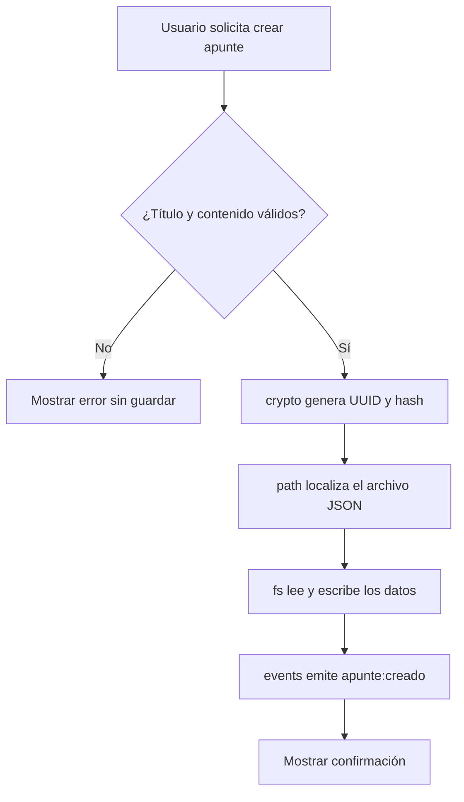

# GUÍA DE ESTUDIO — Módulo 05: Módulos nativos y archivos

**Curso:** CURSO_DESARROLLO_WEB  
**Nivel:** Fundamentos  
**Modalidad:** Autodidacta y práctica sin conexión  
**Requisitos:** Node.js 20+ recomendado, terminal y VS Code  
**Objetivo:** Comprender y aplicar `node:fs`, `node:path`, `node:os`, `node:events` y `node:crypto` para construir componentes mantenibles de una plataforma de aprendizaje.

> **Alcance:** Guía didáctica con un proyecto local ejecutable. El almacenamiento JSON sirve para practicar; no sustituye una base de datos transaccional ni un sistema de autenticación de producción.

## Índice

1. Preparación y definición
2. `fs`: sistema de archivos
3. `path`: rutas portables
4. `os`: información del sistema
5. `events`: eventos
6. `crypto`: identificadores y hashes
7. Analogía y diagramas
8. Buenas prácticas y errores comunes
9. Laboratorio guiado
10. Proyecto integrador: gestor de apuntes local
11. Ejercicios por niveles
12. Solucionario paso a paso
13. Evaluación y rúbrica
14. Hoja de trucos
15. Resumen técnico y checklist

---

## 1. Preparación y definición

Los **módulos nativos** son bibliotecas incluidas en Node.js que permiten acceder a funciones del entorno sin instalar paquetes adicionales. Se recomienda usar el prefijo `node:` para distinguirlos de paquetes de terceros.

```powershell
node -v
npm -v
mkdir modulo-05
cd modulo-05
code .
```

Si `code .` no funciona, abre VS Code manualmente y selecciona **Archivo > Abrir carpeta**. El proyecto usa **ECMAScript Modules (ESM)**: `import` y `export`, configurados con `"type": "module"` en `package.json`.

**Relación con CURSO_DESARROLLO_WEB:** una plataforma puede guardar apuntes, generar identificadores, localizar archivos y notificar eventos cuando se crea contenido. En este módulo simularemos esas necesidades sin una base de datos externa.

## 2. `node:fs`: leer y escribir archivos

`fs` permite consultar, crear, leer, modificar y borrar archivos y directorios. Existen variantes síncronas, con callbacks y basadas en promesas. Para operaciones de E/S en aplicaciones Node.js, suele convenir `node:fs/promises`.

### 2.1 Leer un archivo

Crea `lectura.mjs`:

```js
import { writeFile, readFile } from 'node:fs/promises';

await writeFile('saludo.txt', 'Hola, estudiante de Node.js', 'utf8');
const texto = await readFile('saludo.txt', 'utf8');
console.log(texto);
```

Ejecuta `node lectura.mjs`. **Resultado esperado:** `Hola, estudiante de Node.js`.

### 2.2 Crear directorios y escribir JSON

```js
import { mkdir, writeFile, readFile } from 'node:fs/promises';

await mkdir('datos', { recursive: true });
const cursos = [{ id: 1, titulo: 'Node.js' }];
await writeFile('datos/cursos.json', JSON.stringify(cursos, null, 2), 'utf8');
const recuperados = JSON.parse(await readFile('datos/cursos.json', 'utf8'));
console.log(recuperados[0].titulo);
```

**Advertencia:** `JSON.parse` lanza un error cuando el archivo no contiene JSON válido. `writeFile` reemplaza el contenido existente: lee y valida antes de modificar datos importantes.

### 2.3 Manejar archivos inexistentes

```js
import { readFile } from 'node:fs/promises';
try {
  console.log(await readFile('no-existe.txt', 'utf8'));
} catch (error) {
  if (error.code === 'ENOENT') console.log('El archivo no existe');
  else throw error;
}
```

**Preguntas:** ¿qué ocurre si faltan permisos? ¿qué sucede si dos operaciones escriben al mismo tiempo? ¿por qué no es recomendable bloquear el servidor con lecturas síncronas grandes?

## 3. `node:path`: rutas portables

`path` construye y analiza rutas sin concatenar separadores manualmente. Es útil porque Windows y otros sistemas operativos pueden utilizar convenciones diferentes.

```js
import path from 'node:path';

console.log(path.join('datos', 'cursos.json'));
console.log(path.extname('leccion.md')); // .md
console.log(path.basename('contenido/leccion.md')); // leccion.md
console.log(path.resolve('datos', 'cursos.json'));
```

- `join`: une segmentos y normaliza separadores.
- `resolve`: produce una ruta absoluta a partir de los segmentos y el directorio actual.
- `dirname`: devuelve el directorio de una ruta.
- `basename`: obtiene el último componente.
- `extname`: extrae la extensión.

En ESM, para localizar archivos **relativos al propio módulo**, usa `import.meta.url`:

```js
import { fileURLToPath } from 'node:url';
import path from 'node:path';
const archivoActual = fileURLToPath(import.meta.url);
const carpetaActual = path.dirname(archivoActual);
console.log(path.join(carpetaActual, 'datos', 'cursos.json'));
```

**Seguridad:** no uses directamente una ruta proporcionada por un usuario para leer archivos del servidor. Valida el nombre y restringe el acceso a un directorio permitido.

## 4. `node:os`: información del sistema

`os` permite consultar información del equipo donde se ejecuta Node.js.

```js
import os from 'node:os';
console.log('Sistema:', os.platform());
console.log('Arquitectura:', os.arch());
console.log('Memoria libre (MB):', Math.round(os.freemem() / 1024 ** 2));
console.log('Directorio temporal:', os.tmpdir());
console.log('CPUs lógicas:', os.cpus().length);
```

**Aplicación:** registrar diagnósticos de un proceso o elegir una ubicación temporal. La memoria libre cambia constantemente; no es una medida permanente del rendimiento. Evita registrar información privada del equipo innecesariamente.

## 5. `node:events`: comunicación por eventos

Un evento anuncia que ocurrió algo. `EventEmitter` permite registrar escuchas (`on`), emitir eventos (`emit`) y ejecutar escuchas una sola vez (`once`).

```js
import { EventEmitter } from 'node:events';
const bus = new EventEmitter();
bus.on('curso:creado', (curso) => console.log('Nuevo curso:', curso.titulo));
bus.once('inicio', () => console.log('Sistema iniciado'));
bus.emit('inicio');
bus.emit('inicio'); // No vuelve a activar once
bus.emit('curso:creado', { titulo: 'Node.js' });
```

Los listeners normales se invocan **sincrónicamente** cuando se llama a `emit`. `EventEmitter` no espera automáticamente las promesas devueltas por listeners asíncronos. Un evento `'error'` sin listener puede terminar el proceso: trata errores de forma explícita.

**Caso CURSO_DESARROLLO_WEB:** después de guardar un apunte, emitir `apunte:creado` para actualizar una bitácora o informar a otros componentes.

## 6. `node:crypto`: identificadores y huellas

`crypto` ofrece funciones criptográficas nativas. En el proyecto usaremos `randomUUID()` para crear identificadores y `createHash()` para calcular una huella SHA-256 de contenido.

```js
import { randomUUID, createHash } from 'node:crypto';
const id = randomUUID();
const huella = createHash('sha256').update('Contenido de la lección').digest('hex');
console.log({ id, huella });
```

- **UUID:** identificador con probabilidad de colisión extremadamente baja; no es un secreto.
- **Hash SHA-256:** resumen determinista del contenido; no permite recuperar directamente el texto original.
- **Importante:** un hash SHA-256 simple **no** es adecuado para almacenar contraseñas. Para contraseñas se requieren algoritmos de derivación apropiados (por ejemplo, `scrypt`) con sal única y parámetros revisados.

## 7. Analogía y diagramas

Imagina una **biblioteca educativa**: `fs` es el archivador donde se guardan los apuntes; `path` es el sistema de direcciones que indica dónde está cada documento; `os` describe las instalaciones y recursos de la biblioteca; `events` es el timbre que avisa de un nuevo material; `crypto` coloca una etiqueta única y una huella de integridad.

### Diagrama: flujo del gestor



### Diagrama: ciclo de aprendizaje

```text
Definir necesidad -> Implementar -> Ejecutar -> Comprobar
                                          |          |
                                       Error       Éxito
                                          |          |
                                       Depurar   Documentar
                                          \         /
                                        Siguiente reto
```

## 8. Buenas prácticas y errores comunes

| Buena práctica | Error que evita |
|---|---|
| Usar `node:fs/promises` con `await` | Bloqueos innecesarios en operaciones de E/S |
| Construir rutas con `path.join` | Separadores incompatibles |
| Resolver archivos desde `import.meta.url` | Depender de la carpeta desde la que se ejecuta Node |
| Validar entradas antes de guardar | Archivos con contenido inválido |
| Capturar y clasificar errores | Ocultar problemas de permisos o JSON corrupto |
| Separar almacenamiento, lógica y CLI | Código difícil de mantener |
| Probar datos válidos e inválidos | Falsas expectativas de funcionamiento |
| Mantener `.env` y secretos fuera de Git | Exposición de credenciales |
| No guardar contraseñas con SHA-256 simple | Almacenamiento inseguro de contraseñas |
| No usar JSON como base concurrente de producción | Pérdida de actualizaciones ante escrituras simultáneas |

**Errores típicos y diagnóstico:**

- `ENOENT`: ruta o archivo inexistente; imprime la ruta resuelta y comprueba la carpeta.
- `EACCES` / `EPERM`: permisos insuficientes; revisa permisos, ubicación y bloqueos del sistema.
- `SyntaxError: Unexpected token ...`: JSON inválido; inspecciona el contenido antes de analizarlo.
- `Cannot use import statement outside a module`: falta `"type": "module"` o extensión `.mjs`.
- `ERR_MODULE_NOT_FOUND`: nombre, extensión o ruta de importación incorrectos.

## 9. Laboratorio guiado: primer gestor de apuntes

**Objetivo:** crear y recuperar un apunte guardado en JSON usando Node.js nativo.

1. En una terminal crea `modulo-05` y abre la carpeta en VS Code.
2. Crea `package.json` con `"type": "module"`.
3. Crea `laboratorio.mjs` con el código siguiente.
4. Ejecuta `node laboratorio.mjs`.
5. Abre `datos/laboratorio.json` y verifica que contiene el apunte.
6. Modifica el título y vuelve a ejecutar.
7. Cambia temporalmente el JSON por texto inválido y observa el error; luego restáuralo.
8. Anota en `BITACORA.md` comando, resultado y dificultad.

```js
import { mkdir, writeFile, readFile } from 'node:fs/promises';
import path from 'node:path';
import { fileURLToPath } from 'node:url';
import { randomUUID } from 'node:crypto';

const carpeta = path.dirname(fileURLToPath(import.meta.url));
const datos = path.join(carpeta, 'datos');
const archivo = path.join(datos, 'laboratorio.json');

await mkdir(datos, { recursive: true });
const apunte = { id: randomUUID(), titulo: 'Mi primer apunte', contenido: 'Aprendí fs y path' };
await writeFile(archivo, JSON.stringify(apunte, null, 2), 'utf8');
const recuperado = JSON.parse(await readFile(archivo, 'utf8'));
console.log('Apunte recuperado:', recuperado.titulo);
```

**Criterios de aceptación:** crea el archivo, lee el contenido correcto, identifica errores y documenta el procedimiento. Este laboratorio **sobrescribe** su archivo en cada ejecución; el proyecto integrador siguiente conserva varios apuntes.

## 10. Proyecto integrador: gestor de apuntes local

### 10.1 Objetivo y alcance

Construir una herramienta de terminal para **crear, listar, consultar y eliminar apuntes** asociados a cursos. Se guardarán en `datos/apuntes.json`. Se usará `fs` para persistencia, `path` para rutas, `os` para diagnóstico, `events` para notificaciones y `crypto` para UUID y hash.

**Limitación deliberada:** es un proyecto de un solo proceso y usuario. No ejecutes varias instancias modificando el mismo JSON al mismo tiempo; para producción se necesitaría una base de datos y control de concurrencia.

### 10.2 Estructura

```text
modulo-05/
├── package.json
├── app.js
├── src/
│   ├── almacenamiento.js
│   ├── apuntes.js
│   └── eventos.js
├── datos/                 # Se crea automáticamente
│   └── apuntes.json
├── test/
│   └── apuntes.test.js
├── README.md
└── BITACORA.md
```

### 10.3 `package.json`

```json
{
  "name": "modulo-05-apuntes",
  "version": "1.0.0",
  "private": true,
  "type": "module",
  "scripts": {
    "start": "node app.js",
    "test": "node --test"
  }
}
```

### 10.4 `src/almacenamiento.js`

```js
import { mkdir, readFile, writeFile } from 'node:fs/promises';
import path from 'node:path';
import { fileURLToPath } from 'node:url';

const raiz = path.resolve(path.dirname(fileURLToPath(import.meta.url)), '..');
export const archivoDatos = path.join(raiz, 'datos', 'apuntes.json');

export async function leerApuntes(archivo = archivoDatos) {
  try {
    const contenido = await readFile(archivo, 'utf8');
    const datos = JSON.parse(contenido);
    if (!Array.isArray(datos)) throw new Error('El archivo debe contener un arreglo');
    return datos;
  } catch (error) {
    if (error.code === 'ENOENT') return [];
    throw error;
  }
}

export async function guardarApuntes(apuntes, archivo = archivoDatos) {
  await mkdir(path.dirname(archivo), { recursive: true });
  await writeFile(archivo, JSON.stringify(apuntes, null, 2) + '\n', 'utf8');
}
```

**Explicación:** la función lectora devuelve `[]` solamente cuando el archivo no existe. Si está corrupto, el error se propaga para evitar reemplazar silenciosamente información dañada.

### 10.5 `src/eventos.js`

```js
import { EventEmitter } from 'node:events';
export const eventos = new EventEmitter();
```

### 10.6 `src/apuntes.js`

```js
import { randomUUID, createHash } from 'node:crypto';
import { leerApuntes, guardarApuntes } from './almacenamiento.js';
import { eventos } from './eventos.js';

export function validarTexto(valor, campo) {
  if (typeof valor !== 'string' || !valor.trim()) {
    throw new TypeError(`${campo} debe ser texto no vacío`);
  }
  return valor.trim();
}

export async function crearApunte(curso, titulo, contenido, archivo) {
  const cursoValido = validarTexto(curso, 'curso');
  const tituloValido = validarTexto(titulo, 'titulo');
  const contenidoValido = validarTexto(contenido, 'contenido');
  const apuntes = await leerApuntes(archivo);
  const apunte = {
    id: randomUUID(),
    curso: cursoValido,
    titulo: tituloValido,
    contenido: contenidoValido,
    hash: createHash('sha256').update(contenidoValido).digest('hex'),
    creadoEn: new Date().toISOString()
  };
  apuntes.push(apunte);
  await guardarApuntes(apuntes, archivo);
  eventos.emit('apunte:creado', apunte);
  return apunte;
}

export async function listarApuntes(archivo) {
  return leerApuntes(archivo);
}

export async function buscarApunte(id, archivo) {
  const apuntes = await leerApuntes(archivo);
  return apuntes.find((apunte) => apunte.id === id) ?? null;
}

export async function eliminarApunte(id, archivo) {
  const apuntes = await leerApuntes(archivo);
  const restantes = apuntes.filter((apunte) => apunte.id !== id);
  if (restantes.length === apuntes.length) return false;
  await guardarApuntes(restantes, archivo);
  eventos.emit('apunte:eliminado', { id });
  return true;
}
```

**Diseño:** cada operación usa un archivo opcional para facilitar pruebas aisladas. La validación ocurre antes de escribir. Los eventos se emiten **después** de guardar correctamente.

### 10.7 `app.js`: interfaz de terminal

```js
import os from 'node:os';
import { crearApunte, listarApuntes, buscarApunte, eliminarApunte } from './src/apuntes.js';
import { eventos } from './src/eventos.js';

eventos.on('apunte:creado', (apunte) => console.log('Evento: creado', apunte.id));
eventos.on('apunte:eliminado', ({ id }) => console.log('Evento: eliminado', id));

const [comando, ...args] = process.argv.slice(2);

async function ejecutar() {
  switch (comando) {
    case 'crear': {
      const [curso, titulo, contenido] = args;
      const apunte = await crearApunte(curso, titulo, contenido);
      console.log('Apunte guardado:', apunte.id);
      break;
    }
    case 'listar':
      console.table((await listarApuntes()).map(({ id, curso, titulo }) => ({ id, curso, titulo })));
      break;
    case 'ver':
      console.log((await buscarApunte(args[0])) ?? 'Apunte no encontrado');
      break;
    case 'eliminar':
      console.log((await eliminarApunte(args[0])) ? 'Eliminado' : 'No encontrado');
      break;
    case 'sistema':
      console.log({ plataforma: os.platform(), arquitectura: os.arch(), cpus: os.cpus().length });
      break;
    default:
      console.log('Uso: node app.js crear "Curso" "Título" "Contenido"');
      console.log('     node app.js listar | ver ID | eliminar ID | sistema');
  }
}

try {
  await ejecutar();
} catch (error) {
  console.error('Error:', error.message);
  process.exitCode = 1;
}
```

### 10.8 Ejecutar y comprobar

Desde la raíz del proyecto:

```powershell
node app.js crear "Node.js" "Módulos nativos" "Aprendí a usar fs, path y events"
node app.js crear "JavaScript" "Objetos" "Los objetos tienen propiedades"
node app.js listar
node app.js sistema
```

Copia un `id` real de la tabla y ejecuta:

```powershell
node app.js ver "PEGA_AQUI_UN_ID_REAL"
node app.js eliminar "PEGA_AQUI_UN_ID_REAL"
node app.js listar
```

**Resultado esperado:** dos apuntes aparecen en la lista inicial; `ver` recupera el seleccionado y `eliminar` hace que deje de aparecer. Los UUID y la fecha varían en cada ejecución.

### 10.9 Pruebas automatizadas: `test/apuntes.test.js`

```js
import test from 'node:test';
import assert from 'node:assert/strict';
import { mkdtemp, rm } from 'node:fs/promises';
import os from 'node:os';
import path from 'node:path';
import { crearApunte, listarApuntes, buscarApunte, eliminarApunte } from '../src/apuntes.js';

async function entornoPrueba(t) {
  const carpeta = await mkdtemp(path.join(os.tmpdir(), 'apuntes-test-'));
  t.after(async () => rm(carpeta, { recursive: true, force: true }));
  return path.join(carpeta, 'datos', 'apuntes.json');
}

test('crea, lista, consulta y elimina un apunte', async (t) => {
  const archivo = await entornoPrueba(t);
  const creado = await crearApunte('Node.js', 'fs', 'Guardar archivos', archivo);
  assert.ok(creado.id);
  assert.equal((await listarApuntes(archivo)).length, 1);
  assert.equal((await buscarApunte(creado.id, archivo)).titulo, 'fs');
  assert.equal(await eliminarApunte(creado.id, archivo), true);
  assert.equal((await listarApuntes(archivo)).length, 0);
});

test('rechaza entradas vacías sin guardar', async (t) => {
  const archivo = await entornoPrueba(t);
  await assert.rejects(crearApunte('Node.js', '', 'Texto', archivo), TypeError);
  assert.deepEqual(await listarApuntes(archivo), []);
});

test('no elimina un ID inexistente', async (t) => {
  const archivo = await entornoPrueba(t);
  assert.equal(await eliminarApunte('inexistente', archivo), false);
});
```

Ejecuta `npm test`. **Resultado esperado:** tres pruebas aprobadas y cero fallos en una instalación compatible de Node.js.

### 10.10 Entregables y mejoras

Entrega `package.json`, `app.js`, `src/`, `test/`, `README.md` y `BITACORA.md`. Incluye comandos exactos y evidencia de pruebas. No incluyas datos personales ni credenciales. Como mejoras futuras: editar apuntes, buscar por curso, exportar Markdown, validar integridad del hash y sustituir JSON por una base de datos para accesos simultáneos.

## 11. Ejercicios por niveles

**Nivel 1 — Comprensión**

1. Crea `mensaje.txt` con una frase y léela usando `node:fs/promises`.
2. Obtén con `path` el nombre y extensión de `lecciones/tema-01.md`.
3. Muestra plataforma, arquitectura y directorio temporal con `os`.

**Nivel 2 — Aplicación**

4. Guarda un arreglo de dos cursos en `cursos.json` y recupéralo.
5. Crea un `EventEmitter` que anuncie cuando se inscribe un estudiante.
6. Genera un UUID y el SHA-256 del texto `Node.js`.

**Nivel 3 — Integración**

7. Añade al gestor un comando `contar` que imprima el número de apuntes.
8. Añade una función que filtre apuntes por nombre de curso, ignorando mayúsculas.
9. Gestiona explícitamente el caso de un archivo JSON corrupto sin borrar su contenido.

Antes de consultar el solucionario, predice la salida, ejecuta y registra resultados en `BITACORA.md`.

## 12. Solucionario paso a paso

### Ejercicio 1

```js
import { writeFile, readFile } from 'node:fs/promises';
await writeFile('mensaje.txt', 'Estoy aprendiendo Node.js', 'utf8');
console.log(await readFile('mensaje.txt', 'utf8'));
```

La primera operación crea el archivo; la segunda lo lee como texto UTF-8.

### Ejercicio 2

```js
import path from 'node:path';
const ruta = 'lecciones/tema-01.md';
console.log(path.basename(ruta)); // tema-01.md
console.log(path.extname(ruta)); // .md
```

`basename` devuelve el último segmento y `extname` la extensión.

### Ejercicio 3

```js
import os from 'node:os';
console.log(os.platform(), os.arch(), os.tmpdir());
```

La salida depende del sistema operativo.

### Ejercicio 4

```js
import { writeFile, readFile } from 'node:fs/promises';
const cursos = [{ id: 1, titulo: 'Node.js' }, { id: 2, titulo: 'HTML' }];
await writeFile('cursos.json', JSON.stringify(cursos, null, 2));
const resultado = JSON.parse(await readFile('cursos.json', 'utf8'));
console.log(resultado.length); // 2
```

`JSON.stringify` convierte objetos a texto y `JSON.parse` los reconstruye.

### Ejercicio 5

```js
import { EventEmitter } from 'node:events';
const emisor = new EventEmitter();
emisor.on('inscripcion', ({ nombre }) => console.log(`${nombre} inscrito`));
emisor.emit('inscripcion', { nombre: 'Ana' });
```

La emisión invoca el listener registrado.

### Ejercicio 6

```js
import { randomUUID, createHash } from 'node:crypto';
console.log(randomUUID());
console.log(createHash('sha256').update('Node.js').digest('hex'));
```

El UUID cambia; el hash de la misma cadena es determinista.

### Ejercicio 7

En `app.js`, añade dentro del `switch`:

```js
case 'contar':
  console.log('Total de apuntes:', (await listarApuntes()).length);
  break;
```

Prueba `node app.js contar` antes y después de crear un apunte.

### Ejercicio 8

Añade en `src/apuntes.js`:

```js
export async function filtrarPorCurso(curso, archivo) {
  const consulta = validarTexto(curso, 'curso').toLocaleLowerCase();
  return (await leerApuntes(archivo)).filter(
    (apunte) => apunte.curso.toLocaleLowerCase() === consulta
  );
}
```

Importa la función en `app.js` y agrega un caso `curso` para mostrar los resultados. Comprueba que `node.js` y `NODE.JS` encuentran los mismos apuntes.

### Ejercicio 9

En `src/almacenamiento.js`, la lectura ya propaga los errores de `JSON.parse`. En la interfaz `app.js`, mejora el bloque final:

```js
try {
  await ejecutar();
} catch (error) {
  if (error instanceof SyntaxError) {
    console.error('El JSON está corrupto. Corrige o restaura una copia; no se sobrescribió.');
  } else {
    console.error('Error:', error.message);
  }
  process.exitCode = 1;
}
```

**Prueba:** cambia `datos/apuntes.json` por `esto no es json`, ejecuta `node app.js listar` y verifica que el archivo conserva exactamente ese contenido. Restáuralo después. No ejecutes esta prueba sobre datos importantes sin respaldo.

## 13. Evaluación y criterios de aprobación

**Parte A — Conceptos (25 puntos):** define `fs`, `path`, `os`, `events` y `crypto`; indica una aplicación de cada uno (5 puntos por concepto).

**Parte B — Implementación (35 puntos):** construye un gestor que cree (10), liste (8), consulte (7) y elimine (10) apuntes.

**Parte C — Pruebas (25 puntos):** demuestra casos válidos (10), entradas vacías (5), ID inexistente (5) y archivo corrupto (5).

**Parte D — Documentación (15 puntos):** instrucciones reproducibles (7), bitácora de resultados (5) y limitaciones/mejoras (3).

**Aprobación recomendada:** 80/100. Si no alcanzas el mínimo, repite los ejercicios correspondientes y vuelve a ejecutar las pruebas.

**Preguntas de reflexión:** ¿qué responsabilidad corresponde al servidor? ¿por qué `path.join` es preferible a concatenar barras? ¿qué sucede si falla una escritura? ¿cuándo se debe sustituir un archivo JSON por una base de datos?

## 14. Hoja de trucos (Cheatsheet)

| Necesidad | API / comando |
|---|---|
| Versión de Node.js | `node -v` |
| Ejecutar archivo | `node app.js` |
| Ejecutar pruebas | `npm test` |
| Leer texto | `await readFile(ruta, 'utf8')` |
| Escribir texto | `await writeFile(ruta, texto, 'utf8')` |
| Crear carpeta | `await mkdir(ruta, { recursive: true })` |
| Convertir a JSON | `JSON.stringify(datos, null, 2)` |
| Leer JSON | `JSON.parse(texto)` |
| Unir rutas | `path.join(a, b)` |
| Obtener ruta absoluta | `path.resolve(ruta)` |
| Extensión | `path.extname(ruta)` |
| Plataforma | `os.platform()` |
| Directorio temporal | `os.tmpdir()` |
| Escuchar evento | `emisor.on('evento', callback)` |
| Emitir evento | `emisor.emit('evento', datos)` |
| Generar UUID | `randomUUID()` |
| Hash SHA-256 | `createHash('sha256').update(texto).digest('hex')` |

## 15. Resumen técnico y checklist

Los módulos nativos de Node.js permiten interactuar con archivos, rutas, información del sistema, eventos y funciones criptográficas sin paquetes externos. En CURSO_DESARROLLO_WEB, estos conceptos sirven para prototipar almacenamiento de contenido, crear identificadores, detectar eventos y organizar responsabilidades.

**Checklist de finalización:**

- [ ] Puedo explicar las funciones de `fs`, `path`, `os`, `events` y `crypto`.
- [ ] Sé crear, leer y analizar un archivo JSON.
- [ ] Sé usar rutas portables con `path`.
- [ ] Puedo registrar y emitir un evento.
- [ ] Sé distinguir UUID, hash y contraseña.
- [ ] Implementé el laboratorio guiado.
- [ ] Construí el gestor de apuntes local.
- [ ] Ejecuté las pruebas con `npm test`.
- [ ] Resolví los ejercicios de tres niveles.
- [ ] Documenté mis resultados en `BITACORA.md`.
- [ ] Alcancé al menos 80/100 en la evaluación.

**Siguiente paso sugerido:** conectar el gestor de apuntes a un servidor HTTP en un módulo posterior, manteniendo separadas la lógica de negocio y la persistencia.

---

*Material ampliado a partir de la guía suministrada del Módulo 05. Los ejemplos y el proyecto desarrollados aquí son material adicional didáctico. No se requieren dependencias externas.*
