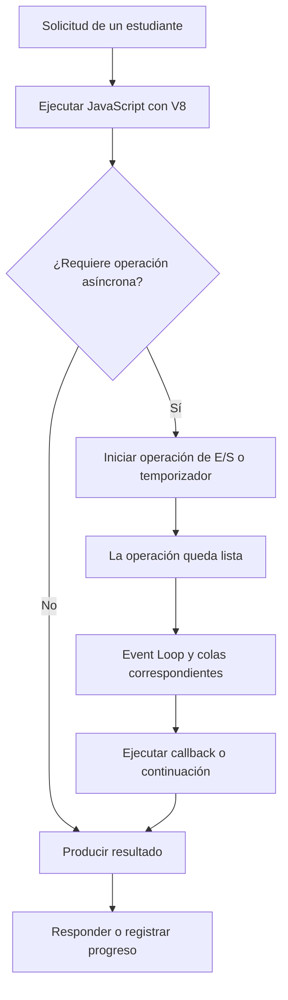

# GUÍA DE ESTUDIO — Módulo 04: Arquitectura interna y asincronía

**Nivel:** Fundamentos  
**Plataforma:** CURSO_DESARROLLO_WEB  
**Modalidad:** Autodidacta y offline (Node.js instalado)  
**Objetivo:** Comprender V8, Event Loop, callbacks, promesas y `async/await` y aplicarlos a un simulador de tareas concurrentes.

> Esta guía amplía el temario y las actividades del PDF proporcionado con explicaciones, código ejecutable y soluciones. Es material didáctico, no una implementación productiva.

## Índice
1. Preparación
2. V8
3. Event Loop
4. Callbacks
5. Promesas
6. Async/await
7. Analogía y diagrama
8. Buenas prácticas y errores comunes
9. Laboratorio guiado
10. Proyecto integrador
11. Ejercicios por niveles
12. Solucionario paso a paso
13. Evaluación y rúbrica
14. Hoja de trucos
15. Resumen técnico y checklist

## 1. Preparación

Abre VS Code, crea una carpeta `modulo-04` y ejecuta en su terminal:

```powershell
node -v
npm -v
mkdir laboratorio
```

Se recomienda Node.js LTS actual. Todos los ejemplos usan APIs nativas: no requieren `npm install`. Registra tus resultados en `BITACORA.md`. Si en otro proyecto se requieren dependencias externas, revisa `DEPENDENCIAS_OFFLINE.md` del curso.

## 2. V8

**Definición:** V8 es el motor JavaScript que analiza y ejecuta código JavaScript en Node.js. Compila código a instrucciones ejecutables y administra memoria mediante recolección de basura. **V8 no es Node.js completo:** Node.js añade APIs del sistema, integración con libuv, módulos y otras capacidades.

**¿Para qué sirve?** Ejecuta las funciones que calculan notas, filtran cursos o validan datos. No ofrece por sí mismo el sistema de archivos `node:fs`.

**Ejemplo (`v8.js`):**

```js
const cursos = [{ titulo: 'Node.js', alumnos: 12 }, { titulo: 'HTML', alumnos: 8 }];
const total = cursos.reduce((suma, curso) => suma + curso.alumnos, 0);
console.log('Alumnos:', total);
console.log('Motor V8:', process.versions.v8);
```

Ejecuta `node v8.js`. La suma será `20`; la versión de V8 depende de tu instalación.

**Para reflexionar:** ¿Qué parte es JavaScript ejecutado por V8 y qué parte corresponde a una API de Node.js? `reduce` es JavaScript; `process.versions` es una API expuesta por Node.js.

## 3. Event Loop

**Definición:** El Event Loop coordina cuándo se ejecutan callbacks y continuaciones de operaciones asíncronas. Node.js ejecuta normalmente JavaScript en un hilo principal, pero puede delegar ciertas operaciones de E/S al sistema operativo o al grupo de hilos de libuv. **Asincronía no significa que todo JavaScript se ejecute en paralelo.**

### Ejemplo de orden (`event-loop.js`)

```js
console.log('A: inicio');
setTimeout(() => console.log('D: temporizador'), 0);
Promise.resolve().then(() => console.log('C: promesa'));
console.log('B: fin síncrono');
```

Resultado esperado:

```text
A: inicio
B: fin síncrono
C: promesa
D: temporizador
```

Primero termina el código síncrono; después se procesan las microtareas de promesas; luego se ejecuta el callback del temporizador. **Nota:** el orden relativo entre `setImmediate` y `setTimeout(0)` puede variar según el contexto; no construyas lógica que dependa de ese orden.

### Bloqueo del hilo principal

```js
const inicio = Date.now();
while (Date.now() - inicio < 300) {} // Simulación didáctica: bloquea el hilo
console.log('Bloqueo terminado');
```

Mientras ese bucle ocupa el hilo, el Event Loop no puede ejecutar otros callbacks de JavaScript. Evita trabajo CPU-intensivo en el hilo principal de un servidor.

## 4. Callbacks

**Definición:** Un callback es una función que se entrega a otra función para que la invoque posteriormente o al ocurrir un evento. No todos los callbacks son asíncronos: el callback de `map` se ejecuta de manera síncrona.

```js
function saludar(nombre, callback) {
  callback(`Hola, ${nombre}`);
}
saludar('Estudiante', mensaje => console.log(mensaje));
```

### Callback asíncrono estilo Node.js

```js
const fs = require('node:fs');
fs.readFile('curso.json', 'utf8', (error, contenido) => {
  if (error) {
    console.error('No se pudo leer:', error.code);
    return;
  }
  console.log(contenido);
});
```

El patrón habitual es `(error, resultado)`. La ausencia de `curso.json` produce `ENOENT`, que debe manejarse en lugar de dejar la operación sin control.

## 5. Promesas

**Definición:** Una promesa representa un resultado que puede estar **pendiente**, **cumplido** o **rechazado**. Permite encadenar resultados con `.then()` y manejar rechazos con `.catch()`.

```js
function consultarCurso(id) {
  return new Promise((resolve, reject) => {
    setTimeout(() => {
      if (!Number.isInteger(id) || id <= 0) {
        reject(new Error('ID inválido'));
        return;
      }
      resolve({ id, titulo: 'Node.js' });
    }, 100);
  });
}

consultarCurso(1)
  .then(curso => console.log(curso))
  .catch(error => console.error(error.message));
```

**Métodos importantes:** `Promise.all` espera todos los resultados y rechaza si alguno falla; `Promise.allSettled` espera todos e informa éxitos y fallos; `Promise.race` adopta el primer resultado o rechazo que se asiente. No confundas `Promise.all` con ejecución paralela de código CPU-intensivo.

## 6. Async/await

**Definición:** `async` declara una función que devuelve una promesa. `await` suspende la continuación de esa función hasta que la promesa se resuelva o rechace, sin bloquear por sí mismo el hilo principal.

```js
const fs = require('node:fs/promises');

async function guardarProgreso() {
  const progreso = { estudiante: 'Ana', completadas: 3 };
  try {
    await fs.writeFile('progreso.json', JSON.stringify(progreso, null, 2));
    const texto = await fs.readFile('progreso.json', 'utf8');
    console.log(JSON.parse(texto));
  } catch (error) {
    console.error('Error de archivo:', error.message);
  }
}

guardarProgreso();
```

**Secuencial vs. concurrente:**

```js
const esperar = ms => new Promise(resolve => setTimeout(resolve, ms));
async function ejemplo() {
  await esperar(100);
  await esperar(100); // aproximadamente 200 ms en total
  await Promise.all([esperar(100), esperar(100)]); // aproximadamente 100 ms
}
ejemplo();
```

Los tiempos son orientativos y dependen del sistema. Usa `Promise.all` cuando las tareas sean independientes y quieras esperar a todas.

## 7. Analogía y diagrama

Imagina una **biblioteca**: V8 es quien procesa las instrucciones del bibliotecario; el Event Loop es el coordinador que atiende tareas listas; un callback es el aviso de que un libro está disponible; una promesa es el comprobante de una solicitud pendiente; `await` permite continuar la atención cuando llega el libro, sin mantener inmóvil toda la biblioteca.

### Diagrama del ciclo de trabajo



### Flujo de aprendizaje del módulo

```text
Definir entradas → Implementar una unidad pequeña → Ejecutar → ¿Funciona?
                                                        ├─ No → Depurar → Repetir
                                                        └─ Sí → Documentar → Avanzar
```

## 8. Buenas prácticas y errores comunes

| Buena práctica | Error que evita |
|---|---|
| Validar argumentos antes de iniciar tareas | Errores difíciles de diagnosticar |
| Usar `try/catch` alrededor de `await` | Rechazos sin manejar |
| Elegir `Promise.allSettled` cuando se admiten fallos parciales | Perder el reporte de tareas exitosas |
| Separar datos, lógica y presentación | Código difícil de probar |
| Evitar bucles pesados en el hilo principal | Bloquear solicitudes |
| Registrar entradas, salidas y errores | Pruebas irreproducibles |
| No subir `.env`, claves ni tokens | Exposición de secretos |
| Probar en copia o rama antes de integrar | Romper la plataforma principal |

**Errores frecuentes:** olvidar `await`; confundir `setTimeout` con una garantía de tiempo exacto; usar `forEach(async ...)` esperando que espere las promesas; mezclar callbacks y promesas sin control; asumir que los paquetes externos están instalados.

## 9. Laboratorio guiado: tareas concurrentes

**Objetivo:** observar cómo tres tareas de CURSO_DESARROLLO_WEB pueden avanzar con esperas asíncronas independientes.

**Paso 1.** Crea `laboratorio/tareas.js`:

```js
function ejecutarTarea(nombre, demora, debeFallar = false) {
  return new Promise((resolve, reject) => {
    if (typeof nombre !== 'string' || !nombre.trim()) {
      reject(new Error('Nombre inválido'));
      return;
    }
    if (!Number.isInteger(demora) || demora < 0) {
      reject(new Error('Demora inválida'));
      return;
    }
    setTimeout(() => {
      if (debeFallar) reject(new Error(`${nombre}: error simulado`));
      else resolve(`${nombre}: completada`);
    }, demora);
  });
}

async function iniciar() {
  const inicio = Date.now();
  const resultados = await Promise.allSettled([
    ejecutarTarea('Cargar cursos', 300),
    ejecutarTarea('Consultar progreso', 150),
    ejecutarTarea('Generar reporte', 200, true)
  ]);
  resultados.forEach((resultado, indice) => {
    console.log(`Tarea ${indice + 1}:`,
      resultado.status === 'fulfilled' ? resultado.value : resultado.reason.message);
  });
  console.log('Tiempo aproximado:', Date.now() - inicio, 'ms');
}

iniciar().catch(error => console.error(error));
```

**Paso 2.** Ejecuta:

```powershell
node laboratorio/tareas.js
```

**Paso 3.** Comprueba que hay dos tareas completadas y una fallida. El tiempo total suele acercarse al de la tarea más lenta, no a la suma, porque las esperas se superponen.

**Paso 4.** Prueba entradas válidas: `('Cursos', 0)`, `('Cursos', 100)` y `('Notas', 200)`. Prueba entradas inválidas: `('', 100)` y `('Cursos', -1)`. Añade las pruebas dentro de un `Promise.allSettled` para registrar sus resultados.

**Paso 5.** Registra en `BITACORA.md` fecha, comando, resultado observado, explicación y mejoras. No se necesitan credenciales ni paquetes externos.

## 10. Proyecto integrador: simulador de tareas concurrentes

**Contexto:** una plataforma educativa necesita simular tres operaciones: cargar cursos, consultar progreso y generar un reporte. Debe mostrar resultados, manejar fallos individuales y permitir pruebas repetibles.

### Estructura

```text
modulo-04/
├── package.json
├── README.md
├── BITACORA.md
├── src/
│   ├── simulador.js
│   └── index.js
└── test/
    └── simulador.test.js
```

### Paso 1. `package.json`

```json
{
  "name": "curso-desarrollo-web-asincronia",
  "version": "1.0.0",
  "private": true,
  "type": "module",
  "scripts": {
    "start": "node src/index.js",
    "test": "node --test"
  }
}
```

### Paso 2. `src/simulador.js`

```js
export function ejecutarTarea({ nombre, demoraMs, fallar = false }) {
  return new Promise((resolve, reject) => {
    if (typeof nombre !== 'string' || nombre.trim() === '') {
      reject(new TypeError('El nombre es obligatorio'));
      return;
    }
    if (!Number.isInteger(demoraMs) || demoraMs < 0 || demoraMs > 10000) {
      reject(new RangeError('demoraMs debe estar entre 0 y 10000'));
      return;
    }
    if (typeof fallar !== 'boolean') {
      reject(new TypeError('fallar debe ser booleano'));
      return;
    }
    setTimeout(() => {
      if (fallar) reject(new Error(`Falló ${nombre}`));
      else resolve({ nombre, estado: 'completada' });
    }, demoraMs);
  });
}

export async function ejecutarLote(tareas) {
  if (!Array.isArray(tareas)) throw new TypeError('Se esperaba un arreglo');
  const inicio = Date.now();
  const resultados = await Promise.allSettled(tareas.map(ejecutarTarea));
  return {
    duracionMs: Date.now() - inicio,
    exitos: resultados.filter(r => r.status === 'fulfilled').length,
    fallos: resultados.filter(r => r.status === 'rejected').length,
    resultados: resultados.map((r, indice) => ({
      tarea: indice + 1,
      estado: r.status,
      detalle: r.status === 'fulfilled' ? r.value : r.reason.message
    }))
  };
}
```

### Paso 3. `src/index.js`

```js
import { ejecutarLote } from './simulador.js';

const tareas = [
  { nombre: 'Cargar cursos', demoraMs: 300 },
  { nombre: 'Consultar progreso', demoraMs: 150 },
  { nombre: 'Generar reporte', demoraMs: 200, fallar: true }
];

try {
  const reporte = await ejecutarLote(tareas);
  console.log(JSON.stringify(reporte, null, 2));
} catch (error) {
  console.error('No se pudo ejecutar el lote:', error.message);
  process.exitCode = 1;
}
```

### Paso 4. `test/simulador.test.js`

```js
import test from 'node:test';
import assert from 'node:assert/strict';
import { ejecutarTarea, ejecutarLote } from '../src/simulador.js';

test('tarea válida', async () => {
  const resultado = await ejecutarTarea({ nombre: 'Curso', demoraMs: 0 });
  assert.equal(resultado.estado, 'completada');
});

test('nombre inválido', async () => {
  await assert.rejects(ejecutarTarea({ nombre: '', demoraMs: 0 }), /nombre/);
});

test('demora inválida', async () => {
  await assert.rejects(ejecutarTarea({ nombre: 'Curso', demoraMs: -1 }), /demoraMs/);
});

test('lote con fallo parcial', async () => {
  const reporte = await ejecutarLote([
    { nombre: 'Cursos', demoraMs: 0 },
    { nombre: 'Reporte', demoraMs: 0, fallar: true }
  ]);
  assert.equal(reporte.exitos, 1);
  assert.equal(reporte.fallos, 1);
});
```

### Paso 5. Ejecución y verificación

```powershell
npm start
npm test
```

**Criterios de aceptación:** las tareas independientes se inician juntas; el reporte conserva el orden de entrada; se informa cada fallo sin ocultar los éxitos; los parámetros inválidos producen errores claros; las pruebas se pueden repetir.

**Fases de entrega:** planificación → prototipo → validación → refactorización → documentación. Adjunta `README.md` con comandos, `BITACORA.md` con evidencias y una lista de mejoras.

**Integración futura:** conecta el simulador con servicios reales de cursos, estudiantes y progreso mediante interfaces separadas. No sustituyas directamente los servicios existentes sin pruebas. Las demoras simuladas no equivalen a peticiones reales ni garantizan concurrencia ilimitada.

## 11. Ejercicios por niveles

### Nivel 1 — Comprensión

1. Predice el orden de salida del siguiente código y justifícalo:

```js
console.log('uno');
setTimeout(() => console.log('tres'), 0);
Promise.resolve().then(() => console.log('dos'));
```

2. Explica la diferencia entre V8, Node.js y Event Loop con tus palabras.
3. Identifica si los callbacks de `map()` y `setTimeout()` se ejecutan de forma síncrona o asíncrona.

### Nivel 2 — Aplicación

4. Convierte este callback en una promesa:

```js
function buscarCurso(id, callback) {
  setTimeout(() => {
    if (id <= 0) callback(new Error('ID inválido'));
    else callback(null, { id, nombre: 'Node.js' });
  }, 50);
}
```

5. Usa `async/await` y `try/catch` para consumir la función convertida. Prueba un ID válido y otro inválido.
6. Ejecuta dos tareas de 100 ms con `Promise.all` y explica por qué la duración aproximada no es 200 ms.

### Nivel 3 — Integración

7. Modifica el proyecto para incluir una tarea fallida sin perder el resultado de las demás.
8. Añade una validación para impedir demoras superiores a 10 segundos y escribe una prueba automática.
9. Diseña una estrategia para incorporar este simulador a la plataforma educativa sin modificar de inmediato el sistema de producción.

## 12. Solucionario paso a paso

**1.** Se imprime `uno`, luego `dos` y finalmente `tres`. La primera instrucción es síncrona; la promesa se procesa como microtarea; el temporizador se ejecuta después.

**2.** V8 ejecuta JavaScript; Node.js proporciona el entorno y APIs; el Event Loop organiza la ejecución de callbacks y continuaciones cuando las operaciones están listas.

**3.** `map()` invoca su callback síncronamente para cada elemento; `setTimeout()` programa un callback para una fase posterior.

**4.** Versión basada en promesas:

```js
function buscarCursoAsync(id) {
  return new Promise((resolve, reject) => {
    setTimeout(() => {
      if (!Number.isInteger(id) || id <= 0) reject(new Error('ID inválido'));
      else resolve({ id, nombre: 'Node.js' });
    }, 50);
  });
}
```

**5.** Consumo con control de errores:

```js
async function probar(id) {
  try {
    console.log(await buscarCursoAsync(id));
  } catch (error) {
    console.log('Error controlado:', error.message);
  }
}
await probar(1);
await probar(-1);
```

Para ejecutar ambos fragmentos juntos, guárdalos en un archivo `.mjs` o configura `"type": "module"`.

**6.** Ejemplo:

```js
const pausa = ms => new Promise(resolve => setTimeout(resolve, ms));
const inicio = Date.now();
await Promise.all([pausa(100), pausa(100)]);
console.log(Date.now() - inicio);
```

Ambos temporizadores comienzan sin esperar al otro, por lo que la duración suele acercarse a 100 ms, más la sobrecarga del sistema.

**7.** En `src/index.js`, marca una tarea con `fallar: true`. `ejecutarLote` usa `Promise.allSettled`, por lo que conserva éxitos y rechazos. Comprueba `exitos === 2` y `fallos === 1`.

**8.** La función ya valida `demoraMs > 10000`. Añade esta prueba:

```js
test('rechaza demoras excesivas', async () => {
  await assert.rejects(
    ejecutarTarea({ nombre: 'Curso', demoraMs: 10001 }),
    /demoraMs/
  );
});
```

**9.** Define una interfaz para operaciones asíncronas, conserva la implementación actual, añade pruebas de contrato y habilita el nuevo componente en un entorno de desarrollo. Documenta las diferencias, revisa registros y prepara una forma de volver a la implementación anterior.

## 13. Evaluación y criterios de aprobación

**Parte A — Conceptos (25 puntos).** Define V8 y Event Loop (10); explica callbacks y promesas (10); diferencia `await` de bloqueo del hilo (5).

**Parte B — Implementación (35 puntos).** Construye el simulador modular (15); valida argumentos (10); maneja resultados y fallos (10).

**Parte C — Pruebas (25 puntos).** Demuestra un caso exitoso (8), un error de validación (8) y un fallo parcial (9).

**Parte D — Documentación (15 puntos).** Presenta comandos reproducibles (5), `BITACORA.md` (5) y propuesta de integración (5).

**Aprobación recomendada:** al menos **80/100** puntos.

### Preguntas de autoevaluación

- ¿Qué diferencia existe entre una promesa pendiente y una rechazada?
- ¿Por qué una tarea intensiva en CPU puede perjudicar al servidor?
- ¿Cuándo conviene `Promise.allSettled` en lugar de `Promise.all`?
- ¿Qué archivos necesita otra persona para repetir el proyecto?
- ¿Cómo evitarías introducir regresiones en CURSO_DESARROLLO_WEB?

**Orientación para las respuestas:** una promesa pendiente aún no se ha asentado; una rechazada terminó con error. El trabajo CPU-intensivo ocupa el hilo principal. `allSettled` permite informar resultados parciales. Para reproducir el proyecto se requieren `package.json`, `src/`, `test/` y las instrucciones. Para evitar regresiones, prueba aislado antes de integrar.

## 14. Hoja de trucos (Cheatsheet)

| Concepto | Sintaxis / recordatorio |
|---|---|
| Ejecutar archivo | `node archivo.js` |
| Ver versión | `node -v` |
| Callback | `operacion((error, resultado) => {})` |
| Crear promesa | `new Promise((resolve, reject) => {})` |
| Éxito | `.then(valor => ...)` |
| Rechazo | `.catch(error => ...)` |
| Función asíncrona | `async function cargar() {}` |
| Esperar promesa | `await operacion()` |
| Controlar fallo | `try { await ... } catch (e) { ... }` |
| Esperar todas | `Promise.all([...])` |
| Conservar resultados parciales | `Promise.allSettled([...])` |
| Temporizador | `setTimeout(callback, ms)` |
| Pruebas nativas | `node --test` |
| Iniciar proyecto | `npm start` |
| Ejecutar pruebas | `npm test` |

## 15. Resumen técnico y checklist

V8 ejecuta el código JavaScript; Node.js añade APIs y mecanismos para interactuar con el sistema. El Event Loop coordina la ejecución de tareas listas; los callbacks representan funciones que otras funciones invocan; las promesas modelan resultados futuros; `async/await` facilita escribir y manejar operaciones asíncronas. En CURSO_DESARROLLO_WEB, estos conceptos permiten diseñar operaciones de cursos, evaluaciones y progreso con manejo explícito de errores.

### Checklist de finalización

- [ ] Puedo explicar qué es V8 y qué no hace.
- [ ] Puedo predecir el orden básico de código síncrono, promesas y temporizadores.
- [ ] Puedo distinguir callbacks síncronos y asíncronos.
- [ ] Puedo crear y consumir promesas.
- [ ] Puedo utilizar `async/await` y `try/catch`.
- [ ] Sé elegir entre `Promise.all` y `Promise.allSettled`.
- [ ] Ejecuté el laboratorio y documenté resultados.
- [ ] Construí el proyecto integrador con sus archivos.
- [ ] Pasé las pruebas con `npm test`.
- [ ] Resolví ejercicios de los tres niveles.
- [ ] Alcancé al menos 80 puntos en la evaluación.

---

**Fin del Módulo 04 — CURSO_DESARROLLO_WEB.**
