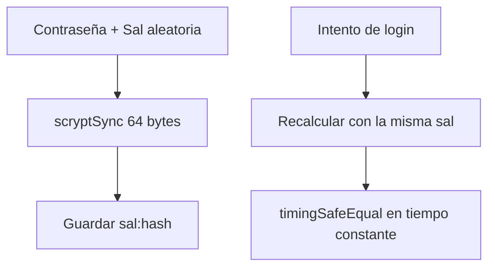

# GUÍA DE ESTUDIO — Módulo 08: Criptografía y Seguridad con `node:crypto`

**Curso:** CURSO_DESARROLLO_WEB  
**Nivel:** Fundamentos / Intermedio  
**Requisitos:** Node.js 20+ LTS, terminal y VS Code  
**Objetivo:** Dominar `node:crypto` para generar identificadores y tokens seguros (`randomUUID`, `randomBytes`), verificar integridad con `SHA-256`, firmar mensajes con `HMAC`, derivar contraseñas con `scrypt` y comparar secretos con `timingSafeEqual`.

---


## 1. `randomUUID()` y `randomBytes()`

- **`randomUUID()`:** genera un UUID v4 criptográficamente aleatorio (ideal para IDs de registros, pedidos o trazas). **No es un secreto**.
- **`randomBytes(n)`:** genera `n` bytes aleatorios seguros (ideal para tokens de sesión, claves API o sales criptográficas).

```js
import { randomUUID, randomBytes } from 'node:crypto';

const idRegistro = randomUUID();
const tokenSeguro = randomBytes(32).toString('hex'); // 64 caracteres hexadecimales

console.log({ idRegistro, tokenSeguro });
```

---

## 2. `createHash('sha256')`: integridad, NO contraseñas

Un **hash** transforma una entrada de cualquier tamaño en un resumen de longitud fija de manera determinista e irreversible. Es útil para comprobar si un archivo o mensaje fue alterado.

```js
import { createHash } from 'node:crypto';

const huella = createHash('sha256')
  .update('Contenido oficial del curso')
  .digest('hex');

console.log('SHA-256:', huella);
```

> **Regla de oro:** **Nunca** uses `SHA-256` simple para guardar contraseñas. Es demasiado rápido y vulnerable a ataques por fuerza bruta o tablas arcoíris si no tiene sal y factor de costo.

---

## 3. `createHmac()`: autenticidad con clave secreta

Un **HMAC** (*Hash-based Message Authentication Code*) combina un hash con una **clave secreta** compartida. Así verificas tanto la integridad del mensaje como quién lo firmó (muy usado en webhooks).

```js
import { createHmac } from 'node:crypto';

const secreto = 'clave-secreta-del-servidor';
const firma = createHmac('sha256', secreto)
  .update(JSON.stringify({ evento: 'pago.aprobado', id: 42 }))
  .digest('hex');

console.log('Firma HMAC:', firma);
```

---

## 4. Contraseñas seguras con `scrypt` y sal única

Para almacenar contraseñas en backend usa funciones lentas diseñadas para ese fin, como **`scrypt`**, siempre combinadas con una **sal aleatoria única por usuario**:

```js
import { scryptSync, randomBytes } from 'node:crypto';

function hashPassword(password) {
  const sal = randomBytes(16).toString('hex');
  const derivado = scryptSync(password, sal, 64).toString('hex');
  return `${sal}:${derivado}`;
}

const guardado = hashPassword('MiClaveSegura2026!');
console.log(guardado);
```

---

## 5. Comparación segura con `timingSafeEqual()`

Comparar firmas HMAC o hashes con `===` puede filtrar información por diferencias mínimas en el tiempo de respuesta (*timing attacks*). **`timingSafeEqual()`** compara dos `Buffer` de igual longitud en tiempo constante:

```js
import { scryptSync, timingSafeEqual } from 'node:crypto';

function verificarPassword(password, guardado) {
  const [sal, hashHex] = guardado.split(':');
  const hashOriginal = Buffer.from(hashHex, 'hex');
  const hashIntento = scryptSync(password, sal, 64);

  if (hashOriginal.length !== hashIntento.length) return false;
  return timingSafeEqual(hashOriginal, hashIntento);
}
```

---

## 5B. Cifrado simétrico autenticado (`AES-256-GCM`)

Cuando sí necesitas **descifrar** un dato en el futuro (por ejemplo, guardar un token OAuth en base de datos), usa `createCipheriv('aes-256-gcm', clave, iv)` con una clave secreta de 32 bytes, un `iv` aleatorio único de 12 bytes y verifica siempre el `authTag` al descifrar:

```js
import { createCipheriv, createDecipheriv, randomBytes } from 'node:crypto';

const clave = randomBytes(32);
const iv = randomBytes(12);
const cipher = createCipheriv('aes-256-gcm', clave, iv);
const cifrado = Buffer.concat([cipher.update('secreto-oauth', 'utf8'), cipher.final()]);
const tag = cipher.getAuthTag();

const decipher = createDecipheriv('aes-256-gcm', clave, iv);
decipher.setAuthTag(tag);
const plano = Buffer.concat([decipher.update(cifrado), decipher.final()]).toString('utf8');
```

---

## 6. Buenas prácticas y errores comunes

| Buena práctica | Error que evita |
|---|---|
| Usar `scrypt` + sal aleatoria por usuario | Exponer contraseñas con hashes rápidos como MD5 o SHA-256 |
| Comparar tokens/firmas con `timingSafeEqual()` | Ataques de canal lateral por tiempo (*timing attacks*) |
| Usar `randomBytes()` en lugar de `Math.random()` | Tokens predecibles fáciles de adivinar |
| Guardar secretos en variables de entorno (`.env`), nunca en Git | Filtración de claves privadas en el repositorio |

---

## 7. Hoja de trucos (Cheatsheet)

```js
randomUUID()                                  // UUID v4 único
randomBytes(32).toString('hex')               // Token aleatorio seguro
createHash('sha256').update(txt).digest('hex')// Hash de integridad
createHmac('sha256', key).update(txt).digest('hex') // Firma HMAC
scryptSync(pass, sal, 64).toString('hex')     // Derivación segura de contraseña
timingSafeEqual(bufA, bufB)                   // Comparación en tiempo constante
```

---

## 8. Resumen técnico y checklist de dominio

- `Math.random()` **no es seguro** para criptografía; usa siempre `node:crypto` (`randomUUID`, `randomBytes`).
- Distingue **integridad** (`SHA-256`), **autenticidad** (`HMAC`) y **almacenamiento de contraseñas** (`scrypt` + sal + `timingSafeEqual`).

## 9. Analogía y diagrama Mermaid

- **`SHA-256`** es como el **sello de cera** de un sobre: detecta si alguien lo abrió o cambió el texto.
- **`HMAC`** es una **firma con clave secreta**: demuestra además quién lo envió.
- **`scrypt` + sal** es guardar una llave dentro de una **caja fuerte lenta** para frenar ataques por fuerza bruta.



## 10. Proyecto integrador con pruebas (`node --test`)

```js
// test/crypto.test.js
import test from 'node:test';
import assert from 'node:assert/strict';
import { createHmac, timingSafeEqual } from 'node:crypto';

test('HMAC + timingSafeEqual valida firma correctamente', () => {
  const firmaA = createHmac('sha256', 'secreto').update('hola').digest();
  const firmaB = createHmac('sha256', 'secreto').update('hola').digest();
  assert.equal(timingSafeEqual(firmaA, firmaB), true);
});
```

## 11. Ejercicios por niveles y solucionario

- **Básico:** genera un `randomUUID()` y un token de 16 bytes en hexadecimal con `randomBytes(16)`.
- **Intermedio:** calcula el `SHA-256` de un texto y una firma `HMAC` con una clave secreta.
- **Avanzado:** implementa `hashPassword(pass)` y `verificarPassword(pass, guardado)` con `scryptSync` y `timingSafeEqual`.

### Solucionario rápido
```js
import { randomBytes, scryptSync, timingSafeEqual } from 'node:crypto';

const sal = randomBytes(16).toString('hex');
const hash = scryptSync('Clave123', sal, 64);
const intento = scryptSync('Clave123', sal, 64);
console.log('Válida:', timingSafeEqual(hash, intento));
```

## 12. Evaluación y checklist de dominio

- [ ] Uso `randomBytes()` en lugar de `Math.random()` para tokens y sales.
- [ ] Nunca guardo contraseñas con `SHA-256` simple, sino con `scrypt` + sal única.
- [ ] Comparo secretos y firmas usando `timingSafeEqual()`.
