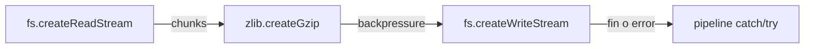

# GUÍA DE ESTUDIO — Módulo 07: Eventos y Streams en Node.js

**Curso:** CURSO_DESARROLLO_WEB  
**Nivel:** Fundamentos / Intermedio  
**Requisitos:** Node.js 20+ LTS, terminal y VS Code  
**Objetivo:** Dominar `node:events` (`EventEmitter`) y `node:stream` (`createReadStream`, `createWriteStream`, `pipeline`) para construir arquitecturas desacopladas y procesar archivos grandes sin saturar la memoria.

---

## Índice

1. `node:events` y `EventEmitter`
2. Clases con eventos y manejo obligatorio de `'error'`
3. `node:stream`: por qué procesar datos por fragmentos (*chunks*)
4. `pipeline()` de `node:stream/promises` y *backpressure*
5. Buenas prácticas y errores comunes
6. Laboratorio guiado
7. Hoja de trucos (Cheatsheet)
8. Resumen técnico

---

## 1. `node:events` y `EventEmitter`

En Node.js, gran parte de las APIs internas (`http.Server`, `process`, `fs.ReadStream`) heredan de `EventEmitter`. Este patrón permite que un componente **emita** eventos cuando ocurre algo y otros componentes **reaccionen** sin acoplarse directamente.

```js
import { EventEmitter } from 'node:events';

const bus = new EventEmitter();

// Se ejecuta una sola vez
bus.once('sistema:listo', () => {
  console.log('Sistema inicializado');
});

// Se ejecuta cada vez que se emite el evento
const onPedido = (pedido) => console.log('Pedido recibido:', pedido.id);
bus.on('pedido:creado', onPedido);

bus.emit('sistema:listo');
bus.emit('sistema:listo'); // No vuelve a ejecutarse
bus.emit('pedido:creado', { id: 'ORD-101' });

// Eliminar listener cuando ya no sea necesario
bus.off('pedido:creado', onPedido);
```

---

## 2. Clases con `EventEmitter` y manejo de `'error'`

Puedes extender `EventEmitter` en tus propias clases para emitir eventos de dominio.

```js
import { EventEmitter } from 'node:events';

class GestorTareas extends EventEmitter {
  completar(nombre) {
    if (!nombre) {
      this.emit('error', new Error('Nombre de tarea requerido'));
      return;
    }
    this.emit('tarea:completada', { nombre, fecha: new Date().toISOString() });
  }
}

const gestor = new GestorTareas();
// Regla crítica: siempre registra un listener para 'error'
gestor.on('error', (err) => console.error('Error controlado:', err.message));
gestor.on('tarea:completada', (info) => console.log('Completada:', info.nombre));

gestor.completar('Subir proyecto');
gestor.completar('');
```

> **Advertencia:** Si se emite `'error'` en un `EventEmitter` sin ningún listener registrado, Node.js lanza la excepción y **termina el proceso**.

---

## 3. `node:stream`: procesar datos por *chunks*

Leer un archivo de 2 GB con `fs.readFile()` intenta cargarlo completo en RAM. Con un **Stream**, Node.js lee y procesa fragmentos (*chunks*) de forma progresiva con un uso mínimo de memoria.

| Tipo de Stream | Qué hace | Ejemplo nativo |
|---|---|---|
| **Readable** | Emite datos por fragmentos | `fs.createReadStream('grande.log')` |
| **Writable** | Recibe y escribe fragmentos | `fs.createWriteStream('copia.log')` |
| **Transform** | Modifica fragmentos al paso | `zlib.createGzip()` |
| **Duplex** | Lee y escribe a la vez | `net.Socket` |

```js
import fs from 'node:fs';

const lectura = fs.createReadStream('entrada.txt', { encoding: 'utf8', highWaterMark: 1024 });
lectura.on('data', (chunk) => console.log('Fragmento recibido:', chunk.length, 'caracteres'));
lectura.on('end', () => console.log('Lectura completada'));
lectura.on('error', (err) => console.error('Error en stream:', err.message));
```

---

## 4. `pipeline()` y *backpressure*

Si un stream lector produce datos más rápido de lo que el escritor puede guardar en disco, se produce **backpressure** (contrapresión). Usar `.pipe()` simple no limpia recursos ni propaga errores automáticamente; en producción usa **`pipeline()`** de `node:stream/promises`:

```js
import fs from 'node:fs';
import { pipeline } from 'node:stream/promises';
import { createGzip } from 'node:zlib';

try {
  await pipeline(
    fs.createReadStream('registros.log'),
    createGzip(),
    fs.createWriteStream('registros.log.gz')
  );
  console.log('Archivo comprimido con éxito');
} catch (error) {
  console.error('Fallo en pipeline:', error.message);
}
```

---

## 5. Buenas prácticas y errores comunes

| Buena práctica | Error que evita |
|---|---|
| Registrar siempre `.on('error', ...)` en `EventEmitter` | Cierre inesperado de toda la aplicación |
| Usar `pipeline()` de `node:stream/promises` | Fugas de memoria y streams abiertos tras fallos |
| Remover listeners temporales con `.off()` o `.once()` | Fugas de memoria (*MaxListenersExceededWarning*) |
| Usar streams para archivos grandes o respuestas HTTP | Agotar la memoria RAM con `readFile()` |

---

## 6. Laboratorio guiado

1. Crea `eventos-demo.js` con `"type": "module"` en `package.json`.
2. Implementa un `EventEmitter` que emita `'archivo:listo'` y `'error'`.
3. Crea un archivo de texto y cópialo usando `pipeline(createReadStream(...), createWriteStream(...))`.

---

## 7. Hoja de trucos (Cheatsheet)

```js
bus.on('ev', fn)           // Escucha continua
bus.once('ev', fn)         // Escucha una única vez
bus.off('ev', fn)          // Desuscribe listener
bus.emit('ev', payload)    // Dispara evento síncronamente
await pipeline(src, dest)  // Conecta streams con manejo de errores y backpressure
```

---

## 8. Resumen técnico y checklist de dominio

- `EventEmitter` desacopla emisores y oyentes en Node.js; los listeners normales se ejecutan de forma síncrona al llamar `emit()`.
- Los **Streams** permiten trabajar con archivos y flujos enormes en pequeños fragmentos (*chunks*).
- `pipeline()` de `node:stream/promises` gestiona automáticamente el *backpressure*, cierre de descriptores y propagación de errores con `async/await`.

## 9. Analogía y diagrama Mermaid

Imagina una **línea de ensamblaje con timbre de avisos**:
- `EventEmitter` es el timbre que avisa cuando llega una caja o ocurre un fallo (`'error'`).
- `Readable` es la cinta que entrega piezas de a poco (*chunks*) sin llenar toda la mesa.
- `pipeline()` coordina la velocidad entre quien entrega y quien empaca (*backpressure*).



## 10. Proyecto integrador con pruebas (`node --test`)

```js
// test/eventos.test.js
import test from 'node:test';
import assert from 'node:assert/strict';
import { EventEmitter } from 'node:events';

test('EventEmitter ejecuta once una sola vez', () => {
  const bus = new EventEmitter();
  let conteo = 0;
  bus.once('listo', () => { conteo += 1; });
  bus.emit('listo');
  bus.emit('listo');
  assert.equal(conteo, 1);
});
```

## 11. Ejercicios por niveles y solucionario

- **Básico:** crea un `EventEmitter` con eventos `'inicio'` (`once`) y `'mensaje'` (`on`).
- **Intermedio:** extiende `EventEmitter` en una clase `Monitor` que emita `'error'` si recibe un valor vacío y captúralo con `.on('error', ...)`.
- **Avanzado:** comprime un archivo de texto usando `await pipeline(createReadStream(...), createGzip(), createWriteStream(...))`.

### Solucionario rápido
```js
import fs from 'node:fs';
import { pipeline } from 'node:stream/promises';
import { createGzip } from 'node:zlib';

await pipeline(
  fs.createReadStream('notas.txt'),
  createGzip(),
  fs.createWriteStream('notas.txt.gz')
);
```

## 12. Evaluación y checklist de dominio

- [ ] Sé diferenciar `.on()`, `.once()` y `.off()` en `EventEmitter`.
- [ ] Registro siempre un listener `'error'` para evitar caídas del proceso.
- [ ] Comprendo por qué `createReadStream()` + `pipeline()` evitan saturar la RAM.
