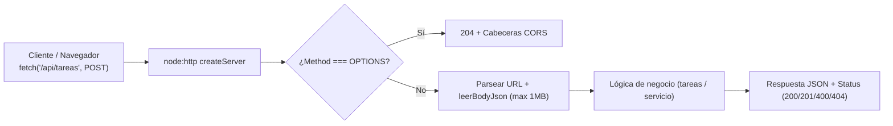

# GUÍA DE ESTUDIO — Módulo 15: Servidores HTTP y APIs REST (`node:http`)

**Curso:** CURSO_DESARROLLO_WEB  
**Nivel:** Intermedio  
**Requisitos:** Node.js 20+ LTS, módulos `Asincronia`, `EventosStreams`, `JSON` y `Process`  
**Objetivo:** Construir una API REST profesional usando únicamente el módulo nativo **`node:http`**: enrutamiento por método y URL, lectura de *query strings* con `URLSearchParams`, lectura segura del *body* por *chunks*, cabeceras CORS, códigos HTTP semánticos, estáticos seguros y consumo con `fetch()`.

---

## 1. Anatomía de una petición y respuesta HTTP en Node.js

Cuando llamas a `http.createServer((req, res) => { ... })`:
- **`req` (`IncomingMessage`, Readable Stream):** contiene `req.method` (`GET`, `POST`, `PATCH`, `DELETE`), `req.url`, `req.headers` y los bytes del cuerpo (*body*).
- **`res` (`ServerResponse`, Writable Stream):** permite fijar el código de estado (`200`, `201`, `400`, `404`, `500`), cabeceras (`res.writeHead`) y enviar el cuerpo con `res.end(...)`.

```js
import http from 'node:http';

const server = http.createServer((req, res) => {
  res.writeHead(200, { 'Content-Type': 'application/json; charset=utf-8' });
  res.end(JSON.stringify({ metodo: req.method, ruta: req.url }));
});

server.listen(3000, () => console.log('API en http://localhost:3000'));
```

---

## 2. Parsear rutas y *Query Params* con `new URL()`

Nunca dividas `req.url` a mano con `.split('?')`: usa la clase estándar `URL`:

```js
const url = new URL(req.url || '/', `http://${req.headers.host || 'localhost'}`);
const pathname = url.pathname;                 // ej. "/api/cursos"
const categoria = url.searchParams.get('cat'); // ej. "/api/cursos?cat=node" -> "node"
```

---

## 3. Leer el cuerpo JSON de un `POST` / `PATCH` con límite de tamaño

`req` es un *stream* que llega por fragmentos (*chunks*). Debes juntarlos, limitar el tamaño máximo (ej. `1e6` bytes = 1 MB) para evitar ataques de memoria y parsear con `JSON.parse()` dentro de `try/catch`:

```js
function leerBodyJson(req, maxBytes = 1e6) {
  return new Promise((resolve, reject) => {
    let raw = '';
    let excedido = false;
    req.on('data', (chunk) => {
      if (excedido) return;
      raw += chunk;
      if (raw.length > maxBytes) {
        excedido = true;
        req.destroy();
        reject(new Error('Payload demasiado grande'));
      }
    });
    req.on('end', () => {
      if (excedido) return;
      try { resolve(raw ? JSON.parse(raw) : {}); }
      catch { reject(new Error('JSON inválido en el body')); }
    });
    req.on('error', reject);
  });
}
```

---

## 4. Diseño REST: métodos y códigos de estado HTTP

| Operación | Método HTTP | Ruta ejemplo | Código éxito | Código error |
|---|---|---|---|---|
| Listar recursos | `GET` | `/api/tareas` | `200 OK` | `500` |
| Obtener uno | `GET` | `/api/tareas/123` | `200 OK` | `404 Not Found` |
| Crear nuevo | `POST` | `/api/tareas` | `201 Created` | `400 Bad Request` |
| Actualizar parcial | `PATCH` | `/api/tareas/123` | `200 OK` | `400` / `404` |
| Eliminar | `DELETE` | `/api/tareas/123` | `200 OK` / `204` | `404` |

---

## 5. CORS (*Cross-Origin Resource Sharing*) y `OPTIONS`

Si tu frontend corre en otro puerto o dominio (ej. Live Server `:5500` llamando a Node `:3000`), el navegador envía primero una petición *preflight* `OPTIONS` y exige cabeceras `Access-Control-Allow-*`:

```js
const CORS = {
  'Access-Control-Allow-Origin': '*',
  'Access-Control-Allow-Methods': 'GET,POST,PATCH,DELETE,OPTIONS',
  'Access-Control-Allow-Headers': 'Content-Type',
};

if (req.method === 'OPTIONS') {
  res.writeHead(204, CORS);
  return res.end();
}
```

---

## 6. Probar endpoints desde código con `fetch()` y `node:test`

```js
import test from 'node:test';
import assert from 'node:assert/strict';
import http from 'node:http';

test('GET /api/salud devuelve 200 y JSON', async (t) => {
  const srv = http.createServer((_req, res) => {
    res.writeHead(200, { 'Content-Type': 'application/json' });
    res.end(JSON.stringify({ ok: true }));
  });
  await new Promise((r) => srv.listen(0, '127.0.0.1', r));
  t.after(() => srv.close());

  const { port } = srv.address();
  const res = await fetch(`http://127.0.0.1:${port}/api/salud`);
  assert.equal(res.status, 200);
  assert.deepEqual(await res.json(), { ok: true });
});
```

---

## 7. Diagrama del ciclo de una petición REST



---

## ✅ Checklist de dominio del módulo

- [ ] Crear un servidor con `node:http` y enviar respuestas JSON con `Content-Type`.
- [ ] Extraer `pathname` y *query params* usando `new URL()`.
- [ ] Leer cuerpos `POST`/`PATCH` por *chunks* con límite de tamaño y `try/catch`.
- [ ] Elegir correctamente códigos `200`, `201`, `204`, `400`, `404` y `500`.
- [ ] Configurar cabeceras CORS y responder peticiones `OPTIONS`.
- [ ] Probar endpoints HTTP en puerto efímero (`listen(0)`) con `fetch()` y `node:test`.


---

## Cliente HTTP Nativo en Node.js (`fetch` + `AbortSignal.timeout`)

Desde Node 18+, `fetch()` es nativo sin instalar librerías externas. En backend conviene fijar siempre un *timeout* para que un servicio externo lento no agote las conexiones de tu servidor:

```js
const res = await fetch('https://api.ejemplo.com/usuarios', {
  signal: AbortSignal.timeout(5000),
  headers: { 'Accept': 'application/json' }
});
if (!res.ok) throw new Error(`HTTP ${res.status}`);
const usuarios = await res.json();
```

---

## Seguridad, Cabeceras y Cierre Elegante (Graceful Shutdown)

```js
// Manejo correcto de cierre en servidores Node.js
process.on('SIGTERM', () => {
  server.close(() => {
    console.log('Servidor cerrado sin cortar peticiones activas');
    process.exit(0);
  });
});
```

- Configura límites de tamaño al leer el body de `req` (`for await (const chunk of req)`) para prevenir ataques DoS por memoria.
- Devuelve siempre `Content-Type` explícito y códigos HTTP semánticos (`201 Created`, `204 No Content`, `400 Bad Request`, `404 Not Found`, `500 Internal Server Error`).

---

## ❌ Errores Comunes en HTTP con Node.js

1. **Olvidar llamar a `res.end()`:** La petición queda colgada hasta expirar por timeout en el navegador.
2. **Enviar cabeceras después de `res.end()` o escribir en el stream:** Lanza `ERR_HTTP_HEADERS_SENT`.
3. **Concatenar `req` sin límite de bytes:** Un payload malicioso de varios GB puede provocar *Out of Memory*.
4. **No manejar errores de JSON en `JSON.parse(body)`:** Si el cliente envía JSON inválido sin `try/catch`, cae el proceso completo.

---

## ✅ Buenas Prácticas Profesionales

- Centraliza el parseo del body y las respuestas JSON en helpers reutilizables con límite de tamaño (ej. 1 MB).
- Implementa un endpoint `/health` ligero para balanceadores de carga y contenedores Docker.
- Maneja CORS explícitamente (`Access-Control-Allow-Origin`) y responde `204` a preflights `OPTIONS`.

---

## Hoja de Trucos (Cheatsheet) — HTTP y APIs en Node.js

| Elemento | Uso Principal |
| :--- | :--- |
| `http.createServer((req, res) => ...)` | Crea un servidor HTTP nativo |
| `new URL(req.url, \`http://${req.headers.host}\`)` | Parsea pathname y query params con seguridad |
| `res.writeHead(200, { 'Content-Type': 'application/json' })` | Envía código HTTP y cabeceras |
| `res.end(JSON.stringify(data))` | Cierra y envía la respuesta |
| `fetch(url, { signal: AbortSignal.timeout(5000) })` | Peticiones salientes con timeout nativo |
