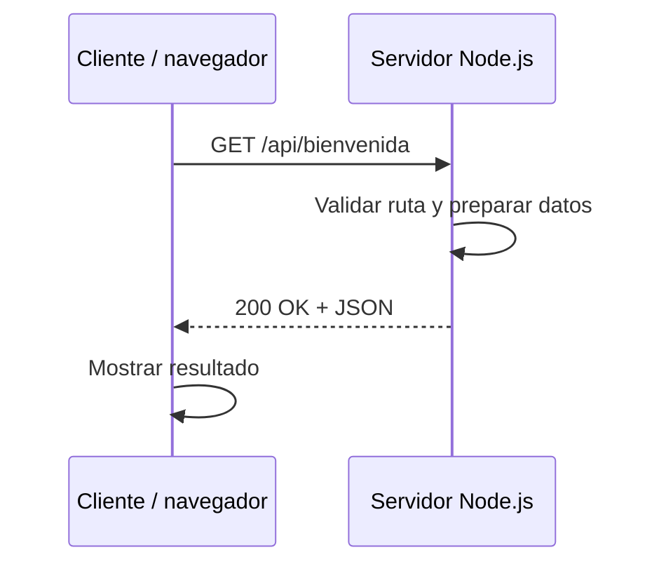
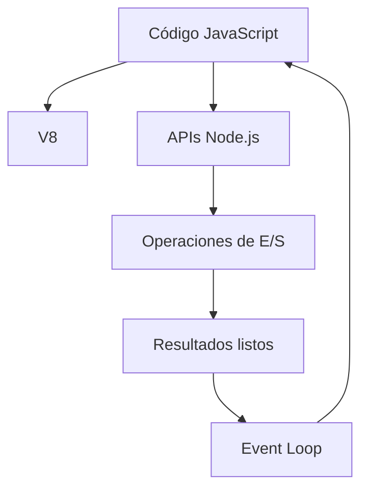
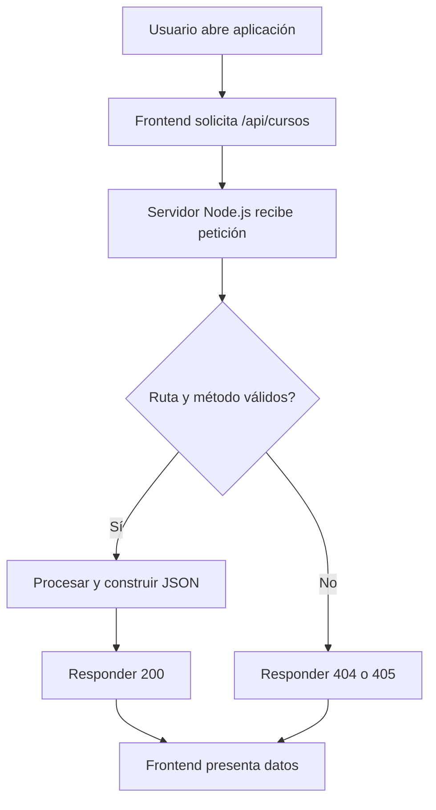

# Introducción a Node.js — CURSO_DESARROLLO_WEB

> **Nivel:** Fundamentos | **Modalidad:** Teoría + práctica | **Requisitos:** Conocimientos básicos de JavaScript | **Entorno:** Windows, Node.js LTS, VS Code

## Objetivos de aprendizaje

Al terminar podrás explicar qué es Node.js y cómo funciona una aplicación backend, instalar las herramientas, crear programas y servidores HTTP, y desarrollar una pequeña API sin frameworks.

## 1. Definición: ¿Qué es Node.js?

**Node.js** es un entorno de ejecución de JavaScript fuera del navegador, construido sobre el motor V8. Permite desarrollar aplicaciones de servidor, herramientas de línea de comandos y procesos automatizados. No es un lenguaje de programación, un navegador ni un framework.

```bash
node --version
node -e "console.log('Hola desde Node.js')"
```

**Comprueba:** debe aparecer la versión instalada y el saludo.

## 2. Backend y frontend

- **Frontend:** interfaz con la que interactúa una persona; normalmente HTML, CSS y JavaScript en el navegador.
- **Backend:** recibe solicitudes, aplica reglas de negocio, consulta datos y responde.
- **Base de datos:** almacena información persistente; puede ser usada por el backend.

| Característica | Frontend | Backend |
|---|---|---|
| Se ejecuta habitualmente en | Navegador | Servidor |
| Responsabilidad | Presentación e interacción | Reglas, seguridad y datos |
| Ejemplo | Formulario de registro | Validar y registrar usuario |
| Acceso a secretos | Nunca | Mediante configuración segura |

**Ejemplo:** al presionar «Ver cursos», el frontend hace una petición; el backend obtiene los cursos y devuelve JSON.

## 3. Principales usos de Node.js

1. APIs REST y servicios web.
2. Aplicaciones en tiempo real, como chats.
3. Herramientas de terminal y automatización.
4. Procesamiento de archivos y tareas de integración.
5. Servidores de aplicaciones y microservicios.
6. Herramientas de construcción y desarrollo frontend.

**Importante:** las tareas de CPU intensiva pueden bloquear el hilo principal si no se delegan a procesos o workers.

## 4. JavaScript en navegador vs. Node.js

| Navegador | Node.js |
|---|---|
| `document`, `window`, DOM | `process`, `node:fs`, `node:http` |
| Interacción con la página | Archivos, red y procesos |
| APIs web como `fetch` | También dispone de `fetch` en versiones modernas |
| Seguridad limitada por sandbox | Permisos del sistema operativo y configuración del proceso |

Ambos ejecutan JavaScript, pero sus APIs disponibles son diferentes.

```js
// En Node.js
console.log(process.platform);
console.log(process.version);
```

## 5. Arquitectura cliente-servidor y petición HTTP

Una petición HTTP contiene un método (`GET`, `POST`, etc.), una ruta, cabeceras y, opcionalmente, un cuerpo. La respuesta contiene código de estado, cabeceras y cuerpo.



**Códigos frecuentes:** `200` correcto; `201` creado; `400` petición inválida; `404` recurso inexistente; `500` error interno.

## 6. Componentes: V8, runtime, APIs y Event Loop

- **V8:** compila y ejecuta JavaScript.
- **Runtime:** integra V8 con APIs de Node.js y bibliotecas necesarias.
- **APIs nativas:** módulos como `node:http`, `node:fs`, `node:path`.
- **Event Loop:** coordina callbacks y la ejecución de operaciones asíncronas cuando están listas.
- **libuv:** facilita el bucle de eventos y diversas operaciones de E/S; algunas usan un pool de hilos.



**Ejemplo de asincronía:**

```js
console.log('Inicio');
setTimeout(() => console.log('Temporizador'), 0);
console.log('Fin');
// Inicio, Fin, Temporizador
```

El temporizador no interrumpe el código síncrono en ejecución.

## 7. Node.js, npm, paquetes y package.json

**npm** es un gestor de paquetes habitual en Node.js. Un **paquete** agrupa código y metadatos; `package.json` declara nombre, versión, scripts y dependencias.

```powershell
mkdir curso-node
cd curso-node
npm init -y
npm pkg set type=module
npm pkg set scripts.start="node src/server.js"
```

Ejemplo de `package.json`:

```json
{
  "name": "curso-desarrollo-web-api",
  "version": "1.0.0",
  "private": true,
  "type": "module",
  "scripts": {
    "start": "node src/server.js"
  }
}
```

`npm install paquete` agrega una dependencia. `package-lock.json` registra las versiones resueltas: conviene incluirlo en Git en aplicaciones. Nunca subas `node_modules` al repositorio.

## 8. Preparar el entorno en Windows

1. Descarga la versión **LTS** desde https://nodejs.org/.
2. Instala Node.js y asegúrate de que npm esté incluido.
3. Abre una terminal nueva (PowerShell o terminal integrada de VS Code).
4. Comprueba:

```powershell
node -v
npm -v
```

5. Instala VS Code desde https://code.visualstudio.com/.
6. Abre la carpeta de trabajo: **Archivo → Abrir carpeta**.
7. Abre **Terminal → Nuevo terminal**.

**Si `node` no se reconoce:** reinicia la terminal; comprueba la instalación y la variable PATH. **Si PowerShell bloquea `npm.ps1`:** utiliza `npm.cmd` o la terminal CMD, sin modificar innecesariamente la política de ejecución.

## 9. Primer programa con Node.js

Crea `hola.js`:

```js
const estudiante = 'Estudiante';
console.log(`¡Hola, ${estudiante}! Bienvenido a Node.js.`);
console.log(`Versión: ${process.version}`);
```

Ejecuta:

```powershell
node hola.js
```

**Reto:** sustituye el nombre por una variable obtenida desde `process.argv[2]`:

```js
const nombre = process.argv[2] ?? 'Estudiante';
console.log(`¡Hola, ${nombre}!`);
```

Prueba `node hola.js Ana`.

## 10. Primer servidor HTTP

Crea `servidor.js`:

```js
import http from 'node:http';

const servidor = http.createServer((req, res) => {
  res.writeHead(200, { 'Content-Type': 'text/plain; charset=utf-8' });
  res.end('Hola desde mi primer servidor Node.js');
});

servidor.listen(3000, '127.0.0.1', () => {
  console.log('Servidor en http://127.0.0.1:3000');
});
```

**Nota:** el ejemplo utiliza ESM. Asegúrate de configurar `"type": "module"` en `package.json` o cambia la extensión a `.mjs`.

Ejecuta `node servidor.js`, visita `http://127.0.0.1:3000` y detén con **Ctrl+C**.

## 11. Analogías del mundo real

Imagina un restaurante:

- **Cliente:** persona que solicita un plato.
- **Petición HTTP:** pedido entregado al mesero.
- **Servidor:** cocina que recibe pedidos.
- **Lógica de negocio:** receta y reglas de preparación.
- **Respuesta HTTP:** plato servido con un resultado.
- **Event Loop:** coordinación que permite atender pedidos sin esperar inmóvil cada operación.

La analogía simplifica la implementación: el Event Loop no ejecuta automáticamente todo el trabajo en paralelo.

## 12. Diagrama de flujo general



## 13. Buenas prácticas y errores comunes

| Buena práctica | Error que evita |
|---|---|
| Usar Node.js LTS | Incompatibilidades por versiones experimentales |
| Separar rutas y lógica | Archivos gigantes difíciles de mantener |
| Validar entradas | Datos inesperados y errores de ejecución |
| Usar códigos HTTP correctos | Respuestas ambiguas |
| Responder JSON con cabecera adecuada | Clientes que interpretan mal la respuesta |
| Capturar errores esperados | Caídas y mensajes confusos |
| No incluir secretos en código | Filtraciones de credenciales |
| No bloquear el Event Loop | Lentitud en peticiones concurrentes |
| Mantener un `README.md` | Dificultad para ejecutar el proyecto |

**Errores típicos:** `EADDRINUSE` indica puerto ocupado; `ERR_MODULE_NOT_FOUND` indica importación incorrecta o dependencia ausente; `Cannot use import statement outside a module` suele indicar configuración ESM incompatible; `404` indica ruta inexistente.

## 14. Laboratorio guiado: servidor con rutas

**Meta:** crear dos endpoints HTTP con Node.js puro.

**Paso 1.** Crea carpeta `laboratorio-http` e inicializa:

```powershell
mkdir laboratorio-http
cd laboratorio-http
npm init -y
npm pkg set type=module
```

**Paso 2.** Crea `app.js`:

```js
import http from 'node:http';

const server = http.createServer((req, res) => {
  const url = new URL(req.url, 'http://localhost');
  res.setHeader('Content-Type', 'application/json; charset=utf-8');

  if (req.method === 'GET' && url.pathname === '/') {
    res.writeHead(200);
    return res.end(JSON.stringify({ mensaje: 'API funcionando' }));
  }

  if (req.method === 'GET' && url.pathname === '/salud') {
    res.writeHead(200);
    return res.end(JSON.stringify({ estado: 'ok' }));
  }

  res.writeHead(404);
  res.end(JSON.stringify({ error: 'Ruta no encontrada' }));
});

server.listen(3000, '127.0.0.1', () => {
  console.log('Visita http://127.0.0.1:3000');
});
```

**Paso 3.** Ejecuta `node app.js`.

**Paso 4.** Abre `/`, `/salud` y `/inexistente`. Observa la respuesta.

**Paso 5.** En otra terminal:

```powershell
curl.exe -i http://127.0.0.1:3000/salud
```

**Resultado esperado:** HTTP `200` y `{"estado":"ok"}`. La ruta inexistente debe devolver `404`.

## 15. Proyecto integrador: API de bienvenida para CURSO_DESARROLLO_WEB

### Objetivo y requisitos

Construir una API HTTP sin dependencias externas que permita consultar la bienvenida, listar cursos y personalizar un saludo. Utilizaremos módulos ESM, validación simple, rutas y JSON.

**Endpoints:**

| Método | Ruta | Función |
|---|---|---|
| GET | `/` | Información de la API |
| GET | `/api/bienvenida` | Saludo con parámetro `nombre` opcional |
| GET | `/api/cursos` | Lista de cursos |
| GET | `/api/salud` | Estado del servicio |
| Otros | Cualquier ruta | Error 404 |

### Estructura

```text
CURSO_DESARROLLO_WEB/
├── package.json
├── README.md
└── src/
    ├── server.js
    ├── data/
    │   └── cursos.js
    └── utils/
        └── responder.js
```

### Paso 1. Crear proyecto

```powershell
mkdir CURSO_DESARROLLO_WEB
cd CURSO_DESARROLLO_WEB
npm init -y
npm pkg set type=module
npm pkg set scripts.start="node src/server.js"
mkdir src
mkdir src\data
mkdir src\utils
```

### Paso 2. Crear `src/data/cursos.js`

```js
export const cursos = [
  { id: 1, titulo: 'Fundamentos de JavaScript', nivel: 'básico' },
  { id: 2, titulo: 'Introducción a Node.js', nivel: 'básico' },
  { id: 3, titulo: 'APIs con Node.js', nivel: 'intermedio' }
];
```

### Paso 3. Crear `src/utils/responder.js`

```js
export function responderJSON(res, estado, datos) {
  res.writeHead(estado, {
    'Content-Type': 'application/json; charset=utf-8',
    'Cache-Control': 'no-store'
  });
  res.end(JSON.stringify(datos));
}
```

### Paso 4. Crear `src/server.js`

```js
import http from 'node:http';
import { cursos } from './data/cursos.js';
import { responderJSON } from './utils/responder.js';

const puerto = Number(process.env.PORT ?? 3000);
const host = '127.0.0.1';

const servidor = http.createServer((req, res) => {
  const url = new URL(req.url, `http://${host}:${puerto}`);

  if (req.method !== 'GET') {
    return responderJSON(res, 405, { error: 'Método no permitido' });
  }

  if (url.pathname === '/') {
    return responderJSON(res, 200, {
      aplicacion: 'CURSO_DESARROLLO_WEB',
      version: '1.0.0',
      endpoints: ['/api/bienvenida', '/api/cursos', '/api/salud']
    });
  }

  if (url.pathname === '/api/bienvenida') {
    const nombre = (url.searchParams.get('nombre') ?? 'estudiante').trim();
    if (!nombre || nombre.length > 60) {
      return responderJSON(res, 400, { error: 'Nombre inválido (1 a 60 caracteres)' });
    }
    return responderJSON(res, 200, {
      mensaje: `¡Bienvenido, ${nombre}, a CURSO_DESARROLLO_WEB!`,
      siguientePaso: 'Aprender rutas, módulos y APIs'
    });
  }

  if (url.pathname === '/api/cursos') {
    return responderJSON(res, 200, { total: cursos.length, cursos });
  }

  if (url.pathname === '/api/salud') {
    return responderJSON(res, 200, { estado: 'ok' });
  }

  return responderJSON(res, 404, { error: 'Ruta no encontrada' });
});

servidor.on('error', (error) => {
  console.error('No se pudo iniciar el servidor:', error.message);
  process.exitCode = 1;
});

servidor.listen(puerto, host, () => {
  console.log(`API disponible en http://${host}:${puerto}`);
});
```

### Paso 5. Ejecutar

```powershell
npm start
```

### Paso 6. Probar con navegador y terminal

```powershell
curl.exe -i http://127.0.0.1:3000/
curl.exe -i "http://127.0.0.1:3000/api/bienvenida?nombre=Laura"
curl.exe -i http://127.0.0.1:3000/api/cursos
curl.exe -i http://127.0.0.1:3000/api/salud
curl.exe -i http://127.0.0.1:3000/no-existe
curl.exe -i -X POST http://127.0.0.1:3000/api/cursos
```

**Resultados esperados:** `200` en las primeras cuatro solicitudes; `404` para ruta desconocida; `405` para POST. La API devuelve JSON en todos los casos.

### Paso 7. Crear README.md

Documenta requisitos, `npm start`, URL base, tabla de rutas y ejemplos de prueba. Detén el servidor con **Ctrl+C**.

### Paso 8. Retos de ampliación

1. Añadir `/api/acerca-de` con autor y propósito.
2. Permitir filtrar `/api/cursos?nivel=básico`.
3. Agregar una ruta `/api/cursos/2`.
4. Extraer las rutas a otro módulo para reducir el tamaño de `server.js`.

**Criterios de entrega:** arranque sin errores, cuatro rutas correctas, validación del nombre, códigos HTTP apropiados, módulos separados y README reproducible.

## 16. Resumen técnico

Node.js ejecuta JavaScript fuera del navegador usando V8. Permite crear servidores HTTP con `node:http`; las peticiones tienen método y ruta y las respuestas códigos de estado y contenido. El Event Loop ayuda a coordinar trabajo asíncrono; npm gestiona paquetes y `package.json` documenta el proyecto. El backend implementa reglas y responde a clientes, mientras que el frontend muestra e interactúa con los resultados.

## 17. Ejercicios por niveles

### Nivel básico

**B1.** Explica con tus palabras qué es Node.js y menciona dos cosas que no es.

**B2.** Crea `datos.js` que imprima tu nombre, `process.version` y `process.platform`.

**B3.** Describe qué representan cliente, servidor, solicitud y respuesta en una API de cursos.

### Nivel intermedio

**I1.** Crea un servidor que responda `200` con JSON en `/hola` y `404` en las demás rutas.

**I2.** Añade un script `dev` en `package.json` que ejecute `node --watch src/server.js` (en una versión moderna de Node.js).

**I3.** Añade a la API del proyecto `/api/acerca-de`, con campos `nombre` y `objetivo`.

### Nivel avanzado

**A1.** Implementa filtro por nivel en `/api/cursos?nivel=basico` (elige y documenta una convención de valores).

**A2.** Implementa `/api/cursos/:id`, validando que el ID sea un entero positivo y devolviendo `400`, `404` o `200` según corresponda.

**A3.** Explica qué ocurre si un servidor ejecuta un bucle síncrono muy costoso y propone una solución.

## 18. Solucionario paso a paso

### B1. Solución

Node.js es un entorno de ejecución de JavaScript fuera del navegador. No es un lenguaje nuevo ni un framework. Verifica que la respuesta diferencie lenguaje y entorno.

### B2. Solución

```js
const nombre = 'Ana';
console.log('Nombre:', nombre);
console.log('Node:', process.version);
console.log('Sistema:', process.platform);
```

Ejecuta `node datos.js`; comprueba tres líneas.

### B3. Solución

El navegador es el cliente; envía `GET /api/cursos` al servidor; Node.js procesa la petición y responde con un estado `200` y JSON. El cliente utiliza el resultado.

### I1. Solución

```js
import http from 'node:http';
http.createServer((req, res) => {
  res.setHeader('Content-Type', 'application/json; charset=utf-8');
  if (req.method === 'GET' && req.url === '/hola') {
    res.writeHead(200);
    return res.end(JSON.stringify({ mensaje: 'Hola' }));
  }
  res.writeHead(404);
  res.end(JSON.stringify({ error: 'No encontrado' }));
}).listen(3001, '127.0.0.1');
```

Ejecuta en un proyecto ESM y visita `http://127.0.0.1:3001/hola`.

### I2. Solución

```powershell
npm pkg set scripts.dev="node --watch src/server.js"
npm run dev
```

Al modificar y guardar el archivo, el modo watch reinicia el proceso cuando detecta cambios compatibles con su seguimiento.

### I3. Solución

En `src/server.js`, antes del `404`, agrega:

```js
if (url.pathname === '/api/acerca-de') {
  return responderJSON(res, 200, {
    nombre: 'CURSO_DESARROLLO_WEB',
    objetivo: 'Aprender desarrollo web con proyectos prácticos'
  });
}
```

Prueba con `curl.exe -i http://127.0.0.1:3000/api/acerca-de`.

### A1. Solución

Sustituye el bloque de `/api/cursos` por:

```js
if (url.pathname === '/api/cursos') {
  const nivel = url.searchParams.get('nivel');
  const normalizar = (valor) => valor.normalize('NFD')
    .replace(/[\u0300-\u036f]/g, '').toLowerCase();
  const filtrados = nivel
    ? cursos.filter(curso => normalizar(curso.nivel) === normalizar(nivel))
    : cursos;
  return responderJSON(res, 200, { total: filtrados.length, cursos: filtrados });
}
```

Prueba `?nivel=basico`, `?nivel=intermedio` y sin parámetro. Esta solución acepta niveles con o sin tilde.

### A2. Solución

Agrega este bloque antes de la respuesta final `404`:

```js
const coincidencia = url.pathname.match(/^\/api\/cursos\/([^/]+)$/);
if (coincidencia) {
  const idTexto = coincidencia[1];
  if (!/^[1-9]\d*$/.test(idTexto) || !Number.isSafeInteger(Number(idTexto))) {
    return responderJSON(res, 400, { error: 'ID inválido' });
  }
  const curso = cursos.find(c => c.id === Number(idTexto));
  if (!curso) return responderJSON(res, 404, { error: 'Curso no encontrado' });
  return responderJSON(res, 200, curso);
}
```

Prueba `/api/cursos/1` (200), `/api/cursos/999` (404), `/api/cursos/abc` (400).

### A3. Solución

Un cálculo síncrono muy costoso ocupa el hilo JavaScript principal e impide que el Event Loop atienda oportunamente otros callbacks. Para trabajos intensivos, usa `worker_threads`, procesos separados o una cola de trabajos; para E/S, prefiere APIs asíncronas.

## 19. Hoja de trucos (Cheatsheet)

| Acción | Comando o código |
|---|---|
| Ver Node.js | `node -v` |
| Ver npm | `npm -v` |
| Ejecutar archivo | `node archivo.js` |
| Crear proyecto | `npm init -y` |
| Configurar ESM | `npm pkg set type=module` |
| Ejecutar script start | `npm start` |
| Ejecutar script dev | `npm run dev` |
| Instalar paquete | `npm install nombre-paquete` |
| Crear servidor | `http.createServer(callback)` |
| Escuchar puerto | `server.listen(3000)` |
| Responder JSON | `res.end(JSON.stringify(datos))` |
| Consultar parámetro | `url.searchParams.get('nombre')` |
| Importar módulo nativo | `import http from 'node:http'` |
| Detener servidor | `Ctrl+C` |
| Probar respuesta HTTP | `curl.exe -i URL` |

## 20. Evaluación y criterios de aprobación

**Duración sugerida:** 60–90 minutos. **Total:** 100 puntos. **Aprobación:** 80 puntos, con el proyecto funcionando.

### Parte A — Teoría (30 puntos, 5 cada una)

1. Define Node.js y menciona una aplicación práctica.
2. Diferencia frontend y backend con un ejemplo.
3. ¿Qué es una petición HTTP y qué devuelve una respuesta?
4. ¿Qué función cumple V8?
5. ¿Por qué conviene evitar operaciones síncronas costosas en el servidor?
6. ¿Para qué sirven npm y `package.json`?

### Parte B — Práctica (40 puntos)

1. Crear proyecto y configurar ESM (10).
2. Crear servidor que responda JSON en `/api/salud` (10).
3. Crear `/api/bienvenida?nombre=...` con valor predeterminado (10).
4. Devolver `404` para rutas desconocidas y probar con `curl.exe` (10).

### Parte C — Proyecto (30 puntos)

1. API CURSO_DESARROLLO_WEB inicia correctamente (10).
2. Endpoints y códigos HTTP correctos (10).
3. Estructura modular, validación y README (10).

### Guía de corrección

**Teoría:** 1) runtime JS fuera del navegador, útil para APIs; 2) interfaz vs lógica/servidor; 3) método/ruta y estado/cuerpo; 4) ejecutar JavaScript; 5) bloquean atención de otras tareas; 6) gestionar dependencias y metadatos/scripts.

**Práctica:** compara con los ejemplos de las secciones 10, 14 y 15; cada ruta debe responder sin errores. **Proyecto:** aplica los criterios de entrega de la sección 15 y comprueba respuestas `200`, `400`, `404` y `405` cuando correspondan.

### Lista de verificación final

- [ ] Puedo definir Node.js correctamente.
- [ ] Distingo frontend, backend y base de datos.
- [ ] Explico la secuencia petición-respuesta HTTP.
- [ ] Reconozco V8, APIs, libuv y Event Loop.
- [ ] Verifico Node.js y npm en Windows.
- [ ] Creo y ejecuto archivos JavaScript.
- [ ] Configuro un proyecto ESM con `package.json`.
- [ ] Creo un servidor HTTP sin frameworks.
- [ ] Respondo JSON y utilizo códigos HTTP adecuados.
- [ ] Pruebo rutas con navegador y `curl.exe`.
- [ ] Completo la API de CURSO_DESARROLLO_WEB.
- [ ] Resuelvo ejercicios básicos, intermedios y avanzados.

---

**Siguiente módulo recomendado:** módulos de Node.js, `import`/`export`, módulos nativos y organización del backend.
