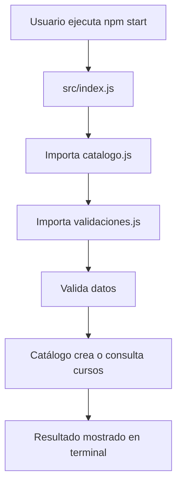

# GUÍA DE ESTUDIO — Módulo 03: JavaScript moderno para Node.js


> Esta guía es educativa. El prototipo no implementa autenticación ni base de datos productiva.

## 1. Preparación

Requisitos: Node.js LTS y un editor como VS Code. En PowerShell:

```powershell
node -v
npm -v
mkdir javascript-moderno
cd javascript-moderno
code .
```

Si `code .` no está disponible, abre la carpeta manualmente en VS Code. Para ejecutar un archivo: `node archivo.js`. No se requieren paquetes de terceros para los ejemplos.

## 2. `const` y `let`

`const` declara una vinculación que no se puede reasignar; `let` permite reasignar. Ambas tienen alcance de bloque. Evita `var` en código nuevo por su alcance de función y comportamiento de elevación.

```js
const nombrePlataforma = 'CURSO_DESARROLLO_WEB';
let estudiantesActivos = 10;
estudiantesActivos += 1;
console.log(nombrePlataforma, estudiantesActivos);
```

`const` **no** vuelve inmutable un objeto:

```js
const curso = { titulo: 'Node.js', cupos: 20 };
curso.cupos = 19; // permitido
// curso = {}; // TypeError al ejecutar
```

Elige `const` por defecto y `let` cuando la variable necesite reasignación. No accedas a una variable antes de su declaración: existe una zona muerta temporal.

## 3. Funciones

Una función agrupa lógica reutilizable. Los parámetros reciben valores; `return` entrega el resultado.

```js
function calcularPorcentaje(obtenido, total) {
  if (total <= 0) throw new Error('El total debe ser positivo');
  return (obtenido / total) * 100;
}

const aprobar = (nota, minimo = 70) => nota >= minimo;
console.log(calcularPorcentaje(18, 20)); // 90
console.log(aprobar(90)); // true
```

**Declaración:** `function sumar(a,b) { return a+b; }`. **Expresión:** `const sumar = function(a,b) { return a+b; };`. **Flecha:** `const sumar = (a,b) => a+b;`. Las flechas no tienen su propio `this` ni `arguments`; no son sustitutos universales de los métodos tradicionales.

Funciones puras, cuando sea posible, facilitan las pruebas:

```js
const agregarImpuesto = (precio, tasa) => precio * (1 + tasa);
```

## 4. Objetos y arrays

Un objeto organiza propiedades con claves; un array organiza elementos en orden.

```js
const estudiante = {
  id: 1,
  nombre: 'Ana',
  progreso: 40,
  saludar() { return `Hola, ${this.nombre}`; }
};
const cursos = [
  { id: 1, titulo: 'JavaScript', horas: 8 },
  { id: 2, titulo: 'Node.js', horas: 12 },
  { id: 3, titulo: 'HTTP', horas: 6 }
];
console.log(estudiante.saludar());
console.log(cursos.map(c => c.titulo));
console.log(cursos.filter(c => c.horas >= 8));
console.log(cursos.find(c => c.id === 2));
console.log(cursos.reduce((total, c) => total + c.horas, 0)); // 26
```

Métodos clave: `map` transforma, `filter` selecciona, `find` devuelve el primer elemento coincidente, `some` verifica si alguno cumple, `every` verifica si todos cumplen, `reduce` acumula. `map`, `filter` y `reduce` devuelven nuevos resultados; `push`, `pop`, `splice` y `sort` modifican el array original (`sort` muta; `toSorted` crea copia en versiones compatibles).

**Copias superficiales:** `const copia = {...estudiante};` y `const otra = [...cursos];` no duplican objetos anidados.

## 5. Desestructuración

Extrae propiedades y posiciones en variables con sintaxis concisa.

```js
const curso = { id: 7, titulo: 'Backend', duracion: 12 };
const { titulo, duracion: horas, categoria = 'Programación' } = curso;
const notas = [95, 80, 70];
const [primera, , tercera] = notas;
console.log(titulo, horas, categoria, primera, tercera);

function presentarCurso({ titulo, duracion = 0 }) {
  return `${titulo}: ${duracion} horas`;
}
console.log(presentarCurso(curso));
```

`...rest` reúne elementos restantes; `...spread` expande valores:

```js
const [primero, ...restantes] = notas;
const cursoActualizado = { ...curso, duracion: 16 };
```

Para datos opcionales, combina `?.` y `??`: `usuario?.perfil?.nombre ?? 'Sin nombre'`.

## 6. Módulos

Un módulo es un archivo que expone funcionalidad a otros archivos. En Node.js existen ECMAScript Modules (ESM) y CommonJS. En este curso utilizaremos ESM.

```json
{
  "name": "javascript-moderno-curso",
  "version": "1.0.0",
  "private": true,
  "type": "module",
  "scripts": { "start": "node src/index.js" }
}
```

```js
// src/matematicas.js
export const sumar = (a, b) => a + b;
export default function duplicar(n) { return n * 2; }
```

```js
// src/index.js
import duplicar, { sumar } from './matematicas.js';
console.log(sumar(2, 3), duplicar(4));
```

En ESM las rutas relativas incluyen extensión `.js`. Un `export default` se importa sin llaves; las exportaciones nombradas, con llaves. En CommonJS se usan `require()` y `module.exports`, pero mezclar sistemas sin entender la configuración produce errores.

## 7. Analogía y diagrama

Imagina una academia: cada **curso** es un objeto; el **catálogo** es un array; la **secretaría** es una función que registra cursos; los **departamentos** son módulos; `import` es pedir un servicio a otro departamento.



## 8. Buenas prácticas y errores comunes

| Buena práctica | Error que evita |
|---|---|
| `const` por defecto | Reasignaciones accidentales |
| Validar entradas | Datos vacíos, tipos incorrectos |
| Funciones pequeñas y con un propósito | Código difícil de probar |
| `===` en lugar de `==` | Conversiones implícitas inesperadas |
| `map` para transformar, `filter` para seleccionar | Efectos secundarios innecesarios |
| Rutas ESM con `.js` | `ERR_MODULE_NOT_FOUND` |
| Separar interfaz, reglas y datos | Acoplamiento excesivo |
| No mutar datos recibidos sin necesidad | Cambios inesperados |

Errores frecuentes: intentar reasignar `const`; olvidar `return` en una función con llaves; confundir `find` (elemento) con `filter` (array); desestructurar `undefined`; importar `./archivo` sin `.js` en ESM; ejecutar Node.js desde otra carpeta; asumir que un array vacío es falsy (en JavaScript es truthy).

## 9. Laboratorio guiado paso a paso

**Meta:** practicar variables, funciones, arrays y desestructuración.

**Paso 1.** Crea `laboratorio.js`:

```js
const plataforma = 'CURSO_DESARROLLO_WEB';
let visitas = 0;
const cursos = [
  { id: 1, titulo: 'HTML', horas: 5 },
  { id: 2, titulo: 'JavaScript', horas: 10 },
  { id: 3, titulo: 'Node.js', horas: 15 }
];

const buscarPorId = (id) => cursos.find(curso => curso.id === id);
const totalHoras = (lista) => lista.reduce((suma, curso) => suma + curso.horas, 0);

visitas += 1;
const { titulo, horas } = buscarPorId(2);
console.log({ plataforma, visitas, titulo, horas });
console.log('Total de horas:', totalHoras(cursos));
console.log('Cursos largos:', cursos.filter(curso => curso.horas >= 10));
```

**Paso 2.** Ejecuta `node laboratorio.js`.

**Paso 3.** Verifica: el curso buscado es JavaScript, su duración es 10, el total es 30 y hay dos cursos de al menos 10 horas.

**Paso 4.** Modifica el filtro a 15 y explica el resultado.

**Paso 5.** Agrega un curso nuevo y vuelve a calcular las horas.

## 10. Proyecto integrador: catálogo modular de CURSO_DESARROLLO_WEB

**Objetivo funcional:** registrar, listar, buscar, filtrar y resumir cursos desde terminal. No requiere instalar paquetes ni conexión. Se guardan en memoria durante la ejecución (no persisten tras cerrar el programa).

### 10.1 Estructura

```text
catalogo-modular/
├── package.json
└── src/
    ├── index.js
    ├── catalogo.js
    └── validaciones.js
```

### 10.2 Crear el proyecto

En PowerShell:

```powershell
mkdir catalogo-modular
cd catalogo-modular
mkdir src
```

Crea los archivos indicados a continuación. No ejecutes `npm install`: el proyecto no tiene dependencias externas.

### 10.3 package.json

```json
{
  "name": "catalogo-modular",
  "version": "1.0.0",
  "private": true,
  "type": "module",
  "scripts": {
    "start": "node src/index.js",
    "test": "node --test"
  }
}
```

### 10.4 src/validaciones.js

```js
export function validarCurso({ titulo, horas }) {
  if (typeof titulo !== 'string' || titulo.trim().length < 3) {
    throw new Error('El título debe tener al menos 3 caracteres');
  }
  if (!Number.isFinite(horas) || horas <= 0) {
    throw new Error('Las horas deben ser un número positivo');
  }
}
```

### 10.5 src/catalogo.js

```js
import { validarCurso } from './validaciones.js';

const cursos = [];
let siguienteId = 1;

export function agregarCurso(datos) {
  validarCurso(datos);
  const curso = {
    id: siguienteId++,
    titulo: datos.titulo.trim(),
    horas: datos.horas,
    categoria: datos.categoria ?? 'General'
  };
  cursos.push(curso);
  return { ...curso };
}

export function listarCursos() {
  return cursos.map(curso => ({ ...curso }));
}

export function buscarCurso(id) {
  const curso = cursos.find(c => c.id === id);
  return curso ? { ...curso } : null;
}

export function filtrarPorCategoria(categoria) {
  return cursos.filter(c => c.categoria === categoria).map(c => ({ ...c }));
}

export function resumen() {
  return {
    cantidad: cursos.length,
    horasTotales: cursos.reduce((total, c) => total + c.horas, 0)
  };
}
```

### 10.6 src/index.js

```js
import {
  agregarCurso,
  listarCursos,
  buscarCurso,
  filtrarPorCategoria,
  resumen
} from './catalogo.js';

agregarCurso({ titulo: 'HTML y CSS', horas: 8, categoria: 'Frontend' });
agregarCurso({ titulo: 'JavaScript moderno', horas: 12, categoria: 'Frontend' });
agregarCurso({ titulo: 'Node.js', horas: 16, categoria: 'Backend' });

console.log('=== CURSO_DESARROLLO_WEB ===');
console.table(listarCursos());
console.log('Curso 2:', buscarCurso(2));
console.log('Frontend:', filtrarPorCategoria('Frontend'));
console.log('Resumen:', resumen());

try {
  agregarCurso({ titulo: '', horas: -2 });
} catch (error) {
  console.log('Validación correcta:', error.message);
}
```

### 10.7 Ejecutar y comprobar

```powershell
npm start
```

**Resultados esperados:** 3 cursos, 36 horas totales, 2 cursos Frontend, curso 2 titulado «JavaScript moderno» y mensaje de validación para el curso inválido.

### 10.8 Prueba automática opcional

Crea `src/catalogo.test.js`:

```js
import test from 'node:test';
import assert from 'node:assert/strict';
import { agregarCurso, buscarCurso, resumen } from './catalogo.js';

test('agrega y recupera un curso', () => {
  const nuevo = agregarCurso({ titulo: 'Pruebas Node', horas: 4 });
  assert.equal(buscarCurso(nuevo.id)?.titulo, 'Pruebas Node');
  assert.ok(resumen().horasTotales >= 4);
});

test('rechaza horas inválidas', () => {
  assert.throws(() => agregarCurso({ titulo: 'Inválido', horas: 0 }));
});
```

Ejecuta `npm test`. Las pruebas usan un catálogo en memoria: cada ejecución de Node inicia su propio proceso. Como extensión, agrega una función `eliminarCurso(id)` y sus pruebas.

## 11. Ejercicios por niveles

### Nivel básico

**B1.** Declara `const nombre = 'CURSO_DESARROLLO_WEB'` y `let inscritos = 5`; aumenta inscritos en 2 e imprime ambos valores.

**B2.** Escribe `saludar(nombre)` que devuelva `Bienvenido, <nombre>`.

**B3.** Dado `[4, 8, 12]`, crea un nuevo array con cada número multiplicado por 2.

### Nivel intermedio

**I1.** Dado `{titulo:'Node', horas:10, nivel:'Fundamentos'}`, extrae `titulo` y renombra `horas` como `duracion`.

**I2.** Filtra cursos de 10 horas o más y calcula la suma de sus horas: `[{horas:5},{horas:10},{horas:15}]`.

**I3.** Crea un módulo `utilidades.js` que exporte una función nombrada `esPositivo` e impórtala desde `app.js`.

### Nivel avanzado

**A1.** Implementa `promedio(notas)` que rechace arrays vacíos y valores no numéricos.

**A2.** Implementa una función inmutable `actualizarCurso(cursos, id, cambios)` que devuelva un nuevo array sin modificar el original.

**A3.** Amplía el proyecto integrador con `eliminarCurso(id)`; debe devolver `true` si elimina y `false` si no encuentra el curso. Escribe una prueba.

## 12. Solucionario paso a paso

### B1

```js
const nombre = 'CURSO_DESARROLLO_WEB';
let inscritos = 5;
inscritos += 2;
console.log(nombre, inscritos); // CURSO_DESARROLLO_WEB 7
```

`let` permite reasignar el contador; `const` protege la vinculación del nombre.

### B2

```js
function saludar(nombre) {
  return `Bienvenido, ${nombre}`;
}
console.log(saludar('Ana'));
```

Primero se recibe el parámetro; después se construye y devuelve el mensaje.

### B3

```js
const numeros = [4, 8, 12];
const dobles = numeros.map(n => n * 2);
console.log(dobles); // [8, 16, 24]
```

`map` devuelve un array nuevo sin modificar `numeros`.

### I1

```js
const curso = { titulo: 'Node', horas: 10, nivel: 'Fundamentos' };
const { titulo, horas: duracion } = curso;
console.log(titulo, duracion);
```

La parte izquierda de `:` identifica la propiedad original; la derecha es el nuevo nombre local.

### I2

```js
const cursos = [{ horas: 5 }, { horas: 10 }, { horas: 15 }];
const largos = cursos.filter(c => c.horas >= 10);
const total = largos.reduce((suma, c) => suma + c.horas, 0);
console.log(largos, total); // dos cursos, 25
```

Se filtra antes de sumar, por lo que el curso de 5 horas no participa.

### I3

```js
// utilidades.js
export const esPositivo = n => typeof n === 'number' && Number.isFinite(n) && n > 0;
```

```js
// app.js (con "type": "module" en package.json)
import { esPositivo } from './utilidades.js';
console.log(esPositivo(3)); // true
```

Las llaves corresponden a una exportación nombrada y `.js` identifica la ruta relativa.

### A1

```js
function promedio(notas) {
  if (!Array.isArray(notas) || notas.length === 0 ||
      !notas.every(n => typeof n === 'number' && Number.isFinite(n))) {
    throw new Error('Se requiere un array no vacío de números finitos');
  }
  return notas.reduce((suma, n) => suma + n, 0) / notas.length;
}
console.log(promedio([80, 90, 100])); // 90
```

Primero valida estructura y elementos; después suma y divide por la cantidad.

### A2

```js
function actualizarCurso(cursos, id, cambios) {
  return cursos.map(curso =>
    curso.id === id ? { ...curso, ...cambios, id: curso.id } : { ...curso }
  );
}
const originales = [{ id: 1, titulo: 'HTML' }];
const nuevos = actualizarCurso(originales, 1, { titulo: 'HTML5' });
console.log(originales[0].titulo, nuevos[0].titulo); // HTML HTML5
```

`map` crea un array nuevo y spread crea objetos nuevos. La solución es superficial: si hay objetos anidados, se necesita una estrategia de copia adicional.

### A3

Agrega a `src/catalogo.js`:

```js
export function eliminarCurso(id) {
  const indice = cursos.findIndex(c => c.id === id);
  if (indice === -1) return false;
  cursos.splice(indice, 1);
  return true;
}
```

Agrega al archivo de pruebas:

```js
import { eliminarCurso } from './catalogo.js';

test('elimina un curso una sola vez', () => {
  const curso = agregarCurso({ titulo: 'Curso temporal', horas: 2 });
  assert.equal(eliminarCurso(curso.id), true);
  assert.equal(eliminarCurso(curso.id), false);
  assert.equal(buscarCurso(curso.id), null);
});
```

Busca el índice, devuelve `false` si no existe, elimina con `splice` si existe y comprueba ambas situaciones.

## 13. Evaluación

**Puntaje total: 100. Aprobación sugerida: 80 puntos.**

| Componente | Puntos | Evidencia |
|---|---:|---|
| Conceptos (`const`, `let`, funciones) | 20 | Respuestas razonadas |
| Arrays, objetos y desestructuración | 20 | Código ejecutable |
| Módulos ESM | 15 | Importaciones correctas |
| Laboratorio | 15 | Salidas esperadas |
| Proyecto integrador | 20 | Catálogo funcional y validaciones |
| Buenas prácticas | 10 | Nombres claros, manejo de errores |

**Preguntas de autoevaluación:**

1. ¿Por qué `const` permite cambiar `objeto.propiedad`?
2. ¿Cuál es la diferencia entre `map` y `filter`?
3. ¿Qué devuelve `find` si no encuentra un elemento?
4. ¿Qué ventaja ofrece la desestructuración?
5. ¿Por qué `import { funcion }` usa llaves?
6. ¿Por qué es útil separar `validaciones.js` de `catalogo.js`?

**Respuestas orientativas:** 1) impide reasignar la vinculación, no mutar el objeto; 2) transforma frente a seleccionar; 3) `undefined`; 4) extraer valores con menos código; 5) importa un símbolo nombrado; 6) permite reutilizar y probar las reglas por separado.

**Criterios:** 90–100 excelente; 80–89 aprobado; 60–79 reforzar y repetir prácticas; menos de 60 revisar fundamentos y rehacer el laboratorio. Para validar el proyecto, ejecuta `npm start` y `npm test` y compara con los resultados esperados.

## 14. Hoja de trucos (Cheatsheet)

| Concepto | Sintaxis |
|---|---|
| Constante | `const x = 1;` |
| Variable reasignable | `let x = 1; x++;` |
| Función | `function f(x) { return x * 2; }` |
| Flecha | `const f = x => x * 2;` |
| Objeto | `const c = { id: 1 };` |
| Array | `const a = [1, 2];` |
| Transformar | `a.map(x => x * 2)` |
| Filtrar | `a.filter(x => x > 1)` |
| Buscar | `a.find(x => x === 2)` |
| Acumular | `a.reduce((s, x) => s + x, 0)` |
| Desestructurar objeto | `const { id } = c;` |
| Desestructurar array | `const [primero] = a;` |
| Copia superficial | `const copia = { ...c };` |
| Exportación nombrada | `export const f = () => {};` |
| Importación nombrada | `import { f } from './modulo.js';` |
| Exportación por defecto | `export default f;` |
| Ejecutar | `node archivo.js` |
| Iniciar proyecto | `npm start` |
| Ejecutar pruebas | `npm test` |

## 15. Resumen técnico y checklist

JavaScript moderno permite crear lógica reutilizable y expresiva. `const` y `let` controlan las vinculaciones; las funciones encapsulan comportamientos; objetos y arrays representan datos; desestructuración y spread simplifican operaciones; los módulos ESM separan responsabilidades y facilitan pruebas. En CURSO_DESARROLLO_WEB, estas herramientas sirven como base para posteriores APIs, persistencia y gestión de usuarios.

**Checklist de dominio:**

- [ ] Sé explicar la diferencia entre `const` y `let`.
- [ ] Creo funciones con parámetros, retorno y valores por defecto.
- [ ] Utilizo `map`, `filter`, `find` y `reduce` correctamente.
- [ ] Distingo operaciones que mutan de las que no mutan.
- [ ] Desestructuro objetos y arrays.
- [ ] Configuro ESM con `"type": "module"`.
- [ ] Exporto e importo funciones entre archivos.
- [ ] Ejecuto el laboratorio sin errores.
- [ ] Ejecuto el proyecto integrador y compruebo sus resultados.
- [ ] Resuelvo los ejercicios sin consultar el solucionario.
- [ ] Obtengo al menos 80/100 en la evaluación.

**Siguiente paso sugerido:** profundizar en asincronía (`Promise`, `async/await`) y APIs HTTP con Node.js.
