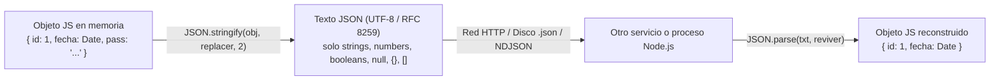

# GUÍA DE ESTUDIO — Módulo 12: JSON en Node.js

**Curso:** CURSO_DESARROLLO_WEB  
**Nivel:** Fundamentos / Intermedio  
**Requisitos:** Node.js 20+ LTS, conocimientos básicos de JavaScript y módulos  
**Objetivo:** Dominar **JSON** (*JavaScript Object Notation*), comprender todas sus características y reglas estrictas (RFC 8259), serializar y deserializar datos con `JSON.stringify()` y `JSON.parse()` (incluyendo `replacer`, `reviver` y `.toJSON()`), evitar trampas comunes en JavaScript y trabajar con archivos y flujos JSON en Node.js.

---

## 1. ¿Qué es JSON y cuáles son sus características?

**JSON** (*JavaScript Object Notation*) es un formato ligero de intercambio y almacenamiento de datos basado en texto plano. Aunque nació inspirado en la sintaxis de objetos de JavaScript, hoy es un estándar abierto (**RFC 8259** / **ECMA-404**) independiente del lenguaje.

### Características principales de JSON

1. **Texto plano y codificación UTF-8:** Cualquier lenguaje (Node.js, Python, Go, Java, Rust, C#) puede leerlo y generarlo sin librerías propietarias.
2. **Ligero y legible por humanos:** Tiene mucha menos verbosidad que XML, reduciendo tamaño en red y facilitando la depuración.
3. **Estructurado en dos colecciones universales:**
   - **Objetos** (`{ "clave": valor }`): pares clave–valor sin orden garantizado.
   - **Arreglos** (`[ valor1, valor2 ]`): listas ordenadas por índice.
4. **Sintaxis estricta (no es un objeto JS literal):** No admite comentarios, comas finales ni comillas simples; esto garantiza que cualquier *parser* lo interprete igual.
5. **Solo datos, sin lógica:** JSON no transporta funciones, métodos, clases ni prototipos; únicamente representa valores estáticos.
6. **Base de APIs REST, configuraciones y bases NoSQL:** Es el formato estándar en `fetch`/HTTP, `package.json`, `tsconfig.json`, JWT payloads, logs estructurados y documentos en MongoDB/PostgreSQL (`jsonb`).

---

## 2. Tipos de datos válidos y reglas de sintaxis

En JSON **solo existen 6 tipos de valores**:

| Tipo | Ejemplo válido | Notas clave |
| :--- | :--- | :--- |
| `string` | `"hola mundo"` | **Siempre** con comillas dobles `"..."` |
| `number` | `42`, `-3.14`, `1e5` | Enteros o decimales (sin `NaN`, `Infinity` ni `0xFF`) |
| `boolean` | `true`, `false` | En minúsculas |
| `null` | `null` | Representa ausencia explícita de valor |
| `object` | `{ "id": 1, "ok": true }` | Claves **siempre** entre comillas dobles |
| `array` | `["node", 20, null]` | Sin coma después del último elemento |

### JSON válido vs. Objeto JS (errores frecuentes)

```json
// ❌ INVÁLIDO como JSON (pero válido en JS):
{
  nombre: 'Ana',          // claves sin comillas y comillas simples
  edad: 28,               // coma final (trailing comma)
  activo: undefined,      // undefined no existe en JSON
  saludar: () => 'hola',  // funciones no existen en JSON
}
```

```json
{
  "nombre": "Ana",
  "edad": 28,
  "activo": true,
  "etiquetas": ["backend", "node"]
}
```

---

## 3. `JSON.parse()` y el parámetro `reviver`

`JSON.parse(texto, reviver?)` convierte una cadena JSON válida en valores nativos de JavaScript. Si el texto tiene un error de sintaxis, lanza `SyntaxError`.

```js
// Parsing seguro con try/catch
function parsearSeguro(texto) {
  try {
    return { ok: true, data: JSON.parse(texto) };
  } catch (err) {
    return { ok: false, error: err.message };
  }
}
```

### Transformar valores al vuelo con `reviver`

El segundo parámetro (`reviver`) es una función `(clave, valor) => nuevoValor` que recorre el árbol de abajo hacia arriba. Es ideal para reconstruir fechas ISO en objetos `Date` o filtrar claves peligrosas como `__proto__`:

```js
const raw = '{"evento":"deploy","fecha":"2026-11-23T22:00:00.000Z"}';

const isoRegex = /^\d{4}-\d{2}-\d{2}T\d{2}:\d{2}:\d{2}(\.\d+)?Z$/;
const data = JSON.parse(raw, (clave, valor) => {
  if (clave === '__proto__' || clave === 'constructor') return undefined;
  if (typeof valor === 'string' && isoRegex.test(valor)) {
    return new Date(valor);
  }
  return valor;
});

console.log(data.fecha instanceof Date); // true
```

---

## 4. `JSON.stringify()`, `replacer`, `space` y `.toJSON()`

`JSON.stringify(valor, replacer?, space?)` serializa un valor de JavaScript a una cadena JSON.

- **`replacer` como arreglo:** lista blanca de propiedades permitidas.
- **`replacer` como función:** `(clave, valor) => ...`; si retorna `undefined`, la propiedad se omite.
- **`space`:** número de espacios (ej. `2`) o cadena (ej. `'\t'`) para formateo legible (*pretty print*).

```js
const usuario = {
  id: 101,
  nombre: 'Lucía',
  passwordHash: 'scrypt$secreto',
  rol: 'admin'
};

// 1) Lista blanca con arreglo
console.log(JSON.stringify(usuario, ['id', 'nombre'], 2));

// 2) Filtro con función replacer
const publico = JSON.stringify(
  usuario,
  (clave, valor) => (clave === 'passwordHash' ? undefined : valor),
  2
);
```

### Personalizar la serialización con `.toJSON()`

Si un objeto implementa el método `toJSON()`, `JSON.stringify()` lo invoca automáticamente antes de serializar:

```js
class Cuenta {
  constructor(titular, saldo, tokenSecreto) {
    this.titular = titular;
    this.saldo = saldo;
    this.tokenSecreto = tokenSecreto;
  }
  toJSON() {
    return { titular: this.titular, saldo: this.saldo };
  }
}

console.log(JSON.stringify(new Cuenta('Carlos', 500, 'xyz')));
// '{"titular":"Carlos","saldo":500}'
```

---

## 5. Comportamientos especiales y trampas comunes

| Valor en JS | Resultado en `JSON.stringify()` | Solución / precaución |
| :--- | :--- | :--- |
| `undefined`, `Function`, `Symbol` en objeto | Se **omite** la propiedad | Usar `null` si quieres conservar la clave |
| `undefined`, `Function`, `Symbol` en array | Se convierte en **`null`** | Validar elementos antes de serializar |
| `NaN`, `Infinity`, `-Infinity` | Se convierte en **`null`** | Validar con `Number.isFinite()` |
| `Date` | Se convierte en **string ISO 8601** | Usar `reviver` en `JSON.parse()` |
| `Map` / `Set` | Se serializa como **`{}`** vacío | Convertir con `Object.fromEntries(map)` o `[...set]` |
| `BigInt` (`10n`) | Lanza **`TypeError`** | Convertir a `String(n)` con `replacer` |
| Referencia circular (`a.self = a`) | Lanza **`TypeError`** | Evitar ciclos o usar `WeakSet` en `replacer` |

---

## 6. JSON en Node.js: archivos, imports y NDJSON

### A) Leer y escribir JSON con `node:fs/promises`

```js
import { readFile, writeFile } from 'node:fs/promises';

export async function leerJson(ruta) {
  const texto = await readFile(ruta, 'utf8');
  return JSON.parse(texto);
}

export async function guardarJson(ruta, datos) {
  const texto = JSON.stringify(datos, null, 2) + '\n';
  await writeFile(ruta, texto, 'utf8');
}
```

### B) Importar archivos `.json` directamente

- **CommonJS:** `const pkg = require('./package.json');` (sincrónico, cacheado).
- **ES Modules (Node 20.10+ / 22+):** `import pkg from './package.json' with { type: 'json' };`
- **Alternativa portable en ESM:**

```js
import { createRequire } from 'node:module';
const require = createRequire(import.meta.url);
const pkg = require('./package.json');
```

### C) NDJSON (Newline Delimited JSON) para archivos grandes

Un archivo JSON gigante (`[ {...}, {...} ]`) obliga a cargarlo entero en memoria para hacer `JSON.parse()`. Con **NDJSON** (`.ndjson` / `.jsonl`), **cada línea es un JSON independiente**, ideal para logs y *streams* en Node.js:

```ndjson
{"ts":"2026-11-23T22:00:00Z","level":"info","msg":"Servidor iniciado"}
{"ts":"2026-11-23T22:00:05Z","level":"warn","msg":"Latencia alta"}
```

---

## 7. Buenas prácticas y seguridad

1. **Nunca uses `eval()` para leer JSON:** Usa siempre `JSON.parse()`, que no ejecuta código arbitrario.
2. **Envuelve `JSON.parse()` en `try/catch`:** Cualquier entrada externa (HTTP body, archivo, query) puede llegar corrupta.
3. **Valida la estructura tras parsear:** Que sea JSON válido no significa que tenga los campos esperados; valida tipos o usa un validador (como Zod o AJV).
4. **Limita el tamaño del payload en APIs:** Un JSON de decenas de megabytes bloquea el hilo principal durante `JSON.parse()`.
5. **No serialices secretos:** Usa `replacer` o `.toJSON()` para excluir contraseñas, tokens o claves privadas.

---

## 8. Analogía visual y flujo de serialización

Piensa en JSON como una **caja de envío internacional estandarizada**: antes de enviar un objeto vivo de JavaScript por red o guardarlo en disco, lo empaquetas en texto plano (`JSON.stringify`), y al recibirlo en otro servicio lo desempaquetas (`JSON.parse`).



---

## 9. Pruebas automatizadas con `node --test`

Guarda como `json.test.mjs` y ejecuta `node --test json.test.mjs`:

```js
import test from 'node:test';
import assert from 'node:assert/strict';

test('replacer oculta campos sensibles y reviver restaura Date', () => {
  const original = { user: 'ana', secret: '1234', createdAt: new Date('2026-01-01T00:00:00.000Z') };
  const texto = JSON.stringify(original, (k, v) => (k === 'secret' ? undefined : v));
  assert.equal(texto.includes('1234'), false);

  const restaurado = JSON.parse(texto, (k, v) => (k === 'createdAt' ? new Date(v) : v));
  assert.equal(restaurado.createdAt instanceof Date, true);
  assert.equal(restaurado.user, 'ana');
});
```

---

## 10. Ejercicios prácticos y solucionario

### Ejercicios

1. **Validador seguro:** Escribe `parsearConfig(texto)` que devuelva el objeto si el JSON es válido, o `{ error: true, mensaje }` si falla.
2. **Limpieza de datos sensibles:** Serializa `{ id: 7, email: 'a@b.com', token: 'abc', extra: undefined }` ocultando `token` con `replacer` e indentando con 2 espacios.
3. **NDJSON parser:** Dado un texto con 3 líneas JSON separadas por `\n`, conviértelo en un arreglo de objetos ignorando líneas vacías.

### Solucionario

```js
// 1. Validador seguro
function parsearConfig(texto) {
  try {
    return JSON.parse(texto);
  } catch (err) {
    return { error: true, mensaje: err.message };
  }
}

// 2. Limpieza de datos sensibles
const salida = JSON.stringify(
  { id: 7, email: 'a@b.com', token: 'abc', extra: undefined },
  (clave, valor) => (clave === 'token' ? undefined : valor),
  2
);

// 3. NDJSON parser
function parseNdjson(texto) {
  return texto
    .split(/\r?\n/)
    .map((linea) => linea.trim())
    .filter(Boolean)
    .map((linea) => JSON.parse(linea));
}
```

---

## ✅ Checklist de dominio del módulo

- [ ] Explicar las características principales de JSON y por qué no es un objeto JS literal.
- [ ] Identificar los 6 tipos válidos en JSON y detectar errores de sintaxis (comas finales, comillas simples, comentarios).
- [ ] Usar `JSON.parse()` dentro de `try/catch` y aplicar `reviver` para transformar tipos como `Date`.
- [ ] Usar `JSON.stringify()` con `replacer`, `space` y `.toJSON()` para formatear y filtrar datos sensibles.
- [ ] Prevenir trampas con `undefined`, `NaN`, `Map`/`Set`, `BigInt` y referencias circulares.
- [ ] Leer, escribir e importar archivos `.json` y `.ndjson` en Node.js.
