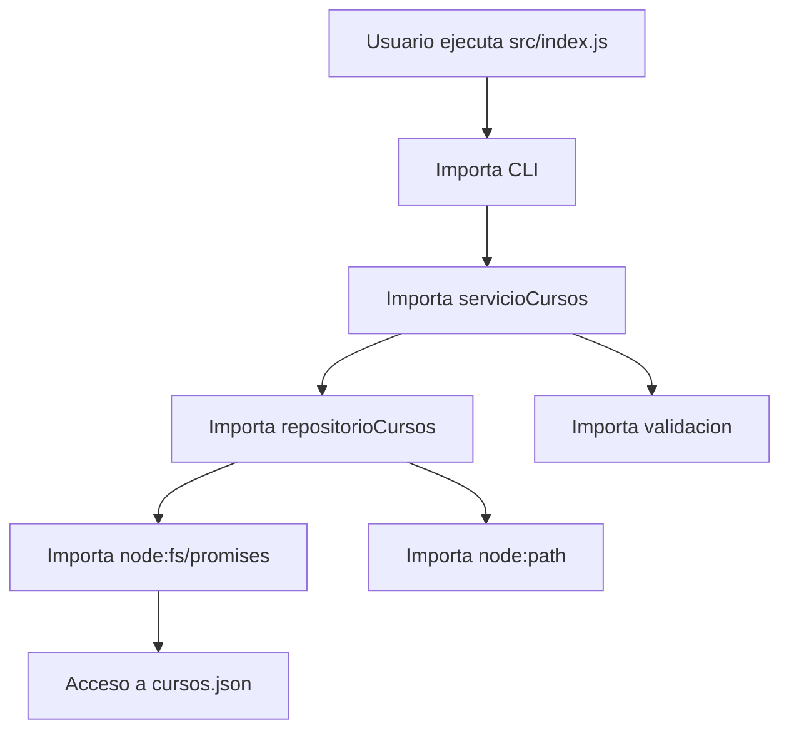

# Módulos en Node.js — Guía completa


## 1. Definición: ¿qué es un módulo?

Un **módulo** es un archivo o unidad de código con una responsabilidad concreta que puede ofrecer funcionalidades a otros archivos mediante exportaciones. En Node.js, cada módulo tiene su propio ámbito: sus variables internas no pasan automáticamente a ser globales.

Ejemplo: `saludos.cjs`:

```js
function saludar(nombre) {
  return `Hola, ${nombre}`;
}
module.exports = { saludar };
```

Archivo `app.cjs`:

```js
const { saludar } = require('./saludos.cjs');
console.log(saludar('Ana'));
```

Ejecuta `node app.cjs`. Salida: `Hola, Ana`.

## 2. ¿Por qué modularizar una aplicación?

- **Mantenibilidad:** cada archivo tiene un propósito.
- **Reutilización:** la misma función puede utilizarse en varios programas.
- **Pruebas:** es más fácil verificar unidades pequeñas.
- **Colaboración:** diferentes personas trabajan en módulos distintos.
- **Escalabilidad:** el crecimiento no obliga a concentrar todo en `app.js`.

Evita tanto un archivo gigante como dividir funciones triviales en decenas de archivos sin necesidad.

## 3. Tipos de módulos en Node.js

1. **Nativos o integrados:** vienen con Node.js (`node:fs`, `node:path`, `node:os`).
2. **Locales:** archivos creados dentro del proyecto (`./servicios/cursos.js`).
3. **Externos:** paquetes instalados desde npm u otra fuente (`express`, `chalk`).

Además, hay **dos sistemas principales de módulos**: CommonJS (CJS) y ECMAScript Modules (ESM). No confundas origen del módulo con su sistema de carga.

## 4. CommonJS: `require()`, `module.exports` y `exports`

CommonJS es el sistema tradicional de módulos de Node.js. La carga con `require()` es normalmente síncrona.

`operaciones.cjs`:

```js
function sumar(a, b) { return a + b; }
function restar(a, b) { return a - b; }
module.exports = { sumar, restar };
```

`main.cjs`:

```js
const operaciones = require('./operaciones.cjs');
console.log(operaciones.sumar(8, 5)); // 13
```

También puedes escribir `exports.sumar = sumar`, porque inicialmente `exports` referencia el mismo objeto que `module.exports`. **Error frecuente:** `exports = { sumar }` solo reasigna la variable local y no cambia lo exportado. Para reemplazar el objeto completo, utiliza `module.exports = ...`.

```js
// Válido
exports.multiplicar = (a, b) => a * b;
// Válido
module.exports = { multiplicar: (a, b) => a * b };
// Incorrecto si quieres reemplazar lo exportado
exports = { multiplicar: (a, b) => a * b };
```

## 5. ECMAScript Modules: `import` y `export`

ESM es el sistema estándar de JavaScript, compatible con Node.js y navegadores modernos. Sus importaciones estáticas se analizan antes de ejecutar el módulo.

`matematicas.mjs`:

```js
export function sumar(a, b) { return a + b; }
export const PI = 3.14159;
```

`main.mjs`:

```js
import { sumar, PI } from './matematicas.mjs';
console.log(sumar(2, 3), PI);
```

Ejecuta `node main.mjs`. Para ESM local usa la extensión completa en la ruta relativa.

## 6. Exportaciones nombradas y por defecto

**Nombradas:** permiten exportar múltiples valores y se importan entre llaves.

```js
// usuarios.mjs
export const rol = 'estudiante';
export function crearUsuario(nombre) { return { nombre, rol }; }
// app.mjs
import { rol, crearUsuario as nuevoUsuario } from './usuarios.mjs';
console.log(nuevoUsuario('Luis'), rol);
```

**Por defecto:** hay una sola exportación predeterminada por módulo; el importador elige el nombre local.

```js
// mensaje.mjs
export default function mensaje(nombre) { return `Bienvenido, ${nombre}`; }
// inicio.mjs
import bienvenida from './mensaje.mjs';
console.log(bienvenida('Laura'));
```

Se pueden combinar ambas modalidades, pero para APIs con varias funciones suelen ser claras las exportaciones nombradas.

## 7. Diferencias entre CommonJS y ESM

| Característica | CommonJS | ESM |
|---|---|---|
| Sintaxis | `require`, `module.exports` | `import`, `export` |
| Extensión inequívoca | `.cjs` | `.mjs` |
| Archivo `.js` | Depende de configuración y detección | Depende de configuración y detección |
| Carga típica | `require()` síncrono | Importaciones estáticas; `import()` asíncrono |
| `__dirname` | Disponible | No disponible como global |
| `await` de nivel superior | No en CJS | Sí |
| Caché | `require.cache` | Caché ESM independiente |

**Interoperabilidad:** desde CommonJS puedes usar `await import('./archivo.mjs')` dentro de una función asíncrona. Algunas versiones modernas de Node permiten `require()` de determinados ESM síncronos, pero para compatibilidad y claridad no dependas de ello en ejercicios introductorios.

## 8. Configuración de `package.json` y extensiones

```json
{
  "name": "ejemplo-modulos",
  "version": "1.0.0",
  "private": true,
  "type": "module",
  "scripts": { "start": "node src/index.js" }
}
```

Con `"type": "module"`, los `.js` de ese ámbito se interpretan como ESM; con `"type": "commonjs"`, como CJS. `.mjs` siempre indica ESM y `.cjs` siempre indica CommonJS. En Node.js modernos, un `.js` ambiguo puede clasificarse por detección de sintaxis; **define `type` explícitamente** para evitar confusiones.

Práctica:

1. Crea `package.json` con el contenido anterior.
2. Crea `src/index.js` con `console.log('Proyecto ESM listo')`.
3. Ejecuta `npm start`.
4. Crea `prueba.cjs` con `console.log(typeof require)` y ejecútalo: verás `function`.

## 9. Resolución de módulos y rutas relativas

- `./archivo.js`: mismo directorio.
- `../archivo.js`: directorio superior.
- `./carpeta/archivo.js`: ruta explícita.
- `node:fs`: módulo integrado.
- `nombre-paquete`: dependencia resuelta según reglas de paquetes y `node_modules`.

```text
proyecto/
├── package.json
└── src/
    ├── index.js
    └── utils/
        └── formato.js
```

Desde `src/index.js`: `import { formatear } from './utils/formato.js'`. Las rutas relativas se interpretan desde el archivo importador, **no** desde la carpeta en que ejecutas el comando.

Los ESM no añaden automáticamente `.js` a imports relativos. Los paquetes pueden usar campos `exports` e `imports` en `package.json`, que controlan las rutas públicas y alias internos.

## 10. Módulos nativos: `node:fs`, `node:path`, `node:os`

`fs` trabaja con archivos; `path` construye rutas; `os` consulta datos del sistema operativo.

```js
// sistema.mjs
import { writeFile, readFile } from 'node:fs/promises';
import path from 'node:path';
import os from 'node:os';

const archivo = path.join(os.tmpdir(), 'ejemplo-modulos-node.txt');
await writeFile(archivo, 'Hola desde Node.js', 'utf8');
const contenido = await readFile(archivo, 'utf8');
console.log({ archivo, contenido, plataforma: os.platform() });
```

Ejecuta `node sistema.mjs`. `node:fs/promises` ofrece métodos asíncronos basados en promesas; para aplicaciones con múltiples solicitudes suele ser preferible a bloquear el hilo con operaciones síncronas.

## 11. Módulos externos y npm

```bash
mkdir demo-npm
cd demo-npm
npm init -y
npm install chalk
```

Configura `"type": "module"` en `package.json` y crea `index.js`:

```js
import chalk from 'chalk';
console.log(chalk.green('Dependencia instalada correctamente'));
```

Ejecuta `node index.js`. **Esta práctica requiere conexión al instalar**; una vez descargado el paquete, podrás usarlo localmente. `package.json` declara dependencias y `package-lock.json` fija su resolución. No edites manualmente `node_modules` ni lo subas al repositorio; usa `.gitignore`.

## 12. Importaciones dinámicas y asincronía

`import()` devuelve una promesa y permite cargar un módulo cuando realmente se necesita.

```js
// reportes.mjs
export function generarReporte() { return 'Reporte generado'; }
// ejecutar.mjs
const { generarReporte } = await import('./reportes.mjs');
console.log(generarReporte());
```

También puedes usarlo dentro de una función:

```js
async function cargarReporte() {
  const modulo = await import('./reportes.mjs');
  return modulo.generarReporte();
}
```

No confundas carga dinámica con paralelismo: `import()` es asíncrono, pero el código JavaScript que ejecuta el módulo no se convierte automáticamente en trabajo paralelo.

## 13. Caché de módulos y estado compartido

Node normalmente evalúa un módulo una vez por identidad de módulo resuelta y reutiliza su instancia. Por ello, un estado mutable exportado puede ser compartido.

`contador.cjs`:

```js
let total = 0;
module.exports = { incrementar: () => ++total, leer: () => total };
```

`demo.cjs`:

```js
const a = require('./contador.cjs');
const b = require('./contador.cjs');
console.log(a.incrementar()); // 1
console.log(b.leer());        // 1
console.log(a === b);         // true
```

La caché de CJS se puede inspeccionar con `require.cache`. La caché de ESM funciona de otra manera y no está expuesta mediante `require.cache`. Evita depender de estado global implícito: para estados independientes, exporta una **función fábrica**.

```js
export function crearContador() {
  let total = 0;
  return { incrementar: () => ++total, leer: () => total };
}
```

## 14. `__dirname`, `__filename` e `import.meta.url`

En CommonJS:

```js
console.log(__dirname);  // Directorio del módulo
console.log(__filename); // Ruta completa del módulo
```

En ESM, la alternativa portable es:

```js
import { fileURLToPath } from 'node:url';
import path from 'node:path';
const __filename = fileURLToPath(import.meta.url);
const __dirname = path.dirname(__filename);
console.log(__dirname);
```

En versiones recientes de Node existen además `import.meta.dirname` e `import.meta.filename` para módulos locales, pero el patrón anterior resulta útil para entender y mantener compatibilidad con distintas versiones.

## 15. Dependencias circulares

Ocurren cuando A importa B y B importa A, directa o indirectamente.

```text
A → B → A
```

En CJS puede observarse un objeto de exportaciones todavía incompleto. En ESM, acceder demasiado pronto a una vinculación puede producir errores de inicialización. Soluciones: extraer lo compartido a un tercer módulo, invertir dependencias o pasar funciones y datos como argumentos.

```text
ANTES: A ↔ B
DESPUÉS: A → compartido ← B
```

## 16. Diseño modular y separación de responsabilidades

Para el gestor de cursos usaremos capas:

- **Modelo y validación:** define la forma y las reglas de los datos.
- **Repositorio:** lee y escribe información.
- **Servicio:** implementa las reglas del negocio.
- **Interfaz CLI:** recibe órdenes y muestra resultados.

Un módulo no debería mezclar innecesariamente interacción con el usuario, lógica de negocio y persistencia.

## 17. Analogías del mundo real

Una aplicación modular se parece a un restaurante: cocina (servicio), almacén (repositorio) y mesero (interfaz) colaboran mediante pedidos claros. También se parece a un conjunto de piezas LEGO: cada pieza tiene una función y una forma de conexión. La analogía tiene límites: los módulos pueden compartir referencias y estado, por lo que no siempre están completamente aislados.

## 18. Diagrama de flujo de importaciones



Orden conceptual: el punto de entrada importa la interfaz, la interfaz usa servicios, los servicios consultan el repositorio y las reglas de validación. **Nota:** este diagrama representa dependencias, no garantiza un orden temporal único de evaluación en todos los casos.

## 19. Buenas prácticas y errores comunes

| Buena práctica | Error común | Corrección |
|---|---|---|
| Definir `"type"` | Mezclar sintaxis sin configuración | Elegir ESM o CJS deliberadamente |
| Incluir `.js` en rutas ESM | `import './utils'` | `import './utils.js'` |
| Usar `node:` para integrados | Confundir paquete con integrado | `import fs from 'node:fs'` |
| Exportar API mínima | Exportar todo | Exponer solo funciones necesarias |
| Separar lógica y E/S | Leer archivos dentro de validadores | Crear repositorio independiente |
| Manejar errores de lectura | Suponer que todo archivo existe | Tratar `ENOENT` explícitamente |
| Evitar ciclos | Módulos que se importan mutuamente | Extraer dependencias compartidas |
| Validar entradas | Confiar en datos de CLI o JSON | Comprobar tipos y restricciones |

## 20. Laboratorio guiado paso a paso

**Objetivo:** crear una calculadora modular ESM sin paquetes externos.

**Paso 1.** Crea una carpeta `laboratorio-modulos` y entra en ella.

```bash
mkdir laboratorio-modulos
cd laboratorio-modulos
npm init -y
```

**Paso 2.** Modifica `package.json` para incluir `"type": "module"`.

**Paso 3.** Crea `operaciones.js`:

```js
export const sumar = (a, b) => a + b;
export const restar = (a, b) => a - b;
export const dividir = (a, b) => {
  if (b === 0) throw new Error('No se puede dividir por cero');
  return a / b;
};
```

**Paso 4.** Crea `formato.js`:

```js
export default function mostrarOperacion(nombre, resultado) {
  return `${nombre}: ${resultado}`;
}
```

**Paso 5.** Crea `index.js`:

```js
import { sumar, restar, dividir } from './operaciones.js';
import mostrarOperacion from './formato.js';
console.log(mostrarOperacion('Suma', sumar(10, 5)));
console.log(mostrarOperacion('Resta', restar(10, 5)));
console.log(mostrarOperacion('División', dividir(10, 5)));
```

**Paso 6.** Ejecuta `node index.js`.

**Salida esperada:**

```text
Suma: 15
Resta: 5
División: 2
```

**Paso 7.** Prueba `dividir(10, 0)` dentro de `try/catch` y registra el mensaje de error.

**Paso 8.** Repite el ejercicio con `.cjs`, `require()` y `module.exports` para comparar.

## 21. Proyecto integrador: gestor modular de cursos

Construiremos una aplicación de terminal que permite **listar, crear, buscar y eliminar cursos** y guarda los datos en JSON. Funciona sin conexión y sin dependencias externas.

### 21.1 Estructura final

```text
gestor-cursos/
├── package.json
├── data/
│   └── cursos.json           (se crea automáticamente)
└── src/
    ├── index.js
    ├── cli.js
    ├── services/
    │   └── cursosService.js
    ├── repositories/
    │   └── cursosRepository.js
    └── utils/
        └── validarCurso.js
```

### 21.2 Crear el proyecto

```bash
mkdir gestor-cursos
cd gestor-cursos
npm init -y
```

Crea las carpetas `src`, `src/services`, `src/repositories`, `src/utils` y `data` desde tu editor o explorador. Sustituye `package.json` por:

```json
{
  "name": "gestor-cursos",
  "version": "1.0.0",
  "private": true,
  "type": "module",
  "scripts": {
    "start": "node src/index.js",
    "test": "node --test"
  }
}
```

### 21.3 Validación — `src/utils/validarCurso.js`

```js
export function validarTitulo(titulo) {
  if (typeof titulo !== 'string' || titulo.trim().length < 3) {
    throw new Error('El título debe tener al menos 3 caracteres');
  }
  return titulo.trim();
}

export function validarDuracion(duracion) {
  const numero = Number(duracion);
  if (!Number.isInteger(numero) || numero <= 0) {
    throw new Error('La duración debe ser un entero positivo');
  }
  return numero;
}
```

### 21.4 Persistencia — `src/repositories/cursosRepository.js`

```js
import { mkdir, readFile, writeFile } from 'node:fs/promises';
import path from 'node:path';
import { fileURLToPath } from 'node:url';

const carpetaActual = path.dirname(fileURLToPath(import.meta.url));
const rutaDatos = path.resolve(carpetaActual, '../../data/cursos.json');

export async function leerCursos() {
  try {
    const texto = await readFile(rutaDatos, 'utf8');
    const cursos = JSON.parse(texto);
    if (!Array.isArray(cursos)) throw new Error('El archivo no contiene una lista');
    return cursos;
  } catch (error) {
    if (error.code === 'ENOENT') return [];
    throw error;
  }
}

export async function guardarCursos(cursos) {
  await mkdir(path.dirname(rutaDatos), { recursive: true });
  await writeFile(rutaDatos, JSON.stringify(cursos, null, 2), 'utf8');
}
```

**Importante:** este repositorio es apropiado para una CLI local con una operación a la vez. No implementa bloqueos ni escrituras atómicas para múltiples procesos simultáneos.

### 21.5 Lógica de negocio — `src/services/cursosService.js`

```js
import { leerCursos, guardarCursos } from '../repositories/cursosRepository.js';
import { validarTitulo, validarDuracion } from '../utils/validarCurso.js';

export async function listarCursos() {
  return leerCursos();
}

export async function crearCurso(titulo, duracion) {
  const tituloLimpio = validarTitulo(titulo);
  const horas = validarDuracion(duracion);
  const cursos = await leerCursos();
  const id = cursos.reduce((max, curso) => Math.max(max, curso.id), 0) + 1;
  const nuevo = { id, titulo: tituloLimpio, duracionHoras: horas };
  cursos.push(nuevo);
  await guardarCursos(cursos);
  return nuevo;
}

export async function buscarCurso(id) {
  const cursos = await leerCursos();
  return cursos.find(curso => curso.id === Number(id)) ?? null;
}

export async function eliminarCurso(id) {
  const cursos = await leerCursos();
  const restantes = cursos.filter(curso => curso.id !== Number(id));
  if (restantes.length === cursos.length) return false;
  await guardarCursos(restantes);
  return true;
}
```

### 21.6 Interfaz de comandos — `src/cli.js`

```js
import { listarCursos, crearCurso, buscarCurso, eliminarCurso } from './services/cursosService.js';

export async function ejecutarCLI(argumentos) {
  const [comando, ...params] = argumentos;

  switch (comando) {
    case 'listar': {
      const cursos = await listarCursos();
      console.table(cursos);
      break;
    }
    case 'crear': {
      const [titulo, duracion] = params;
      const nuevo = await crearCurso(titulo, duracion);
      console.log('Curso creado:', nuevo);
      break;
    }
    case 'buscar': {
      const curso = await buscarCurso(params[0]);
      console.log(curso ?? 'Curso no encontrado');
      break;
    }
    case 'eliminar': {
      const eliminado = await eliminarCurso(params[0]);
      console.log(eliminado ? 'Curso eliminado' : 'Curso no encontrado');
      break;
    }
    default:
      console.log('Uso: node src/index.js <listar|crear|buscar|eliminar> [argumentos]');
      console.log('Ejemplo: node src/index.js crear "Node.js básico" 12');
  }
}
```

### 21.7 Punto de entrada — `src/index.js`

```js
import { ejecutarCLI } from './cli.js';

try {
  await ejecutarCLI(process.argv.slice(2));
} catch (error) {
  console.error('Error:', error.message);
  process.exitCode = 1;
}
```

### 21.8 Ejecutar y comprobar

Desde la raíz `gestor-cursos`:

```bash
node src/index.js listar
node src/index.js crear "Fundamentos de Node.js" 12
node src/index.js crear "JavaScript moderno" 20
node src/index.js listar
node src/index.js buscar 1
node src/index.js eliminar 1
node src/index.js listar
```

**Resultado esperado:** tras crear dos cursos, `listar` muestra dos filas; `buscar 1` devuelve el primer curso; `eliminar 1` confirma la eliminación; el último `listar` muestra únicamente el segundo curso. Revisa `data/cursos.json` para verificar persistencia. Si vuelves a iniciar la aplicación, los cursos permanecen guardados.

**Pruebas de errores:** intenta `crear "AB" 5`, `crear "Curso" 0` y `buscar 999`. Los dos primeros deben producir errores controlados; el último debe mostrar que no existe el curso.

### 21.9 Pruebas automatizadas (sin paquetes)

Crea `src/utils/validarCurso.test.js`:

```js
import test from 'node:test';
import assert from 'node:assert/strict';
import { validarTitulo, validarDuracion } from './validarCurso.js';

test('acepta títulos válidos y elimina espacios', () => {
  assert.equal(validarTitulo('  Node.js  '), 'Node.js');
});

test('rechaza títulos cortos', () => {
  assert.throws(() => validarTitulo('AB'), /al menos 3/);
});

test('valida duración positiva', () => {
  assert.equal(validarDuracion('12'), 12);
  assert.throws(() => validarDuracion(0), /entero positivo/);
});
```

Ejecuta `npm test`. Deben pasar las tres pruebas.

### 21.10 Retos de ampliación

1. Agrega el comando `actualizar` para cambiar título o duración.
2. Implementa `estadisticas` con número de cursos y suma de horas.
3. Evita títulos duplicados ignorando mayúsculas y espacios exteriores.
4. Crea exportación de cursos a CSV en un módulo separado.
5. Introduce pruebas de servicio con un repositorio temporal o inyectado, evitando modificar los datos reales.

## 22. Ejercicios de tres niveles

### Nivel básico

**B1.** Crea `saludos.mjs` con dos exportaciones nombradas: `hola(nombre)` y `adios(nombre)`. Impórtalas en `main.mjs` y muestra sus resultados.

**B2.** Convierte un archivo CommonJS que exporta `sumar` y `multiplicar` a ESM. Explica dos cambios necesarios.

**B3.** Importa `node:os` y muestra la plataforma y la arquitectura del equipo.

### Nivel intermedio

**I1.** Crea `precios.js` que exporte `calcularIVA(precio, tasa)` y una función por defecto que dé formato al precio. Valida que precio y tasa sean números no negativos.

**I2.** Implementa un módulo `contador.js` con una fábrica de contadores independientes. Demuestra que incrementar uno no modifica otro.

**I3.** Crea `reporte.js` y cárgalo mediante `import()` solo si una variable `generar` es verdadera.

### Nivel avanzado

**A1.** Refactoriza dos módulos con importaciones circulares: extrae utilidades comunes a `compartido.js` y elimina el ciclo.

**A2.** Añade al gestor de cursos un comando `estadisticas` que muestre total de cursos y horas acumuladas.

**A3.** Escribe una prueba automatizada para comprobar que un título de dos caracteres se rechaza y una duración decimal se rechaza.

**Criterios de entrega:** código ejecutable, nombres descriptivos, imports correctos, captura de pantalla o salida de terminal, y breve explicación de las decisiones.

## 23. Solucionario paso a paso

### B1. Saludos

`saludos.mjs`:

```js
export const hola = nombre => `Hola, ${nombre}`;
export const adios = nombre => `Adiós, ${nombre}`;
```

`main.mjs`:

```js
import { hola, adios } from './saludos.mjs';
console.log(hola('Sofía'));
console.log(adios('Sofía'));
```

Ejecuta `node main.mjs`. La primera línea saluda y la segunda se despide.

### B2. Conversión de CJS a ESM

Antes: `module.exports = { sumar, multiplicar }` y `require('./operaciones.cjs')`. Después:

```js
// operaciones.mjs
export const sumar = (a, b) => a + b;
export const multiplicar = (a, b) => a * b;
// main.mjs
import { sumar, multiplicar } from './operaciones.mjs';
console.log(sumar(3, 4), multiplicar(3, 4));
```

Cambios: usar `export`/`import` y emplear `.mjs` (o `.js` con `type: module`).

### B3. Sistema operativo

```js
import os from 'node:os';
console.log('Plataforma:', os.platform());
console.log('Arquitectura:', os.arch());
```

### I1. Precios

```js
// precios.mjs
export function calcularIVA(precio, tasa) {
  if (!Number.isFinite(precio) || precio < 0 || !Number.isFinite(tasa) || tasa < 0) {
    throw new Error('Precio y tasa deben ser números no negativos');
  }
  return precio * tasa;
}
export default function formatearPrecio(valor) {
  if (!Number.isFinite(valor)) throw new Error('Valor inválido');
  return `$${valor.toFixed(2)}`;
}
// main.mjs (archivo separado)
// import formatearPrecio, { calcularIVA } from './precios.mjs';
// console.log(formatearPrecio(100 + calcularIVA(100, 0.19)));
```

Guarda el import y `console.log` comentados en un `main.mjs` aparte, quitando `//` para ejecutarlos. Resultado: `$119.00`.

### I2. Contadores independientes

```js
// contador.mjs
export function crearContador() {
  let valor = 0;
  return { incrementar: () => ++valor, leer: () => valor };
}
// main.mjs
import { crearContador } from './contador.mjs';
const uno = crearContador();
const dos = crearContador();
uno.incrementar();
console.log(uno.leer(), dos.leer()); // 1 0
```

Cada llamada crea un cierre con su propia variable `valor`.

### I3. Importación condicional

```js
// reporte.mjs
export const generarReporte = () => 'Informe listo';
// main.mjs
const generar = true;
if (generar) {
  const { generarReporte } = await import('./reporte.mjs');
  console.log(generarReporte());
}
```

### A1. Eliminar dependencia circular

```js
// compartido.mjs
export const normalizar = texto => texto.trim().toLowerCase();
// usuarios.mjs
import { normalizar } from './compartido.mjs';
export const nombreUsuario = nombre => normalizar(nombre);
// cursos.mjs
import { normalizar } from './compartido.mjs';
export const nombreCurso = titulo => normalizar(titulo);
```

Ambos módulos dependen del tercero, pero no uno del otro.

### A2. Estadísticas del gestor

Agrega a `src/services/cursosService.js`:

```js
export async function obtenerEstadisticas() {
  const cursos = await leerCursos();
  return {
    totalCursos: cursos.length,
    totalHoras: cursos.reduce((total, curso) => total + curso.duracionHoras, 0)
  };
}
```

En `src/cli.js`, añade `obtenerEstadisticas` al import del servicio y, antes de `default`, agrega:

```js
case 'estadisticas': {
  console.log(await obtenerEstadisticas());
  break;
}
```

Prueba `node src/index.js estadisticas`. Actualiza también el texto de ayuda para incluir el nuevo comando.

### A3. Pruebas de validación

Agrega a `src/utils/validarCurso.test.js`:

```js
test('rechaza un título de dos caracteres', () => {
  assert.throws(() => validarTitulo('JS'), /al menos 3/);
});

test('rechaza duración decimal', () => {
  assert.throws(() => validarDuracion(2.5), /entero positivo/);
});
```

Ejecuta `npm test` y comprueba que pasan cinco pruebas.

## 24. Evaluación

**Tiempo sugerido:** 35 minutos. **Puntaje:** 100 puntos.

### Parte A: selección múltiple (5 × 8 = 40 puntos)

1. ¿Qué permite exportar un objeto completo en CJS? A) `module.exports` B) `import` C) `await` D) `package-lock`.
2. ¿Qué extensión indica inequívocamente ESM? A) `.json` B) `.mjs` C) `.cjs` D) `.txt`.
3. ¿Qué devuelve `import('./modulo.mjs')`? A) Un número B) Una promesa C) Un booleano D) Una ruta.
4. ¿Qué módulo nativo permite trabajar con rutas? A) `node:path` B) `node:os` C) `node:http` D) `node:events`.
5. ¿Qué problema puede causar una dependencia circular? A) Una exportación parcialmente inicializada B) Desinstalar npm C) Borrar automáticamente archivos D) Cambiar la versión de Node.

### Parte B: respuestas cortas (3 × 10 = 30 puntos)

6. Explica la diferencia entre exportación nombrada y por defecto con un ejemplo.
7. ¿Por qué las rutas relativas de ESM deben escribirse de forma explícita?
8. Explica cómo puede compartirse estado entre dos importadores y cómo evitarlo.

### Parte C: práctica (30 puntos)

9. Crea dos módulos ESM: `validacion.mjs`, que exporte `esPositivo(numero)`, y `main.mjs`, que importe la función, compruebe 5 y -3 y muestre los resultados. Asigna 10 puntos a estructura, 10 a imports/exports y 10 a resultados correctos.

**Clave de la parte A:** 1-A, 2-B, 3-B, 4-A, 5-A.

**Guía de la parte B:** 6: nombrada usa llaves y admite varias; por defecto se importa sin llaves. 7: la resolución ESM de rutas relativas exige especificadores completos, incluida la extensión. 8: la instancia del módulo se reutiliza y conserva estado mutable; una fábrica crea instancias separadas.

**Solución de la parte C:**

```js
// validacion.mjs
export const esPositivo = numero => typeof numero === 'number' && numero > 0;
// main.mjs
import { esPositivo } from './validacion.mjs';
console.log(esPositivo(5));  // true
console.log(esPositivo(-3)); // false
```

**Escala orientativa:** 90–100 dominio sólido; 70–89 competente; 50–69 requiere práctica; menos de 50 conviene repasar y repetir el laboratorio.

## 25. Hoja de trucos

| Necesidad | Código |
|---|---|
| Exportar en CJS | `module.exports = { funcion }` |
| Importar en CJS | `const { funcion } = require('./mod.cjs')` |
| Exportación nombrada ESM | `export const x = 1` |
| Importación nombrada ESM | `import { x } from './mod.js'` |
| Exportación por defecto | `export default funcion` |
| Importación por defecto | `import funcion from './mod.js'` |
| Importación dinámica | `await import('./mod.js')` |
| Importar módulo integrado | `import path from 'node:path'` |
| Directorio actual del módulo ESM | `path.dirname(fileURLToPath(import.meta.url))` |
| Ejecutar archivo | `node src/index.js` |
| Ejecutar scripts npm | `npm start` / `npm test` |
| Inspeccionar caché CJS | `require.cache` |

## 26. Resumen técnico y checklist

**Resumen:** Node.js permite construir aplicaciones con módulos locales, nativos y externos. CommonJS usa `require` y `module.exports`; ESM usa `import` y `export`. La configuración del paquete y las extensiones determinan el sistema de módulos. Las importaciones tienen reglas de resolución, caché e inicialización que afectan al comportamiento. Una arquitectura por responsabilidades facilita pruebas y evolución.

### Checklist de dominio

- [ ] Defino qué es un módulo y por qué conviene modularizar.
- [ ] Distingo módulos nativos, locales y externos.
- [ ] Creo y consumo módulos CommonJS.
- [ ] Creo y consumo módulos ESM.
- [ ] Diferencio exportaciones nombradas y por defecto.
- [ ] Configuro correctamente `package.json`.
- [ ] Resuelvo rutas relativas y extensiones.
- [ ] Uso `node:fs/promises`, `node:path` y `node:os`.
- [ ] Instalo y utilizo una dependencia npm.
- [ ] Comprendo `import()` y la asincronía.
- [ ] Reconozco efectos de caché y estado compartido.
- [ ] Obtengo rutas del módulo en CJS y ESM.
- [ ] Detecto y corrijo dependencias circulares.
- [ ] Separo interfaz, negocio, validación y persistencia.
- [ ] Ejecuto el laboratorio sin errores.
- [ ] Construyo el gestor modular de cursos.
- [ ] Resuelvo ejercicios básicos, intermedios y avanzados.
- [ ] Ejecuto las pruebas y apruebo la evaluación.

**Próximo paso sugerido:** profundizar en npm, manejo de errores, eventos, streams y pruebas automatizadas para convertir el gestor en una API HTTP.
