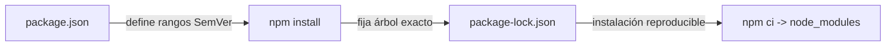

# GUÍA DE ESTUDIO — Módulo 11: NPM y Gestión de Paquetes

**Curso:** CURSO_DESARROLLO_WEB  
**Nivel:** Fundamentos / Intermedio  
**Requisitos:** Node.js 20+ LTS, npm, terminal y VS Code  
**Objetivo:** Dominar `npm` (Node Package Manager) para administrar dependencias externas, comprender el versionado semántico (SemVer), diferenciar `dependencies` de `devDependencies`, usar `package-lock.json` con `npm ci`, ejecutar herramientas con `npx` y automatizar scripts profesionales.

---

## 1. ¿Qué es `npm` y anatomía de `package.json`?

**npm** es el gestor de paquetes estándar de Node.js. Permite instalar bibliotecas de terceros desde el registro oficial, gestionar versiones reproducibles y ejecutar scripts de automatización.

```json
{
  "name": "mi-api-node",
  "version": "1.2.0",
  "private": true,
  "type": "module",
  "scripts": {
    "start": "node src/index.js",
    "dev": "node --watch src/index.js",
    "test": "node --test"
  },
  "dependencies": {
    "express": "^4.21.0"
  },
  "devDependencies": {
    "eslint": "^9.0.0"
  }
}
```

> **Consejo:** Usa `"private": true` en proyectos de aplicaciones para evitar publicarlos accidentalmente en el registro público de npm.

---

## 2. Versionado Semántico (SemVer): `MAJOR.MINOR.PATCH`

Cada paquete publicado en npm sigue el formato **`MAJOR.MINOR.PATCH`** (ejemplo: `4.21.2`):

| Parte | Cuándo sube | Ejemplo |
|---|---|---|
| **MAJOR** (`4`) | Cambios incompatibles (*breaking changes*) | `4.0.0` → `5.0.0` |
| **MINOR** (`21`) | Nuevas funciones compatibles hacia atrás | `4.21.0` → `4.22.0` |
| **PATCH** (`2`) | Corrección de errores (*bugfixes*) | `4.21.2` → `4.21.3` |

### Rangos con `^` (caret) y `~` (tilde)

| Notación | Qué versiones permite actualizar | Ejemplo (`1.4.2`) |
|---|---|---|
| `^1.4.2` | Permite subir **MINOR** y **PATCH** (sin cambiar `MAJOR`) | `>=1.4.2 <2.0.0` |
| `~1.4.2` | Permite subir **solo PATCH** (mantiene `MAJOR.MINOR`) | `>=1.4.2 <1.5.0` |
| `1.4.2` | Versión exacta fija (no actualiza automáticamente) | Solo `1.4.2` |

---

## 3. `dependencies` vs `devDependencies`

| Sección | Para qué sirve | Comando |
|---|---|---|
| `dependencies` | Paquetes necesarios para que la app funcione en producción (`express`, `zod`) | `npm install express` |
| `devDependencies` | Herramientas solo para desarrollo o pruebas (`eslint`, `prettier`) | `npm install -D eslint` |

---

## 4. `package-lock.json`, `npm ci` y scripts

- **`package-lock.json`:** registra el árbol exacto de versiones instaladas (incluyendo subdependencias) para que todo el equipo y los servidores instalen **exactamente lo mismo**. Siempre debe subirse a Git.
- **`npm install` vs `npm ci`:**
  - `npm install`: instala y puede actualizar `package-lock.json`.
  - `npm ci` (*Clean Install*): borra `node_modules` e instala **estrictamente** lo que dice `package-lock.json` (ideal para servidores y CI/CD).
- **Hooks `pre` y `post`:** si defines `"pretest"` o `"postbuild"`, npm los ejecuta automáticamente antes o después de `"test"` o `"build"`.

---

## 5. `npx`, auditoría de seguridad y mantenimiento

| Comando | Función |
|---|---|
| `npx <paquete>` | Ejecuta una herramienta CLI sin instalarla globalmente (ej. `npx eslint .`) |
| `npm outdated` | Muestra qué paquetes tienen versiones más recientes disponibles |
| `npm audit` | Analiza vulnerabilidades conocidas en tus dependencias |
| `npm audit fix` | Aplica actualizaciones seguras compatibles para corregir vulnerabilidades |
| `npm uninstall <pkg>` | Desinstala un paquete y lo elimina de `package.json` |

---

## 6. Buenas prácticas y errores comunes

| Buena práctica | Error que evita |
|---|---|
| Incluir `node_modules/` en `.gitignore` | Subir miles de archivos pesados al repositorio Git |
| Subir `package.json` y `package-lock.json` | Diferencias de versiones entre tu PC y el servidor |
| Usar `npm ci` en despliegues y pipelines | Actualizaciones sorpresa en producción |
| Usar `npm.cmd` si PowerShell bloquea `npm.ps1` | Error de `ExecutionPolicy` sin bajar la seguridad del sistema |

---

## 7. Analogía y diagrama

Imagina una **receta de cocina profesional**:
- `package.json` es la **lista de ingredientes** con márgenes permitidos (`^` o `~`).
- `package-lock.json` es la **factura exacta** con la marca y lote preciso usado para que el plato siempre salga idéntico.
- `node_modules/` es la **despensa temporal** que se reconstruye con `npm ci` cuando llegas a otra cocina.



---

## 8. Proyecto integrador con pruebas (`node --test`)

```js
// test/semver.test.js
import test from 'node:test';
import assert from 'node:assert/strict';

function cumpleCaret(actual, minimo) {
  const [majA, minA, patA] = actual.split('.').map(Number);
  const [majM, minM, patM] = minimo.split('.').map(Number);
  if (majA !== majM) return false;
  if (minA !== minM) return minA > minM;
  return patA >= patM;
}

test('rango ^1.4.2 acepta 1.9.0 y rechaza 2.0.0', () => {
  assert.equal(cumpleCaret('1.9.0', '1.4.2'), true);
  assert.equal(cumpleCaret('2.0.0', '1.4.2'), false);
});
```

---

## 9. Ejercicios por niveles y solucionario

- **Básico:** inicializa una carpeta con `npm init -y`, marca `"private": true` y agrega un script `"saludar": "node -e \"console.log('Hola npm')\""` usando `npm pkg set`.
- **Intermedio:** compara qué versiones acepta `~2.3.1` frente a `^2.3.1` y explica cuál permite pasar a `2.4.0`.
- **Avanzado:** escribe un script de validación en `node --test` que compruebe si un `package.json` tiene `"private": true` y script `"test"`.

### Solucionario rápido
```powershell
npm init -y
npm pkg set private=true
npm pkg set scripts.saludar="node -e \"console.log('Hola npm')\""
npm run saludar
```

---

## 10. Evaluación y checklist de dominio

- [ ] Diferencio `dependencies` de `devDependencies`.
- [ ] Entiendo `MAJOR.MINOR.PATCH` y la diferencia entre `^` y `~`.
- [ ] Sé por qué `package-lock.json` sí va en Git y `node_modules/` no.
- [ ] Sé cuándo usar `npm ci`, `npx` y `npm audit`.
