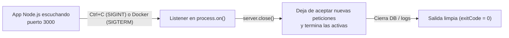

# GUÍA DE ESTUDIO — Módulo 13: Control del Proceso (`node:process`)

**Curso:** CURSO_DESARROLLO_WEB  
**Nivel:** Intermedio  
**Requisitos:** Node.js 20.6+ LTS (22+ recomendado para `loadEnvFile`)  
**Objetivo:** Dominar **`node:process`** para conectar aplicaciones Node.js con el sistema operativo: leer variables de entorno (`.env` nativo), parsear argumentos CLI (`process.argv` y `util.parseArgs`), usar los streams `stdin`/`stdout`/`stderr`, diagnosticar memoria y tiempos, manejar errores globales y aplicar *graceful shutdown* con `SIGINT`/`SIGTERM`.

---

## 1. ¿Qué es `node:process`?

**`process`** es un objeto global en Node.js (también importable explícitamente como `import process from 'node:process'`) que representa el **proceso actual en ejecución** y actúa como puente directo con el sistema operativo.

Además, **`process` hereda de `EventEmitter`**, por lo que emite eventos de ciclo de vida (`'exit'`, `'SIGINT'`, `'SIGTERM'`, `'uncaughtException'`, `'unhandledRejection'`).

---

## 2. Variables de entorno (`process.env`) y `.env` nativo

`process.env` es un objeto con todas las variables de entorno del sistema (puertos, URLs de base de datos, modo `NODE_ENV`, claves secretas). **Todos los valores en `process.env` son `string` (o `undefined`).**

### Cargar archivos `.env` sin instalar `dotenv`

Desde **Node.js 20.6+**:
```bash
node --env-file=.env src/server.js
```

Desde **Node.js 21.7+ / 22+** también puedes cargarlo desde código:
```js
import process from 'node:process';

// Carga variables desde .env en la carpeta actual (solo si el archivo existe)
process.loadEnvFile();

const PORT = Number(process.env.PORT) || 3000;
const ENV = process.env.NODE_ENV ?? 'development';
console.log({ PORT, ENV });
```

> **Seguridad:** Nunca subas archivos `.env` con contraseñas o API keys a Git. Agrégalo siempre a `.gitignore` y sube solo un `.env.example` sin valores reales.

---

## 3. Argumentos de consola (`process.argv` y `node:util` `parseArgs`)

`process.argv` es un arreglo con:
- `process.argv[0]`: ruta del ejecutable `node`
- `process.argv[1]`: ruta del archivo `.js` ejecutado
- `process.argv.slice(2)`: argumentos reales escritos por el usuario

```js
import process from 'node:process';
import { parseArgs } from 'node:util';

// Ejemplo: node cli.js --port 4000 --watch src/index.js
const { values, positionals } = parseArgs({
  args: process.argv.slice(2),
  options: {
    port: { type: 'string', short: 'p', default: '3000' },
    watch: { type: 'boolean', short: 'w', default: false },
  },
  allowPositionals: true,
});

console.log('Opciones:', values, 'Archivos:', positionals);
```

---

## 4. Streams estándar: `stdin`, `stdout` y `stderr`

Todo proceso en el sistema operativo tiene 3 canales de comunicación:

| Stream | Dirección | Uso habitual |
|---|---|---|
| `process.stdin` | Entrada (Readable) | Leer texto del teclado o datos encadenados con `\|` (*pipe*) |
| `process.stdout` | Salida normal (Writable) | Salida estándar (`console.log()` escribe aquí) |
| `process.stderr` | Salida de errores (Writable) | Errores y diagnósticos (`console.error()` escribe aquí) |

```js
import process from 'node:process';

process.stdout.write('Escribe tu nombre: ');
for await (const chunk of process.stdin) {
  const nombre = chunk.toString().trim();
  process.stdout.write(`Hola, ${nombre}\n`);
  break;
}
```

---

## 5. `process.exitCode` vs `process.exit()`

- **`process.exit(1)`:** termina el proceso **inmediatamente**, sin esperar a que terminen escrituras pendientes en disco o mensajes en `stdout`.
- **`process.exitCode = 1` (recomendado):** indica que el programa falló, pero permite que el Event Loop termine sus operaciones pendientes antes de salir de forma natural.

| Código | Significado estándar |
|---|---|
| `0` | Éxito (valor por defecto) |
| `1` | Error general o fallo de validación |
| `> 1` | Códigos específicos (ej. `2` uso incorrecto de CLI) |

---

## 6. Señales del SO (`SIGINT`, `SIGTERM`) y *Graceful Shutdown*

Cuando pulsas **`Ctrl + C`** en la terminal, el sistema operativo envía la señal **`SIGINT`**. Cuando Docker, Kubernetes o un servidor en la nube apaga tu app, envía **`SIGTERM`**.

Si no escuchas estas señales, el servidor se corta en seco dejando peticiones HTTP a medias. Con **cierre limpio (*graceful shutdown*)**:

```js
import http from 'node:http';
import process from 'node:process';

const server = http.createServer((_req, res) => res.end('OK'));
server.listen(3000);

function apagarLimpiamente(senal) {
  console.log(`\nRecibida señal ${senal}. Cerrando servidor...`);
  server.close(() => {
    console.log('Conexiones cerradas correctamente.');
    process.exitCode = 0;
  });
}

process.on('SIGINT', () => apagarLimpiamente('SIGINT'));
process.on('SIGTERM', () => apagarLimpiamente('SIGTERM'));
```

---

## 7. Eventos globales de error (`uncaughtException` y `unhandledRejection`)

- `'uncaughtException'`: captura errores síncronos no atrapados por ningún `try/catch`.
- `'unhandledRejection'`: captura promesas rechazadas sin `.catch()` ni `try/catch`.

> **Regla de oro:** No intentes "seguir corriendo como si nada" tras un `uncaughtException`, porque el estado de memoria puede haber quedado corrupto. Úsalos solo para **registrar el error** en logs y cerrar el proceso limpiamente (`process.exitCode = 1`).

---

## 8. Diagnóstico del proceso y métricas

| Propiedad / Método | Qué devuelve |
|---|---|
| `process.cwd()` | Carpeta actual desde donde se ejecutó `node` |
| `process.pid` / `process.ppid` | ID del proceso actual y del proceso padre |
| `process.version` / `process.platform` / `process.arch` | Versión de Node, SO (`win32`, `linux`, `darwin`) y CPU (`x64`, `arm64`) |
| `process.uptime()` | Segundos que lleva encendido el proceso |
| `process.memoryUsage()` | Memoria usada en bytes (`rss`, `heapTotal`, `heapUsed`, `external`) |
| `process.hrtime.bigint()` | Reloj de alta precisión en nanosegundos para benchmarks |

---

## 9. Analogía visual y flujo de cierre limpio



---

## 10. Pruebas, ejercicios y solucionario

### Prueba con `node --test`

```js
import test from 'node:test';
import assert from 'node:assert/strict';
import { parseArgs } from 'node:util';

test('parseArgs lee --port y --watch correctamente', () => {
  const { values } = parseArgs({
    args: ['--port', '4000', '--watch'],
    options: {
      port: { type: 'string', default: '3000' },
      watch: { type: 'boolean', default: false },
    },
  });
  assert.equal(values.port, '4000');
  assert.equal(values.watch, true);
});
```

### Ejercicios

1. Imprime la memoria `heapUsed` en MB usando `process.memoryUsage().heapUsed`.
2. Crea un script que acepte `--name Ana` con `parseArgs()` y salude en `process.stdout`.
3. Mide cuántos milisegundos tarda un bucle usando `process.hrtime.bigint()`.

### Solucionario

```js
import process from 'node:process';
import { parseArgs } from 'node:util';

// 1. Memoria en MB
const mb = (process.memoryUsage().heapUsed / 1024 ** 2).toFixed(2);
console.log(`Heap usado: ${mb} MB`);

// 2. Flag --name con parseArgs
const { values } = parseArgs({
  args: process.argv.slice(2),
  options: { name: { type: 'string', default: 'Mundo' } },
});
process.stdout.write(`Hola, ${values.name}\n`);

// 3. Medición en nanosegundos -> milisegundos
const inicio = process.hrtime.bigint();
for (let i = 0; i < 1e6; i++) {}
const ms = Number(process.hrtime.bigint() - inicio) / 1e6;
console.log(`Duración: ${ms.toFixed(2)} ms`);
```

---

## ✅ Checklist de dominio del módulo

- [ ] Diferenciar `process.env`, `node --env-file=.env` y `process.loadEnvFile()`.
- [ ] Parsear argumentos de consola con `process.argv` y `util.parseArgs()`.
- [ ] Distinguir `process.stdin`, `process.stdout` y `process.stderr`.
- [ ] Preferir `process.exitCode = 1` frente a `process.exit(1)`.
- [ ] Implementar *graceful shutdown* escuchando `SIGINT` y `SIGTERM`.
- [ ] Consultar métricas con `process.memoryUsage()`, `process.uptime()` y `process.hrtime.bigint()`.


---

## ❌ Errores Comunes con `process`

1. **Llamar `process.exit(1)` abruptamente:** Corta respuestas HTTP pendientes y escrituras a disco/BD sin cerrarlas limpiamente. Prefiere `process.exitCode = 1` o cerrar conexiones antes de salir.
2. **Ignorar `unhandledRejection` y `uncaughtException`:** En producción, un rechazo sin capturar cierra Node; registra el error en logs y realiza cierre ordenado.
3. **Asumir que `process.env.PUERTO` es número:** Todas las variables de entorno en `process.env` son `string` (o `undefined`); conviértelas explícitamente con `Number(process.env.PORT || 3000)`.
4. **Subir `.env` con secretos al repositorio:** Añade `.env` a `.gitignore` y usa `.env.example` como plantilla.

---

## ✅ Buenas Prácticas Profesionales

- Usa `node --env-file=.env app.js` (nativo desde Node 20.6+) en lugar de depender siempre de librerías externas para desarrollo local.
- Escucha `SIGINT` (Ctrl+C) y `SIGTERM` (Docker/Kubernetes) para cerrar servidores HTTP, pools de base de datos y streams antes de salir.
- Usa `process.hrtime.bigint()` para medir latencias con precisión de nanosegundos sin depender del reloj del sistema.

---

## Hoja de Trucos (Cheatsheet) — Módulo `process`

| Propiedad / Método | Uso Principal |
| :--- | :--- |
| `process.env` | Variables de entorno (siempre strings) |
| `process.argv` | Argumentos recibidos por CLI (`slice(2)` para los del usuario) |
| `process.cwd()` | Directorio de trabajo actual desde donde se ejecutó `node` |
| `process.exitCode = 1` | Define el código de salida sin cortar tareas pendientes |
| `process.on('SIGTERM', fn)` | Captura señal de apagado para *graceful shutdown* |
| `process.memoryUsage()` | Consumo actual de memoria (`rss`, `heapUsed`, `heapTotal`) |
