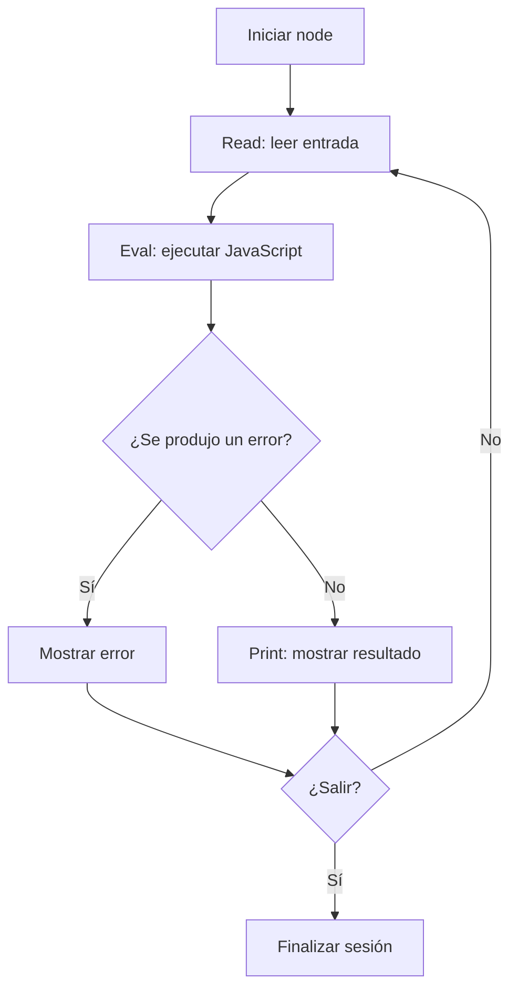
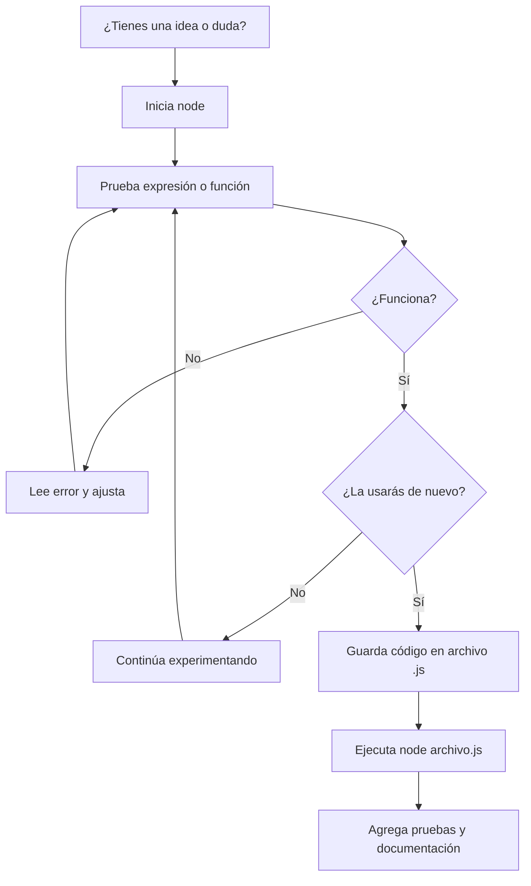

# REPL en Node.js — Guía completa

**Objetivo:** Utilizar el entorno REPL para experimentar con JavaScript, explorar APIs de Node.js, depurar ideas y construir un prototipo interactivo de catálogo de cursos.

> **Convención:** las líneas que empiezan por `>` representan entradas en REPL. No escribas el símbolo `>`: es el indicador que muestra Node. Las salidas se muestran debajo. Cuando un ejemplo diga **terminal**, ejecútalo fuera de REPL.

## 1. Definición: ¿qué es REPL?

**REPL** significa **Read–Eval–Print–Loop** (leer, evaluar, imprimir y repetir). Es un entorno interactivo de Node.js en el que escribes una expresión o instrucción JavaScript, Node la ejecuta y muestra el resultado, sin crear primero un archivo `.js`.

**Ejemplo:** abre una terminal, ejecuta `node` y prueba:

```text
> 5 + 7
12
> 'Curso'.toUpperCase()
'CURSO'
```

**Importante:** REPL es una herramienta para experimentar y explorar; el código de una aplicación permanente suele guardarse en archivos.

## 2. Principales usos

1. **Aprender JavaScript:** comprobar rápidamente operadores, funciones y estructuras de datos.
2. **Probar algoritmos pequeños:** verificar una fórmula antes de integrarla en un proyecto.
3. **Inspeccionar datos:** consultar objetos, arreglos y valores devueltos por funciones.
4. **Explorar Node.js:** experimentar con módulos nativos y utilidades.
5. **Depurar:** reproducir casos mínimos y comparar resultados.
6. **Crear prototipos:** modelar datos y operaciones antes de escribir la aplicación definitiva.

**Cuándo no usarlo:** para aplicaciones grandes, pruebas automatizadas, cambios que deban versionarse o código que necesite ejecutarse de forma repetible sin intervención.

## 3. Cómo iniciar y salir de REPL

En una **terminal**:

```bash
node --version
node
```

La primera orden comprueba la instalación. La segunda inicia REPL; aparecerá un indicador `>`.

Para salir, escribe `.exit` y presiona Enter. También puedes pulsar **Ctrl+D**; **Ctrl+C** dos veces suele terminar la sesión. En Windows usa PowerShell o CMD; en macOS y Linux, Terminal.

Si `node` no se reconoce, instala Node.js y abre una terminal nueva. Comprueba que esté en `PATH`.

**Práctica:** entra, calcula `8 * 6`, sal y vuelve a entrar. Observa que las variables de la sesión anterior no persisten automáticamente.

## 4. El ciclo Read–Eval–Print–Loop

- **Read (leer):** recibe el texto que escribes.
- **Eval (evaluar):** interpreta y ejecuta la instrucción.
- **Print (imprimir):** muestra el valor resultante o un error.
- **Loop (repetir):** espera otra entrada.



Una expresión como `2 + 3` produce `5`. Una declaración puede producir `undefined` aunque haya funcionado: significa que no devuelve un valor útil para imprimir.

## 5. Expresiones, variables y funciones

### 5.1 Expresiones

```js
10 / 2                 // 5
2 ** 3                 // 8
'Node' + '.js'         // 'Node.js'
18 >= 18               // true
```

### 5.2 Variables

Introduce cada línea por separado:

```js
const precio = 50000
let cupos = 12
precio * cupos
cupos -= 2
cupos
```

**Advertencia:** no puedes volver a declarar `const precio` o `let cupos` con el mismo nombre en la misma sesión. Reutiliza la variable con `let`, cambia el nombre o reinicia REPL.

### 5.3 Funciones

```js
function aplicarDescuento(precio, porcentaje) {
  return precio * (1 - porcentaje / 100);
}
aplicarDescuento(80000, 15) // 68000
```

**Reto breve:** crea `calcularIVA(valor, tasa)` y verifica `calcularIVA(100, 19) === 119`.

## 6. Objetos, arreglos y métodos de JavaScript

```js
const curso = { id: 1, titulo: 'Node.js', precio: 80000, activo: true }
curso.titulo
Object.keys(curso)
```

```js
const cursos = [
  { id: 1, titulo: 'Node.js', precio: 80000 },
  { id: 2, titulo: 'Git', precio: 50000 },
  { id: 3, titulo: 'SQL', precio: 70000 }
]
cursos.map(c => c.titulo)
cursos.filter(c => c.precio < 75000)
cursos.find(c => c.id === 2)
cursos.reduce((total, c) => total + c.precio, 0)
```

**Diferencia:** `map` transforma cada elemento; `filter` selecciona varios; `find` obtiene el primero; `reduce` acumula un resultado.

## 7. Comandos especiales de REPL

Estos comandos empiezan por un punto y se escriben **directamente en REPL**, no dentro de un archivo `.js`.

| Comando | Función | Ejemplo |
|---|---|---|
| `.help` | Muestra ayuda de comandos | `.help` |
| `.exit` | Termina REPL | `.exit` |
| `.clear` | Reinicia el contexto de REPL predeterminado; también cancela una entrada multilínea | `.clear` |
| `.break` | Cancela la entrada multilínea actual | `.break` |
| `.save archivo.js` | Guarda el historial de entradas de la sesión en un archivo | `.save prueba.js` |
| `.load archivo.js` | Ejecuta el contenido de un archivo en la sesión | `.load prueba.js` |
| `.editor` | Activa modo de edición multilínea | `.editor` |

**Detalles importantes:** `.clear` no es equivalente a limpiar visualmente la pantalla. `.save` guarda entradas, no una fotografía de todos los valores del contexto; revisa el archivo generado antes de ejecutarlo como programa. `.load` ejecuta código, por lo que solo debes cargar archivos confiables. Los comandos disponibles pueden variar entre versiones; consulta `.help` en tu instalación.

**Prueba de `.editor`:** escribe `.editor`, pega este bloque y pulsa **Ctrl+D** para ejecutarlo (o **Ctrl+C** para cancelar):

```js
const cuadrado = n => n * n;
console.log([2, 3, 4].map(cuadrado));
```

## 8. Historial, autocompletado y expresiones multilínea

- **Flecha arriba/abajo:** recorre entradas anteriores en terminales compatibles.
- **Tab:** completa identificadores y muestra posibilidades cuando están disponibles.
- **Multilínea:** al abrir `{`, `[` o `(` y no cerrar la expresión, REPL espera más líneas; `.break` cancela.
- **`.editor`:** facilita pegar varias instrucciones relacionadas.

```text
> function sumar(a, b) {
... return a + b;
... }
undefined
> sumar(4, 9)
13
```

El historial persistente puede depender de la configuración y del entorno. Evita introducir contraseñas o tokens, porque podrían quedar en historial o archivos guardados.

## 9. Variables y módulos disponibles en REPL

Prueba estas variables y objetos globales:

```js
process.version
process.platform
process.cwd()
Math.PI
JSON.stringify({ curso: 'Node' })
console.log('Hola desde REPL')
```

En el REPL estándar de Node.js suele estar disponible `require`:

```js
const os = require('node:os')
os.platform()
os.cpus().length
const path = require('node:path')
path.join('cursos', 'node', 'repl.md')
```

**Nota:** `require` funciona en el REPL estándar aunque un proyecto use ESM; no asumas que todo el código de un archivo ESM funcionará idénticamente al pegarlo en REPL. Los nombres especiales del REPL, como `_` para el último resultado, pueden comportarse de forma distinta si se les asigna un valor.

## 10. Promesas y `await` interactivo

En versiones modernas de Node.js, el REPL estándar admite **`await` en el nivel superior**:

```js
await Promise.resolve('listo')
await new Promise(resolve => setTimeout(() => resolve(42), 300))
```

Ejemplo con el módulo nativo de archivos:

```js
const fs = require('node:fs/promises')
await fs.writeFile('repl-ejemplo.txt', 'Aprendiendo Node.js', 'utf8')
await fs.readFile('repl-ejemplo.txt', 'utf8')
```

El archivo se crea en el directorio de trabajo actual (`process.cwd()`). Evita sobrescribir archivos importantes. Si deshabilitas experimentalmente funciones del REPL o usas una versión antigua, `await` puede comportarse de otra manera.

**Diferencia:** una promesa representa un resultado futuro; `await` espera ese resultado sin bloquear el hilo de JavaScript como una operación síncrona de archivo.

## 11. Diferencias entre REPL, `node archivo.js` y consola del navegador

| Aspecto | REPL de Node.js | `node archivo.js` | Consola del navegador |
|---|---|---|---|
| Ejecución | Interactiva | Archivo completo | Interactiva en una página |
| Entorno | Node.js | Node.js | Navegador |
| DOM (`document`) | No | No, salvo librerías/entornos especiales | Sí, según la página |
| APIs de Node (`node:fs`) | Sí | Sí | No directamente |
| Persistencia del código | Temporal salvo guardar | Archivo permanente | Temporal salvo herramientas del navegador |
| Uso habitual | Experimentar | Aplicaciones y scripts | Inspeccionar páginas web |

**Error típico:** escribir `document.querySelector(...)` en REPL de Node. `document` no está definido porque Node no proporciona el DOM del navegador por defecto.

## 12. Analogías del mundo real

- **REPL es una calculadora de laboratorio:** pruebas una operación y ves inmediatamente el resultado.
- **Un archivo `.js` es una receta escrita:** puede repetirse, compartirse y versionarse.
- **La consola del navegador es un taller dentro de una página:** puedes inspeccionar su interfaz y sus elementos HTML.
- **Una promesa es un número de turno:** representa un resultado pendiente; `await` espera a que esté listo.

## 13. Diagrama de flujo de trabajo con REPL



## 14. Buenas prácticas y errores comunes

| Buena práctica | Error que evita |
|---|---|
| Usa REPL para pruebas pequeñas y aisladas | Sesiones enormes difíciles de repetir |
| Comprueba `process.cwd()` antes de escribir archivos | Guardar datos en una carpeta equivocada |
| Prefiere `const` para valores que no reasignarás | Cambios accidentales de referencias |
| Guarda el prototipo en `.js` y usa control de versiones | Perder código al salir |
| Lee los mensajes de error completos | Corregir una causa equivocada |
| Valida los datos antes de calcular | `NaN`, resultados inesperados |
| No pegues código desconocido | Ejecutar instrucciones peligrosas |
| No escribas credenciales en REPL | Exponerlas en el historial |

**Errores frecuentes:**

```js
// ReferenceError: la variable no existe
variableQueNoExiste
// TypeError: el valor no tiene el método pedido
(123).toUpperCase()
// NaN: conversión inválida
Number('no-es-numero')
```

Si te aparece `Identifier 'x' has already been declared`, cambia el identificador, usa otra sesión o limpia el contexto con `.clear` cuando corresponda.

## 15. Laboratorio guiado paso a paso

**Meta:** construir y probar una lista de cursos en una sesión REPL. **Tiempo sugerido:** 30–45 minutos.

### Paso 1. Prepara el entorno

En terminal:

```bash
mkdir laboratorio-repl
cd laboratorio-repl
node
```

Comprueba la ruta:

```js
process.cwd()
```

### Paso 2. Crea los datos

```js
let catalogo = [
  { id: 1, nombre: 'Node.js', precio: 100000, cupos: 10 },
  { id: 2, nombre: 'Git', precio: 60000, cupos: 15 }
]
```

### Paso 3. Consulta el catálogo

```js
catalogo.map(({ id, nombre }) => ({ id, nombre }))
catalogo.find(c => c.id === 1)
```

### Paso 4. Agrega un curso

```js
catalogo.push({ id: 3, nombre: 'SQL', precio: 90000, cupos: 8 })
catalogo.length // 3
```

### Paso 5. Actualiza cupos

```js
const seleccionado = catalogo.find(c => c.id === 2)
seleccionado.cupos -= 1
seleccionado.cupos // 14
```

### Paso 6. Calcula el valor del catálogo

```js
catalogo.reduce((total, c) => total + c.precio, 0) // 250000
```

### Paso 7. Guarda datos en JSON

```js
const fsLab = require('node:fs/promises')
await fsLab.writeFile('catalogo.json', JSON.stringify(catalogo, null, 2), 'utf8')
JSON.parse(await fsLab.readFile('catalogo.json', 'utf8'))
```

### Paso 8. Verifica y termina

Comprueba que exista `catalogo.json` en `laboratorio-repl`, revisa su contenido y sal con `.exit`.

**Criterios de éxito:** 3 cursos, Git con 14 cupos, suma de precios de 250000 y JSON legible guardado en disco.

## 16. Proyecto integrador: prototipo interactivo de catálogo de cursos

**Contexto CURSO_DESAR:** necesitas validar un catálogo antes de construir su API. Crearás un prototipo **funcional en REPL** con altas, consultas, búsquedas, inscripciones, estadísticas y persistencia JSON.

**Estructura final:**

```text
proyecto-catalogo-repl/
├── catalogo.js
└── cursos.json          # se crea al guardar
```

### Paso 1. Crea el directorio y archivo

En terminal:

```bash
mkdir proyecto-catalogo-repl
cd proyecto-catalogo-repl
```

Crea `catalogo.js` con este contenido **completo**:

```js
const fs = require('node:fs/promises');
const path = require('node:path');

const archivo = path.join(process.cwd(), 'cursos.json');
let cursos = [
  { id: 1, nombre: 'Fundamentos de Node.js', precio: 80000, cupos: 12 },
  { id: 2, nombre: 'Git y GitHub', precio: 60000, cupos: 8 }
];

function validarTexto(texto) {
  if (typeof texto !== 'string' || !texto.trim()) {
    throw new Error('El nombre debe ser un texto no vacío');
  }
  return texto.trim();
}

function validarEntero(valor, minimo = 0) {
  if (!Number.isInteger(valor) || valor < minimo) {
    throw new Error(`Se requiere un entero mayor o igual a ${minimo}`);
  }
  return valor;
}

function listar() {
  return cursos.map(curso => ({ ...curso }));
}

function agregar(nombre, precio, cupos) {
  nombre = validarTexto(nombre);
  if (typeof precio !== 'number' || !Number.isFinite(precio) || precio < 0) {
    throw new Error('El precio debe ser un número válido no negativo');
  }
  validarEntero(cupos);
  const id = cursos.reduce((max, c) => Math.max(max, c.id), 0) + 1;
  const nuevo = { id, nombre, precio, cupos };
  cursos.push(nuevo);
  return { ...nuevo };
}

function buscar(termino) {
  const consulta = validarTexto(termino).toLowerCase();
  return cursos.filter(c => c.nombre.toLowerCase().includes(consulta))
    .map(c => ({ ...c }));
}

function inscribir(id) {
  validarEntero(id, 1);
  const curso = cursos.find(c => c.id === id);
  if (!curso) throw new Error('Curso no encontrado');
  if (curso.cupos === 0) throw new Error('No quedan cupos');
  curso.cupos -= 1;
  return { ...curso };
}

function estadisticas() {
  return {
    cantidad: cursos.length,
    cuposDisponibles: cursos.reduce((suma, c) => suma + c.cupos, 0),
    precioPromedio: cursos.length
      ? cursos.reduce((suma, c) => suma + c.precio, 0) / cursos.length
      : 0
  };
}

async function guardar() {
  await fs.writeFile(archivo, JSON.stringify(cursos, null, 2), 'utf8');
  return archivo;
}

async function cargar() {
  const contenido = await fs.readFile(archivo, 'utf8');
  const datos = JSON.parse(contenido);
  if (!Array.isArray(datos) || !datos.every(c =>
    c && Number.isInteger(c.id) && c.id > 0 &&
    typeof c.nombre === 'string' && c.nombre.trim() &&
    typeof c.precio === 'number' && Number.isFinite(c.precio) && c.precio >= 0 &&
    Number.isInteger(c.cupos) && c.cupos >= 0
  ) || new Set(datos.map(c => c.id)).size !== datos.length) {
    throw new Error('Formato de catálogo inválido');
  }
  cursos = datos.map(c => ({ ...c }));
  return listar();
}

module.exports = {
  listar, agregar, buscar, inscribir, estadisticas, guardar, cargar
};
```

### Paso 2. Inicia REPL en esa carpeta

En terminal:

```bash
node
```

### Paso 3. Importa el prototipo

```js
const app = require('./catalogo.js')
app.listar()
```

**Resultado esperado:** dos cursos con identificadores 1 y 2.

### Paso 4. Agrega y busca

```js
app.agregar('Bases de datos SQL', 75000, 20)
app.buscar('sql')
```

**Resultado esperado:** un curso SQL con `id: 3`.

### Paso 5. Inscribe un estudiante

```js
app.inscribir(3)
app.buscar('sql')
```

**Resultado esperado:** el curso SQL tiene 19 cupos.

### Paso 6. Consulta estadísticas

```js
app.estadisticas()
```

**Resultado esperado:** `{ cantidad: 3, cuposDisponibles: 39, precioPromedio: 71666.66666666667 }` (la representación decimal puede variar mínimamente).

### Paso 7. Guarda en disco

```js
await app.guardar()
```

Verifica `cursos.json` en el directorio. El archivo contiene el estado actualizado.

### Paso 8. Comprueba la persistencia

Sal de REPL con `.exit`, inicia `node` de nuevo e introduce:

```js
const app2 = require('./catalogo.js')
app2.listar()      // Estado inicial de dos cursos
await app2.cargar()
app2.listar()      // Tres cursos recuperados desde JSON
```

**Por qué:** al reiniciar Node, las variables en memoria se reinician; el archivo JSON conserva lo que guardaste.

### Paso 9. Prueba errores controlados

```js
try { app2.inscribir(999) } catch (e) { console.log(e.message) }
try { app2.agregar('', -1, 2) } catch (e) { console.log(e.message) }
```

**Resultado esperado:** mensajes de error explicativos, sin modificar el catálogo.

### Paso 10. Comprueba los criterios de aceptación

- [ ] Puedo listar cursos sin modificar accidentalmente los objetos internos.
- [ ] Puedo agregar cursos con identificadores nuevos.
- [ ] Puedo buscar ignorando mayúsculas/minúsculas.
- [ ] Inscribir descuenta exactamente un cupo.
- [ ] No se permiten cupos negativos ni cursos inexistentes.
- [ ] Las estadísticas coinciden con los datos.
- [ ] Guardar y cargar preservan el catálogo.
- [ ] El proyecto usa solo Node.js, sin paquetes externos.

**Extensiones opcionales:** eliminar cursos, registrar estudiantes, impedir inscripciones duplicadas y escribir pruebas con `node:test`.

## 17. Ejercicios de tres niveles

**Instrucciones:** intenta resolverlos antes de consultar el solucionario. Trabaja en una sesión REPL nueva para evitar colisiones de nombres.

### Nivel básico

**B1. Operaciones:** calcula `(15 + 5) * 3` y `2 ** 5`. Explica ambos resultados.

**B2. Texto:** crea una variable `lenguaje` con valor `'node.js'`; conviértela a mayúsculas y calcula su longitud.

**B3. Arreglos:** dado `[10, 20, 30, 40]`, calcula la suma y filtra los valores mayores que 20.

### Nivel intermedio

**I1. Cursos:** crea un arreglo de tres cursos con nombre y precio. Devuelve solo los nombres y el precio promedio.

**I2. Funciones:** crea una función `precioFinal(precio, descuento)` que rechace descuentos fuera de 0–100 y devuelva el precio con descuento.

**I3. Asincronía:** usa `await` para resolver una promesa que entregue `'completado'` tras 200 ms.

### Nivel avanzado

**A1. Inventario:** crea una función para reservar un cupo; debe fallar si el curso no existe o no tiene cupos.

**A2. Persistencia:** guarda un arreglo en un archivo JSON y vuelve a leerlo con `node:fs/promises`.

**A3. Diseño:** explica cómo transformar el prototipo REPL en una aplicación modular con archivos separados para catálogo, validaciones, almacenamiento y entrada de usuario. Incluye un esquema de dependencias.

## 18. Solucionario paso a paso

### B1. Operaciones

```js
(15 + 5) * 3 // 60
2 ** 5       // 32
```

Primero se resuelve el paréntesis (20) y luego la multiplicación. `**` eleva a una potencia.

### B2. Texto

```js
const lenguaje = 'node.js'
lenguaje.toUpperCase() // 'NODE.JS'
lenguaje.length        // 7
```

Los métodos de cadena permiten transformar texto; `.length` devuelve la cantidad de caracteres.

### B3. Arreglos

```js
const numeros = [10, 20, 30, 40]
numeros.reduce((s, n) => s + n, 0) // 100
numeros.filter(n => n > 20)       // [30, 40]
```

`reduce` acumula la suma y `filter` devuelve los elementos que cumplen la condición.

### I1. Cursos

```js
const lista = [
  { nombre: 'Node', precio: 80 },
  { nombre: 'Git', precio: 60 },
  { nombre: 'SQL', precio: 70 }
]
lista.map(c => c.nombre) // ['Node', 'Git', 'SQL']
lista.reduce((s, c) => s + c.precio, 0) / lista.length // 70
```

Primero se extraen nombres con `map`; después se suma con `reduce` y se divide entre 3.

### I2. Funciones

```js
function precioFinal(precio, descuento) {
  if (!Number.isFinite(precio) || precio < 0) throw new Error('Precio inválido');
  if (!Number.isFinite(descuento) || descuento < 0 || descuento > 100) {
    throw new Error('Descuento inválido');
  }
  return precio * (1 - descuento / 100);
}
precioFinal(100, 20) // 80
```

La validación impide resultados incoherentes antes de realizar el cálculo.

### I3. Asincronía

```js
await new Promise(resolve => setTimeout(() => resolve('completado'), 200))
```

`setTimeout` programa la resolución y `await` entrega el resultado al finalizar la promesa.

### A1. Inventario

```js
const inventario = [{ id: 1, cupos: 1 }]
function reservar(id) {
  const item = inventario.find(c => c.id === id);
  if (!item) throw new Error('No existe');
  if (item.cupos <= 0) throw new Error('Sin cupos');
  item.cupos--;
  return item.cupos;
}
reservar(1) // 0
try { reservar(1) } catch (e) { e.message } // 'Sin cupos'
```

Primero se comprueba existencia; luego disponibilidad; solo después se descuenta el cupo.

### A2. Persistencia

```js
const fsEj = require('node:fs/promises')
const datosEj = [{ id: 1, nombre: 'Node' }]
await fsEj.writeFile('ejercicio.json', JSON.stringify(datosEj, null, 2), 'utf8')
const recuperadosEj = JSON.parse(await fsEj.readFile('ejercicio.json', 'utf8'))
recuperadosEj
```

`JSON.stringify` convierte objetos a texto; `JSON.parse` reconstruye los datos al leerlos.

### A3. Diseño

```text
app.js (entrada / interfaz)
  └── catalogo.js (operaciones del negocio)
        ├── validaciones.js (reglas de entrada)
        └── almacenamiento.js (leer y guardar JSON)
```

La separación reduce acoplamiento: la lógica del catálogo no necesita saber cómo se imprimen los mensajes ni cómo se obtienen los datos del usuario. Cada archivo exporta sus funciones y puede probarse por separado.

## 19. Evaluación

**Puntuación:** 100 puntos. Intenta responder sin consultar las secciones anteriores.

### Parte A: selección y conceptos (40 puntos; 5 cada uno)

1. ¿Qué significa REPL? **A)** Read–Eval–Print–Loop **B)** Run–Export–Push–Load **C)** Read–Edit–Parse–Link.
2. ¿Qué comando muestra ayuda? **A)** `.load` **B)** `.help` **C)** `.editor`.
3. ¿Qué comando sale de REPL? **A)** `.exit` **B)** `.clear` **C)** `.save`.
4. ¿Qué devuelve `[1, 2, 3].map(n => n * 2)`? **A)** `[2, 4, 6]` **B)** `6` **C)** `[1, 2, 3]`.
5. ¿Cuál es el propósito de `await`? **A)** Declarar una clase **B)** Esperar el resultado de una promesa **C)** Salir de Node.
6. ¿Dónde existe normalmente `document`? **A)** En el navegador **B)** En cualquier proceso Node **C)** En `node:os`.
7. ¿Qué comando ejecuta un archivo desde la terminal? **A)** `node app.js` **B)** `.save app.js` **C)** `npm app.js`.
8. ¿Qué método convierte un objeto en texto JSON? **A)** `JSON.parse` **B)** `JSON.stringify` **C)** `Object.keys`.

### Parte B: práctica (40 puntos; 10 cada una)

9. Escribe una función `doble(n)` y ejecútala con 21.
10. Filtra precios mayores que 50 de `[20, 55, 80, 40]`.
11. Escribe un objeto a un archivo JSON usando una API de promesas.
12. Explica cómo recuperar un prototipo después de cerrar REPL.

### Parte C: proyecto (20 puntos)

13. Ejecuta el proyecto integrador, agrega un curso, inscribe un estudiante, guarda el catálogo y comprueba la recuperación tras reiniciar REPL. Entrega los comandos utilizados y una captura o transcripción de los resultados.

### Clave y criterios de calificación

- **1–8:** A, B, A, A, B, A, A, B (5 puntos cada una).
- **9:** `const doble = n => n * 2; doble(21)` devuelve `42` (10 puntos).
- **10:** `[20,55,80,40].filter(n => n > 50)` devuelve `[55,80]` (10 puntos).
- **11:** usar `require('node:fs/promises')`, `JSON.stringify` y `await fs.writeFile(...)` (10 puntos).
- **12:** guardar el código en `.js` y/o los datos en JSON; reiniciar, importar el archivo y cargar datos (10 puntos).
- **13:** agrega (4), inscribe (4), guarda (4), recupera tras reinicio (4) y documenta evidencia (4).

**Interpretación:** 90–100 excelente; 75–89 competente; 60–74 requiere refuerzo; menos de 60 repasar y repetir el laboratorio.

## 20. Hoja de trucos

| Objetivo | Comando o ejemplo |
|---|---|
| Iniciar REPL | `node` (terminal) |
| Salir | `.exit` |
| Ayuda | `.help` |
| Cancelar multilínea | `.break` |
| Reiniciar contexto | `.clear` |
| Editar bloque | `.editor` |
| Guardar entradas | `.save prueba.js` |
| Cargar archivo | `.load prueba.js` |
| Ver versión | `process.version` |
| Ver carpeta | `process.cwd()` |
| Importar módulo nativo | `require('node:os')` |
| Crear arreglo transformado | `datos.map(x => x * 2)` |
| Filtrar arreglo | `datos.filter(x => x > 10)` |
| Buscar elemento | `datos.find(x => x.id === 1)` |
| Sumar elementos | `datos.reduce((a, b) => a + b, 0)` |
| Esperar promesa | `await Promise.resolve(10)` |
| Convertir a JSON | `JSON.stringify(valor, null, 2)` |
| Leer JSON | `JSON.parse(texto)` |
| Ejecutar archivo | `node archivo.js` (terminal) |

## 21. Resumen técnico

El **REPL de Node.js** ejecuta JavaScript de forma interactiva y permite inspeccionar resultados sin crear archivos para cada prueba. Su ciclo consiste en leer, evaluar, imprimir y repetir. Resulta especialmente útil para explorar expresiones, objetos, funciones, módulos nativos y operaciones asíncronas con promesas. Los comandos especiales permiten consultar ayuda, cancelar entradas, editar bloques y guardar o cargar instrucciones.

El REPL **no sustituye** la organización en archivos, las pruebas automatizadas ni la persistencia. En un flujo profesional se utiliza para validar una idea y luego trasladarla a código reproducible y versionado. El proyecto de catálogo demuestra esta transición: la lógica se guarda en `catalogo.js`, se explora desde REPL y los datos se conservan en `cursos.json`.

### Checklist final

- [ ] Puedo explicar qué significa REPL y describir sus cuatro etapas.
- [ ] Sé iniciar y terminar una sesión.
- [ ] Distingo comandos de REPL de instrucciones JavaScript.
- [ ] Manejo expresiones, variables, funciones, objetos y arreglos.
- [ ] Uso `.help`, `.exit`, `.clear`, `.break`, `.save`, `.load` y `.editor`.
- [ ] Comprendo el historial, el autocompletado y el modo multilínea.
- [ ] Puedo explorar `process` y módulos nativos.
- [ ] Entiendo promesas y `await` interactivo.
- [ ] Diferencio REPL, archivos Node y consola del navegador.
- [ ] Terminé el laboratorio guiado y validé sus resultados.
- [ ] Ejecuté el catálogo, guardé datos y los recuperé.
- [ ] Resolví los nueve ejercicios y revisé la evaluación.

**Siguiente tema sugerido:** ejecución de scripts, argumentos de línea de comandos y depuración de aplicaciones Node.js.
