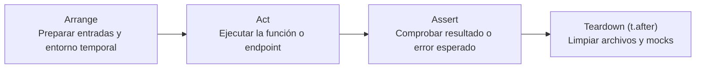

# GUÍA DE ESTUDIO — Módulo 14: Testing Nativo (`node:test` y `node:assert`)

**Curso:** CURSO_DESARROLLO_WEB  
**Nivel:** Intermedio  
**Requisitos:** Node.js 20+ LTS, conocimientos de ESM y `async/await`  
**Objetivo:** Dominar el corredor nativo de pruebas de Node.js (**`node:test`**) y las aserciones estrictas (**`node:assert/strict`**) para probar funciones síncronas, asíncronas, errores, archivos temporales aislados y *mocks* sin instalar dependencias externas.

---

## 1. ¿Por qué `node:test` y `node:assert/strict`?

Desde Node.js 18/20 ya no necesitas instalar Jest, Mocha o Vitest para escribir pruebas profesionales en backend. El corredor nativo **`node:test`**:
- Ejecuta archivos `*.test.js` / `*.test.mjs` en paralelo automáticamente.
- Soporta *ES Modules*, `async/await` y `--watch` de fábrica.
- Se combina con **`node:assert/strict`**, que exige igualdad estricta (`===`) para evitar conversiones engañosas de tipos (`1 == '1'`).

```bash
node --test
node --test --watch
```

---

## 2. Aserciones esenciales con `node:assert/strict`

| Método | Qué comprueba | Ejemplo |
|---|---|---|
| `assert.equal(a, b)` | Igualdad estricta (`Object.is` / `===`) para primitivos | `assert.equal(sumar(2, 3), 5)` |
| `assert.deepEqual(a, b)` | Igualdad profunda de objetos y arreglos | `assert.deepEqual(res, { ok: true })` |
| `assert.ok(valor)` | Que el valor sea *truthy* | `assert.ok(usuario.id)` |
| `assert.throws(fn, err)` | Que una función **síncrona** lance un error | `assert.throws(() => dividir(1, 0), /cero/)` |
| `assert.rejects(fn, err)` | Que una **promesa / async** sea rechazada | `await assert.rejects(() => crear(''), { code: 'validation' })` |

---

## 3. Suites (`describe`/`it`) y Hooks (`beforeEach`, `afterEach`, `t.after`)

Puedes organizar pruebas relacionadas con `describe()` e `it()`, y limpiar estado entre pruebas con *hooks*:

```js
import { describe, it, beforeEach } from 'node:test';
import assert from 'node:assert/strict';

describe('Carrito de compras', () => {
  let items;
  beforeEach(() => { items = []; });

  it('agrega un producto correctamente', () => {
    items.push('Curso Node');
    assert.equal(items.length, 1);
  });
});
```

---

## 4. Pruebas aisladas con carpetas temporales (`mkdtemp` + `t.after`)

Nunca pruebes escritura de archivos sobre tu carpeta real de datos. Usa `os.tmpdir()` + `fs/promises.mkdtemp()` y borra la carpeta temporal con `t.after()`:

```js
import test from 'node:test';
import assert from 'node:assert/strict';
import { mkdtemp, rm, writeFile, readFile } from 'node:fs/promises';
import os from 'node:os';
import path from 'node:path';

test('guarda y lee JSON en carpeta temporal aislada', async (t) => {
  const dir = await mkdtemp(path.join(os.tmpdir(), 'test-node-'));
  t.after(() => rm(dir, { recursive: true, force: true }));

  const archivo = path.join(dir, 'datos.json');
  await writeFile(archivo, JSON.stringify({ ok: true }), 'utf8');
  const leido = JSON.parse(await readFile(archivo, 'utf8'));
  assert.deepEqual(leido, { ok: true });
});
```

---

## 5. *Mocks* y espías nativos con `t.mock`

Cuando una función depende de la hora del sistema, de un envío de correo o de una API externa, usa `t.mock.fn()` o `t.mock.timers` para simularla y verificar cuántas veces fue llamada:

```js
import test from 'node:test';
import assert from 'node:assert/strict';

test('notifica una sola vez al crear usuario', () => {
  const enviarCorreo = test.mock ? undefined : null; // en test usa t.mock
});

test('espía llamadas con t.mock.fn()', (t) => {
  const notificar = t.mock.fn((email) => `Enviado a ${email}`);
  notificar('ana@curso.dev');

  assert.equal(notificar.mock.callCount(), 1);
  assert.deepEqual(notificar.mock.calls[0].arguments, ['ana@curso.dev']);
});
```

---

## 6. Buenas prácticas de testing (Patrón AAA)

1. **AAA (*Arrange – Act – Assert*):** prepara datos, ejecuta la función y verifica el resultado.
2. **Pruebas independientes:** ninguna prueba debe depender de que otra haya corrido antes.
3. **Prueba casos límite:** cadenas vacías, `null`, IDs inexistentes y errores esperados (`assert.rejects`).
4. **Cobertura integrada:** ejecuta `node --test --experimental-test-coverage` para ver qué líneas aún no están probadas.

---

## 7. Diagrama del ciclo AAA



---

## 8. Ejercicios y solucionario

1. Escribe una prueba para `sumar(a, b)` usando `assert.equal()`.
2. Escribe una prueba con `assert.rejects()` para verificar que `buscarPorId('')` rechaza con `TypeError`.
3. Crea un mock con `t.mock.fn()` y comprueba que se llamó exactamente 2 veces.

```js
import test from 'node:test';
import assert from 'node:assert/strict';

const sumar = (a, b) => a + b;
async function buscarPorId(id) {
  if (!id) throw new TypeError('ID obligatorio');
  return { id };
}

test('1. sumar devuelve la suma exacta', () => {
  assert.equal(sumar(4, 6), 10);
});

test('2. buscarPorId rechaza ID vacío', async () => {
  await assert.rejects(() => buscarPorId(''), TypeError);
});

test('3. mock cuenta 2 llamadas', (t) => {
  const log = t.mock.fn();
  log('a'); log('b');
  assert.equal(log.mock.callCount(), 2);
});
```

---

## ✅ Checklist de dominio del módulo

- [ ] Ejecutar pruebas con `node --test` y `node --test --watch`.
- [ ] Elegir entre `assert.equal`, `assert.deepEqual`, `assert.throws` y `assert.rejects`.
- [ ] Organizar pruebas con `describe`/`it` y limpiar recursos con `beforeEach` / `t.after()`.
- [ ] Aislar pruebas de archivos con `mkdtemp()` y `os.tmpdir()`.
- [ ] Simular y verificar llamadas con `t.mock.fn()`.


---

## Mocks y Cobertura de Código Nativa

El corredor nativo `node:test` incluye mocks y reporte de cobertura sin instalar Jest ni Vitest:

```js
import test from 'node:test';
import assert from 'node:assert/strict';

test('llama al callback con el usuario', (t) => {
  const notificar = t.mock.fn();
  notificar('ana@dev.com');
  assert.equal(notificar.mock.callCount(), 1);
  assert.deepEqual(notificar.mock.calls[0].arguments, ['ana@dev.com']);
});
```

```bash
# Ejecutar tests con cobertura nativa en terminal
node --test --experimental-test-coverage
```

---

## ❌ Errores Comunes en Testing

1. **Testear detalles internos de implementación:** Acopla los tests al código privado y rompe al refactorizar; testea entradas, salidas y comportamiento observable.
2. **Compartir estado mutable entre tests:** Hace que un test pase solo y falle en grupo; usa `beforeEach()` para reiniciar estado.
3. **Olvidar `await` en tests asíncronos:** El test termina en verde antes de que la promesa se rechace.
4. **No limpiar mocks o timers:** Usa `t.mock.restoreAll()` o hooks `afterEach`.

---

## Hoja de Trucos (Cheatsheet) — `node:test` & `node:assert`

| API / Comando | Uso |
| :--- | :--- |
| `node --test` | Ejecuta todos los archivos `*.test.js` automáticamente |
| `describe` / `it` / `test` | Agrupa y define casos de prueba |
| `beforeEach` / `afterEach` | Prepara y limpia estado por cada test |
| `assert.strictEqual(a, b)` | Igualdad estricta (`===`) |
| `assert.deepStrictEqual(a, b)` | Compara objetos y arrays en profundidad |
| `assert.rejects(fn, /err/)` | Verifica que una función asíncrona rechace |
| `t.mock.fn(impl)` | Crea un espía/mock nativo con historial de llamadas |
