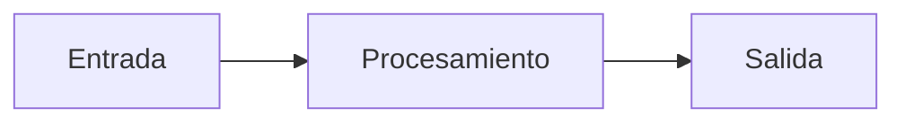

# GUÍA DE ESTUDIO — Módulo XX: Título del Módulo

**Curso:** CURSO_DESARROLLO_WEB  
**Nivel:** Fundamentos / Intermedio  
**Objetivo:** Describir de forma concreta qué dominará el estudiante al finalizar esta guía (sin repetir contenido de módulos previos).

---

## 1. Preparación y concepto base

Explica qué es, para qué sirve y cómo se configura.

```js
// Ejemplo inicial ejecutable y directo
console.log('Listo para comenzar');
```

## 2. Sintaxis y casos principales

| Elemento | Propósito | Ejemplo |
|---|---|---|
| `ejemplo()` | Descripción corta | `ejemplo('dato')` |

## 3. Buenas prácticas y errores comunes

| Buena práctica | Error que evita |
|---|---|
| Validar entradas antes de procesar | Fallos silenciosos o difíciles de depurar |

## 4. Analogía y diagrama

Describe una analogía clara del mundo real.



## 5. Proyecto integrador con pruebas (`node --test`)

```js
import test from 'node:test';
import assert from 'node:assert/strict';

test('caso base', () => {
  assert.equal(1 + 1, 2);
});
```

## 6. Ejercicios por niveles y solucionario

- **Básico:** ...
- **Intermedio:** ...
- **Avanzado:** ...

## 7. Resumen técnico y checklist de dominio

- [ ] Comprendo el concepto principal.
- [ ] Puedo aplicarlo sin depender de ejemplos copiados.
